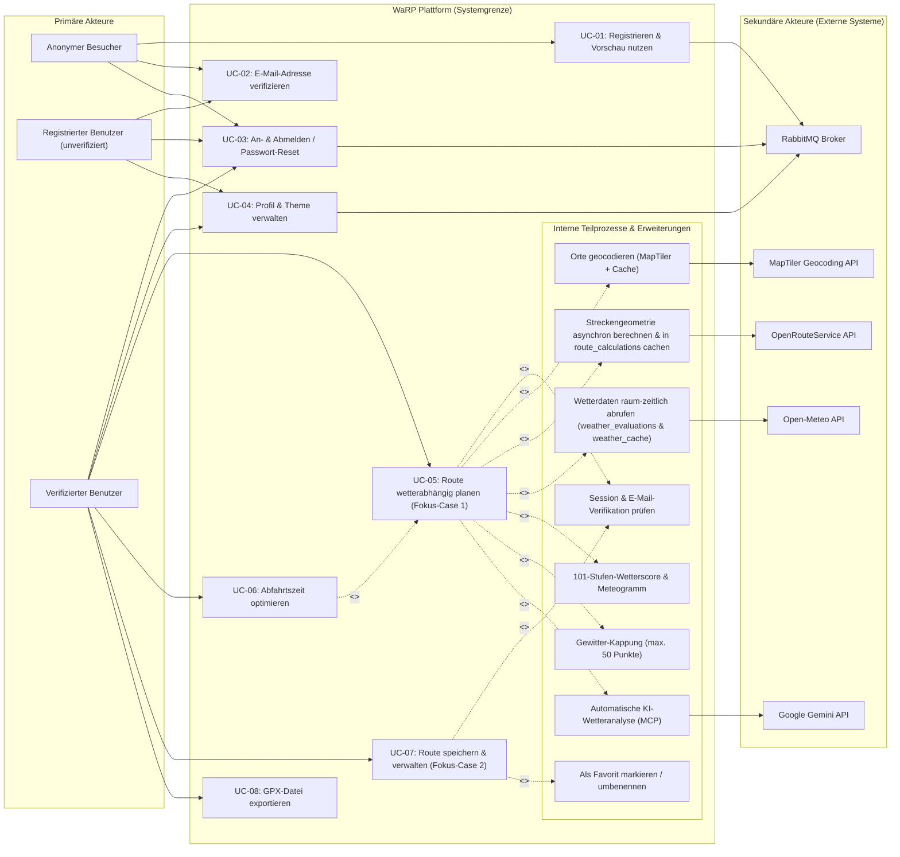
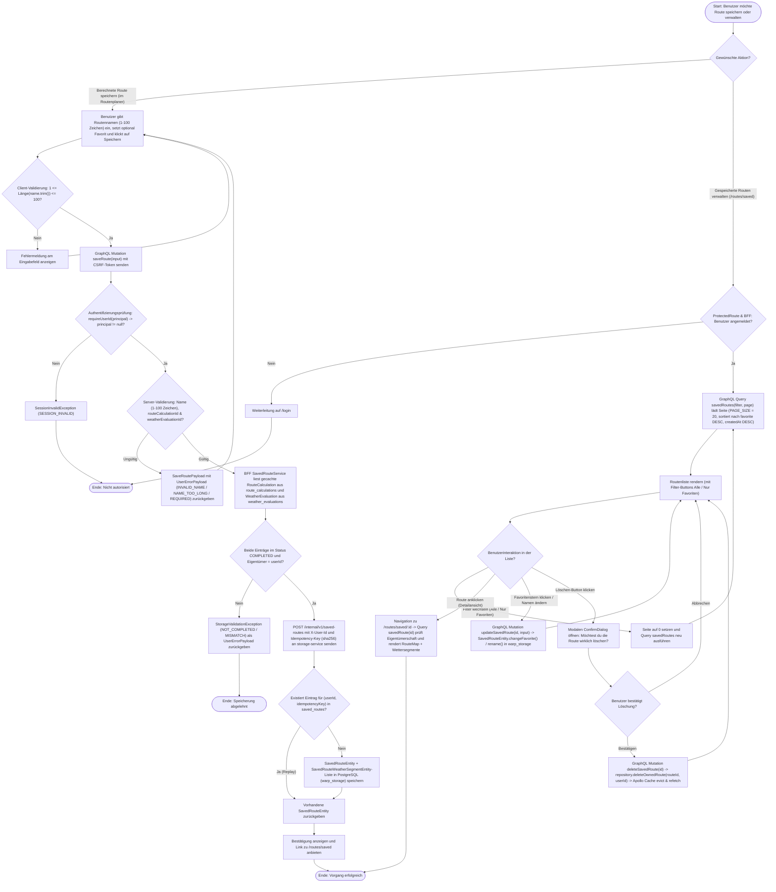
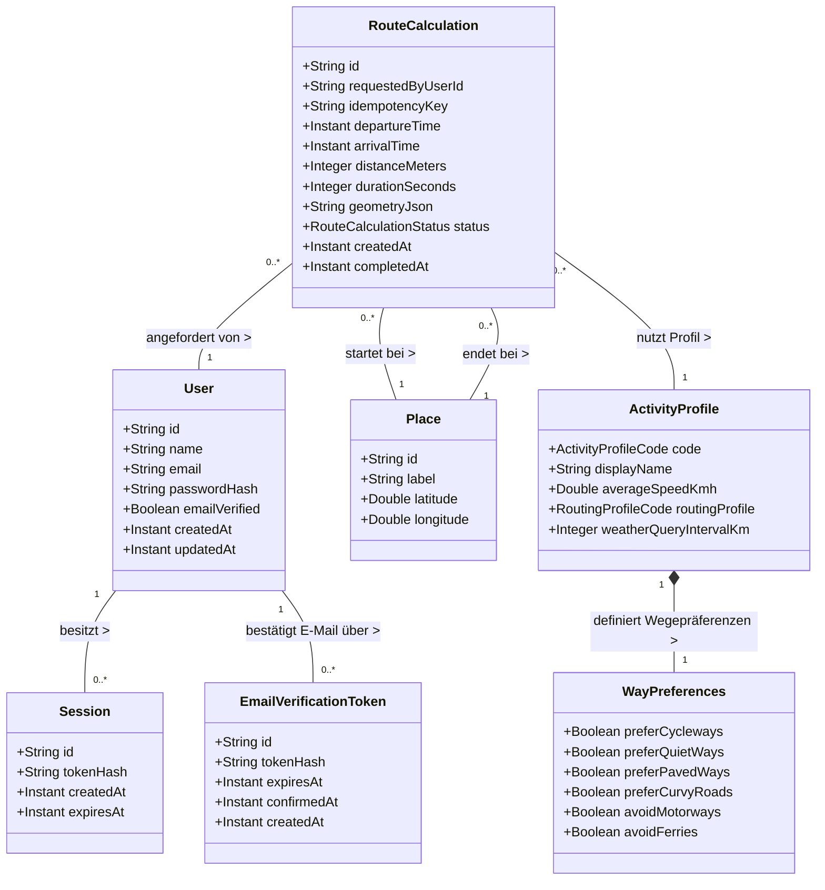
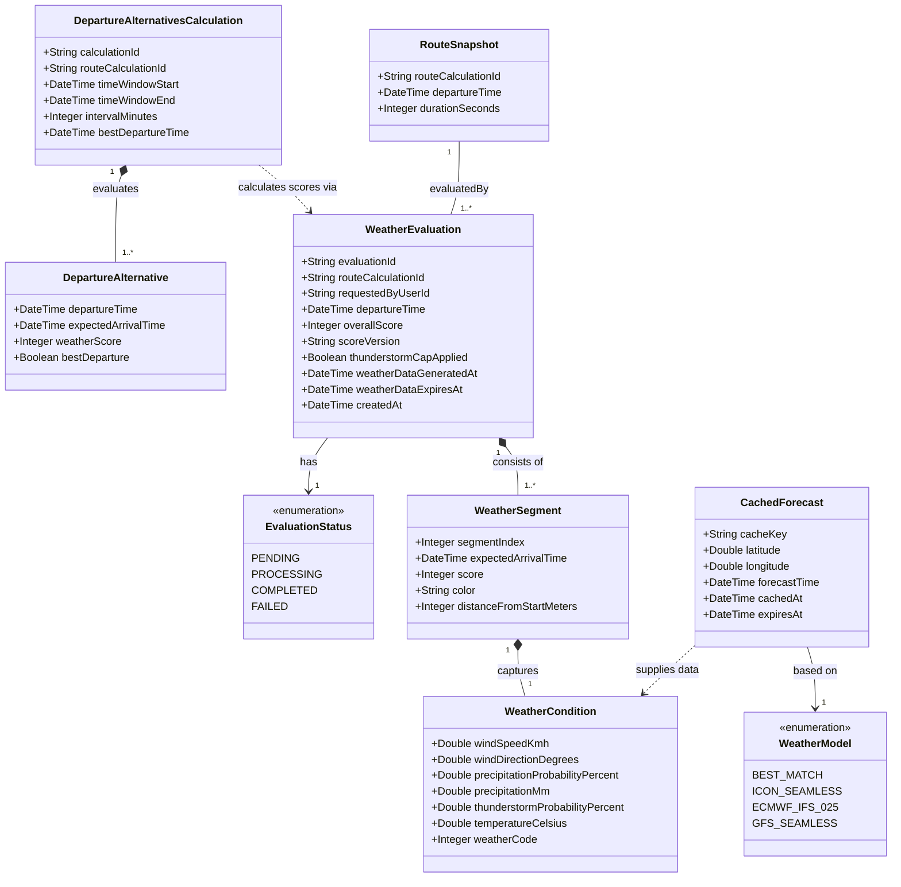
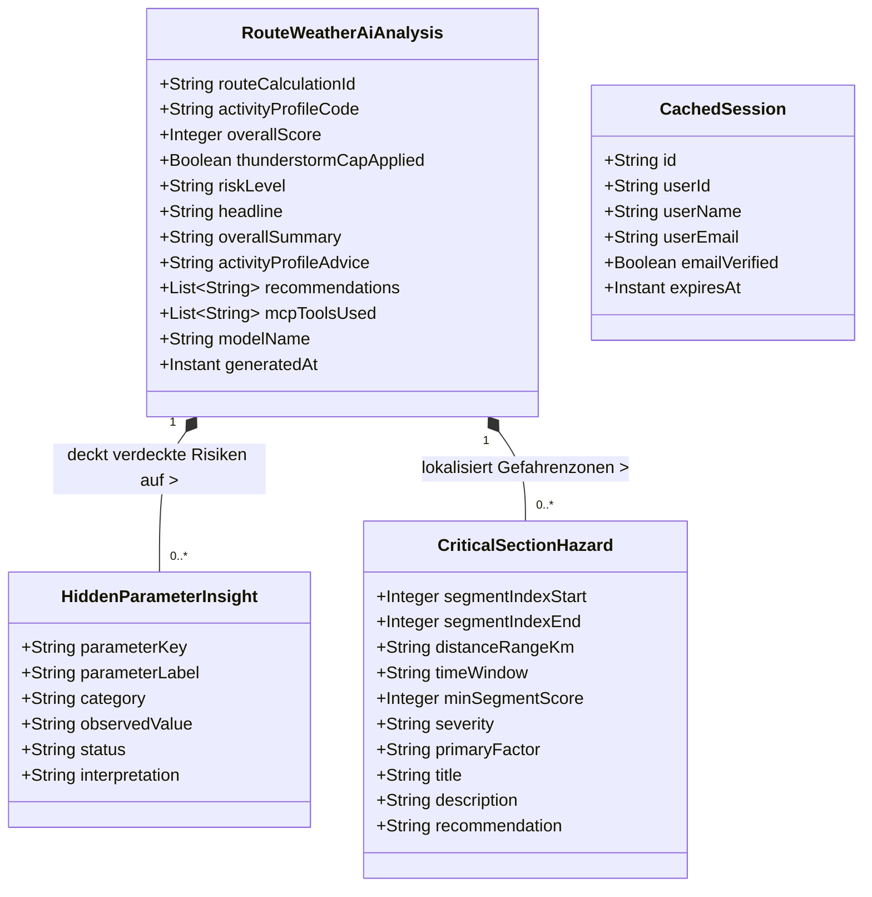
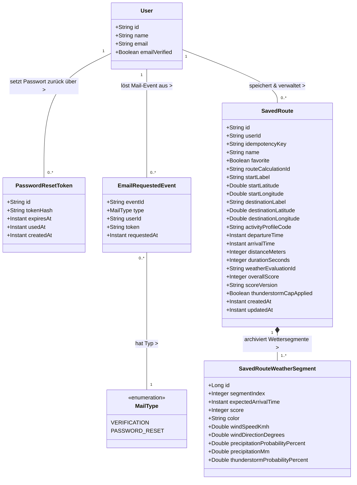

<!-- [KI-Log Nr. KI-25] KI-generiert (Google Antigravity (Gemini 3.8 Flash High)): Projekt-Dokumentation & QS -->
# Product Backlog und Anforderungen

**Projekt:** WaRP – Weather-aware Route Planning  
**Modul:** Fallstudie Software Engineering (Prof. Dr. Christian Schalles)  
**Hochschule:** DHBW Mosbach  
**Team:** Jonas Bieler (PO), Enrico Großmann (PO / Tech Lead), Kai Spitzer (SM), Finley Brosig (SM)  
**Dokumentenversion:** 1.3 (Abgeglichen mit der realen Implementierung und Testsuite des Repositories)

---

## Inhaltsverzeichnis
1. [Beschreibung aller Akteure (= User)](#1-beschreibung-aller-akteure--user)
2. [Product Backlog mit User Stories, Akzeptanzkriterien & MoSCoW-Priorisierung](#2-product-backlog-mit-user-stories-akzeptanzkriterien--moscow-priorisierung)
   * 2.1 Tabellarische Gesamtübersicht des Product Backlogs
   * 2.2 Detaillierte Ausarbeitung der User Stories mit Akzeptanzkriterien
3. [Nicht-funktionale Anforderungen nach dem FURPS+-Modell](#3-nicht-funktionale-anforderungen-nach-dem-furps-modell)
4. [Grafische Abbildung der User Stories im Systemkontext (UML-Use-Case-Diagramm)](#4-grafische-abbildung-der-user-stories-im-systemkontext-uml-use-case-diagramm)
5. [Textuelle Kurzbeschreibungen aller User Stories / Use Cases](#5-textuelle-kurzbeschreibungen-aller-user-stories--use-cases)
6. [Detaillierte Aktivitätsdiagramme der beiden Fokus-Cases](#6-detaillierte-aktivitätsdiagramme-der-beiden-fokus-cases)
   * 6.1 Fokus-Case 1: Route wetterabhängig planen
   * 6.2 Fokus-Case 2: Route speichern und verwalten
7. [Iterativ wachsendes UML-Domänenmodell](#7-iterativ-wachsendes-uml-domänenmodell)
   * 7.1 Sprint 1: Authentifizierung, Aktivitätsprofile und asynchrone Routenberechnung
   * 7.2 Sprint 2: Raum-zeitliche Wettersegmentierung und 101-Stufen-Scoring
   * 7.3 Sprint 3: Abfahrtszeit-Optimierung, In-Memory Caching und automatische KI-Wetteranalyse (MCP)
   * 7.4 Sprint 4: Persistenz gespeicherter Routen, GPX-Export, Profilverwaltung und RabbitMQ Mail-Queue
8. [Glossar](#8-glossar)

---

## 1. Beschreibung aller Akteure (= User)

Gemäß der in der Lehrveranstaltung vorgegebenen Systematik (*Schalles, Folie 19*) werden die Akteure des Systems in primäre Akteure (menschliche Endnutzer) und sekundäre Akteure (externe Fremdsysteme und Schnittstellenpartner) unterteilt.

| Akteur | Typ | Beschreibung |
| :--- | :--- | :--- |
| **Anonymer Besucher (Gast)** | Primär (Mensch) | Nicht angemeldeter Besucher der Webanwendung. Kann öffentlich zugängliche Seiten (`/`, `/login`, `/register`, `/forgot-password`, `/verify-email`) aufrufen, das interaktive Karten-UI im Routenplaner betrachten, Aktivitätsprofile ansehen und Orte über die Geocoding-Suche (`searchPlaces`) suchen. Das Starten einer Routenberechnung (`startRouteCalculation`) sowie das Speichern und Verwalten von Routen werden serverseitig mit `SESSION_INVALID` abgewiesen. |
| **Registrierter Benutzer (unverifiziert)** | Primär (Mensch) | Hat ein Benutzerkonto mit Name, E-Mail-Adresse und Passwort angelegt (`emailVerified = false`), seine E-Mail-Adresse jedoch noch nicht über den Bestätigungslink verifiziert. Kann sich anmelden und seine Profilseite (`/profile`) aufrufen, wird jedoch beim Starten einer Routenberechnung durch den GraphQL-Controller (`RouteCalculationGraphQlController`) mit dem Fehlercode `EMAIL_NOT_VERIFIED` blockiert. |
| **Verifizierter Benutzer** | Primär (Mensch) | Vollwertiger, authentifizierter und per E-Mail bestätigter Nutzer (`emailVerified = true`). Erfasst Start- und Zielorte, wählt Aktivitätsprofile (`BICYCLE`, `MOTORCYCLE`, `HIKING`), startet asynchrone Routenberechnungen, analysiert den Wetterscore entlang der Strecke sowie im Meteogramm-Dock, nutzt die automatische Abfahrtszeit-Optimierung und die automatische KI-Wetteranalyse (`AiWeatherAdvisorPanel`), exportiert Touren als GPX-Datei, verwaltet sein Profil und speichert Routen inkl. Favoritenmarkierung. |
| **OpenRouteService (ORS)** | Sekundär (System) | Externer Geodatendienst (`https://api.heigit.org`). Wird vom `routing-service` (`OpenRouteServiceClient`) asynchron angesprochen, empfängt Start-/Zielkoordinaten sowie das gemappte Routingprofil (`cycling-regular`, `driving-car`, `foot-walking`) samt `WayPreferences` und liefert Streckengeometrie (GeoJSON `LineString`), Gesamtdistanz (`distanceMeters`) und Fahrtdauer (`durationSeconds`). |
| **Open-Meteo API** | Sekundär (System) | Externer Wetterprognosedienst (`https://api.open-meteo.com`). Wird vom `weather-service` (`OpenMeteoClient`) bei Cache-Miss abgefragt und liefert zeitlich aufgelöste meteorologische Prognosedaten (Windgeschwindigkeit, Windrichtung, Böen, Niederschlagswahrscheinlichkeit, Niederschlagsmenge, CAPE/Gewitterwahrscheinlichkeit, Temperatur, Straßenzustand, WMO-Wettercode) für die berechneten Segment-Wegpunkte. |
| **MapTiler Geocoding API** | Sekundär (System) | Externer Geokodierungsdienst (`https://api.maptiler.com`). Wird vom `routing-service` (`MapTilerGeocodingClient`, gekapselt durch `CachedGeocodingService`) aufgerufen und löst Freitext-Ortsnamen in geografische Koordinaten (`Place` mit `id`, `label`, `latitude`, `longitude`) auf. |
| **Google Gemini API** | Sekundär (System) | Externer Cloud-KI-Dienst (`gemini-3.5-flash`, Fallback `gemini-3.6-flash`). Wird vom `weather-service` (`GeminiClient`) nach Ausführung der drei deterministischen internen MCP-Tools aufgerufen, um eine strukturierte, deutschsprachige Routen-Wetteranalyse (`RouteWeatherAiAnalysisResponse`) ohne personenbezogene Daten zu erzeugen. |
| **RabbitMQ Broker** | Sekundär (System) | Asynchroner AMQP-Message-Broker. Nimmt im `identity-service` nach erfolgreichem DB-Commit (`AFTER_COMMIT`) Events vom Typ `EmailRequestedEvent` über den Exchange `warp.mail.exchange` (`QueueMailEventRelay`) entgegen und stellt Verifikations- und Passwort-Reset-Mails fehlertolerant mit Retry- und Dead-Letter-Queue-Mechanismus (`warp.mail.dlq`) über SMTP/Mailpit zu. |

---

## 2. Product Backlog mit User Stories, Akzeptanzkriterien & MoSCoW-Priorisierung

Das Product Backlog umfasst alle fachlichen und architektonischen Anforderungen des Gesamtsystems. Neben den ursprünglichen Basisanforderungen sind auch alle im Projektverlauf hinzugekommenen Erweiterungen (E-Mail-Verifikationsprüfung bei Routenberechnung, Frontend-Redesign mit Meteogramm-Dock, GPX-Export, Profilverwaltung mit Dark/Light-Theme, serverseitig gerenderte MPA, Caffeine In-Memory-Caching, RabbitMQ Mail-Queue sowie die automatische KI-Wetteranalyse aus Ereigniskarte 12) als User Stories enthalten.

Die Priorisierung erfolgt nach der **MoSCoW-Methode**:
* **Must Have (M):** Zwingend erforderlich für das lauffähige Kernprodukt (MVP) und die Sicherheit der Schnittstellen.
* **Should Have (S):** Wichtige Anforderungen zur vollständigen Zielerreichung, Resilienz, Performance und Differenzierung (inkl. Change Request).
* **Could Have (C):** Komfortfunktionen für erweiterte Personalisierung, Export und Datenhygiene.
* **Won’t Have (W):** Ausdrücklich für Folgeversionen abgegrenzt (z. B. Live-Turn-by-Turn-Sprachnavigation während der Fahrt).

### 2.1 Tabellarische Gesamtübersicht des Product Backlogs

| ID | User Story (Titel) | MoSCoW | Begründung der Priorisierung | Aufwand (SP) |
| :--- | :--- | :---: | :--- | :---: |
| **US-AUTH-01** | Öffentlicher Anwendungszugriff | **Must** | Basis für jede Webnutzung; öffentliche Seiten und Orts-Vorschau ohne Login erreichbar | 2 |
| **US-AUTH-02** | Benutzerregistrierung | **Must** | Voraussetzung für personalisierte und geschützte Funktionen | 5 |
| **US-AUTH-03** | E-Mail-Verifikation & Routenschutz | **Must** | Schutz vor Spam-Konten und unautorisiertem Verbrauch externer Routing-/Wetter-Quotas | 5 |
| **US-AUTH-04** | Anmeldung, Abmeldung & Sitzungsverwaltung | **Must** | Sichere Authentifizierung via `HttpOnly`-Session-Cookie und Rate-Limiting | 5 |
| **US-AUTH-05** | Passwort zurücksetzen | **Could** | Self-Service-Wiederherstellung des Kontozugriffs bei Passwortverlust | 5 |
| **US-AUTH-06** | Profilverwaltung & Theme-Auswahl | **Could** | Selbstverwaltung von E-Mail, Passwort und Farbschema (`light`/`dark`/`system`) | 5 |
| **US-ROUT-01** | Start- und Zieleingabe mit Geocoding | **Must** | Fundamentale Eingabe für jede Routenberechnung inkl. Autocomplete-Vorschlägen | 5 |
| **US-ROUT-02** | Aktivitätsprofile auswählen | **Must** | Fahrrad, Motorrad und Wandern benötigen unterschiedliche Geschwindigkeiten, Wege & Intervalle | 3 |
| **US-ROUT-03** | Asynchrone Routenberechnung & Kartendarstellung | **Must** | Kernausgabe der Anwendung; asynchrone Berechnung via ORS und Darstellung auf MapLibre/Leaflet | 8 |
| **US-ROUT-04** | GPX-Export für berechnete Routen | **Could** | Nahtlose Weiternutzung geplanter Routen auf externen GPS-Radcomputern und Navigationsgeräten | 3 |
| **US-WETT-01** | Raum-zeitlicher Wetterdatenabruf | **Must** | Herzstück von WaRP: Wetterprognose exakt für die erwartete Durchfahrtszeit je Streckenabschnitt | 8 |
| **US-WETT-02** | 101-stufiger Wetterscore & Gewitterkappung | **Must** | Kerninnovation: Perzeptuelle Bewertung (0–100) inkl. harter Sicherheitskappung bei Gewitter | 8 |
| **US-WETT-03** | Farbvisualisierung & interaktives Meteogramm-Dock | **Must** | Intuitive visuelle Erfassung wetterbedingt kritischer Streckenabschnitte auf Karte und Zeitachse | 5 |
| **US-WETT-04** | Automatische KI-Wetteranalyse via MCP (**CR-01**) | **Should** | Umsetzung Ereigniskarte 12: Automatisches KI-Briefing mit Gefahrenstellen & Ausrüstungstipps | 8 |
| **US-WETT-05** | Persistentes Wetterdaten-Caching (60 Min TTL) | **Should** | Schutz vor Open-Meteo Rate-Limits und Beschleunigung wiederholter Abfragen | 5 |
| **US-OPT-01** | Alternative Abfahrtszeiten im Zeitfenster berechnen | **Should** | Macht den Wetterscore über einen interaktiven Zeitschieberegler für die Tourenplanung nutzbar | 8 |
| **US-OPT-02** | Beste Abfahrtszeit ermitteln & kennzeichnen | **Should** | Klare Entscheidungshilfe inkl. deterministischer Gleichstandsregel (`[FR-WETT-12]`) | 3 |
| **US-SAV-01** | Berechnete Route mit Wetter-Snapshot speichern | **Should** | Dauerhafte Sicherung berechneter Routen inkl. Geometrie- und Wetter-Snapshot | 5 |
| **US-SAV-02** | Gespeicherte Routen auflisten & Detailansicht öffnen | **Should** | Wiederverwendung gespeicherter Touren mit Paginierung und Kartenansicht | 5 |
| **US-SAV-03** | Gespeicherte Route umbenennen & als Favorit markieren | **Could** | Schnellerer Zugriff und Filterung (`Nur Favoriten`) bei umfangreichen Routensammlungen | 3 |
| **US-SAV-04** | Gespeicherte Route mit Bestätigungsdialog löschen | **Could** | Datenhygiene und Schutz vor versehentlichem Löschen | 2 |
| **US-ARCH-01** | Serverseitig gerenderte Multi-Page Application (MPA) | **Should** | Zweiter unabhängiger Web-Touchpoint (Express + EJS) für Systemstatus, Konto & Routenarchiv | 8 |
| **US-ARCH-02** | In-Memory Caching für Sessions & Geocoding (Caffeine) | **Should** | Minimierung interner Service-Latenzen und Einsparung redundanter MapTiler-Aufrufe | 5 |
| **US-ARCH-03** | Asynchrone E-Mail-Zustellung über RabbitMQ & DLQ | **Should** | Entkopplung von SMTP-Latenzen aus DB-Transaktionen und Ausfallsicherheit durch Fallback | 5 |

---

### 2.2 Detaillierte Ausarbeitung der User Stories mit Akzeptanzkriterien

#### US-AUTH-01: Öffentlicher Anwendungszugriff
* **Story:** Als anonymer Besucher möchte ich ohne ein registriertes Konto durch die öffentlich zugänglichen Seiten der Anwendung navigieren und den Routenplaner im Vorschaumodus betrachten können.
* **Akzeptanzkriterien:**
  1. Startseite (`/`), Routenplaner (`/routes/new`), Login (`/login`), Registrierung (`/register`), Passwort-Reset (`/forgot-password`, `/reset-password`) und E-Mail-Verifikation (`/verify-email`) sind ohne aktive Sitzung aufrufbar.
  2. Geschützte Routen wie `/routes/saved` und `/profile` leiten nicht angemeldete Besucher über die Komponente `ProtectedRoute` automatisch auf `/login` (inkl. Rücksprungziel) weiter.
  3. Im Routenplaner erscheint für nicht angemeldete Nutzer ein transparenter Hinweis, dass zum Berechnen und Speichern einer Route eine Anmeldung erforderlich ist.

#### US-AUTH-02: Benutzerregistrierung
* **Story:** Als Besucher möchte ich mich mit Name, E-Mail-Adresse und Passwort registrieren können, damit ich ein persönliches Benutzerkonto für die geschützten Funktionen von WaRP erhalte.
* **Akzeptanzkriterien:**
  1. Das Registrierungsformular (`RegistrationPage`) validiert Name (Pflichtfeld, max. 100 Zeichen), E-Mail-Adresse (valides Format, Normalisierung auf Kleinbuchstaben) und Passwort.
  2. Das Passwort muss mindestens **12 Zeichen** lang sein (`PasswordRequirements.MIN_LENGTH = 12`).
  3. Bei bereits registrierter E-Mail-Adresse antwortet der `identity-service` mit `EmailAlreadyExistsException` (HTTP 409 Conflict).
  4. Das Passwort wird vor der Persistierung in `warp_identity.users` mit `BCryptPasswordEncoder` gehasht (`PasswordConfig`).
  5. Direkt nach erfolgreichem Datenbank-Commit wird ein Verifikationstoken (`EmailVerificationTokenEntity`, 24 Stunden gültig) erzeugt und der Versand der Bestätigungs-E-Mail angestoßen.

#### US-AUTH-03: E-Mail-Verifikation & Routenschutz
* **Story:** Als registrierter Benutzer möchte ich meine E-Mail-Adresse über einen Bestätigungslink verifizieren und bei Bedarf eine neue Bestätigungs-E-Mail anfordern können, damit mein Konto für Routenberechnungen freigeschaltet wird.
* **Akzeptanzkriterien:**
  1. Klick auf den Link `/verify-email?token=<token>` prüft das Token (SHA-256-Hash-Abgleich in `email_verification_tokens`), setzt `emailVerified = true` am `UserEntity` und markiert das Token als verbraucht (`confirmedAt`).
  2. Abgelaufene (> 24 h) oder ungültige Tokens werden mit `InvalidEmailVerificationTokenException` abgewiesen; der Nutzer kann über `/api/v1/auth/email-verification/resend` eine neue E-Mail anfordern.
  3. Versucht ein angemeldeter, aber noch **nicht verifizierter** Benutzer (`!principal.emailVerified()`) eine Routenberechnung (`startRouteCalculation`) zu starten, lehnt der `RouteCalculationGraphQlController` dies mit `EmailNotVerifiedException` (`EMAIL_NOT_VERIFIED`: *„Die E-Mail-Adresse ist noch nicht verifiziert.“*) ab.

#### US-AUTH-04: Anmeldung, Abmeldung & Sitzungsverwaltung
* **Story:** Als registrierter Benutzer möchte ich mich sicher an- und abmelden können, damit meine Sitzung über Seitenaufrufe hinweg geschützt bestehen bleibt.
* **Akzeptanzkriterien:**
  1. `POST /api/v1/auth/session` prüft über `LoginRateLimiter` maximal **5 Anmeldeversuche pro 60 Sekunden** je `(E-Mail, Client-IP)` und blockiert weitere Versuche mit HTTP 429 (`TooManyLoginAttemptsException`).
  2. Zum Schutz vor Timing- und Benutzer-Enumerationsangriffen führt `SessionService` bei unbekannter E-Mail-Adresse einen Dummy-BCrypt-Vergleich (`dummyPasswordHash`) aus.
  3. Bei gültigen Zugangsdaten erzeugt `SessionTokenService` ein kryptografisches 256-Bit-Token (`SecureRandom`, 32 Bytes, Base64URL-kodiert auf 43 Zeichen), speichert ausschließlich dessen **SHA-256-Hash** (64 Hex-Zeichen) mit einer Gültigkeit von standardmäßig **12 Stunden** (`PT12H`) in PostgreSQL und liefert das Klartext-Token als `HttpOnly`-, `SameSite=Lax`-Cookie `warp_session` aus.
  4. `DELETE /api/v1/auth/session` löscht die Sitzung in der Datenbank, invalidiert den Caffeine-Cache (`@CacheEvict`) und leert das Session-Cookie (`maxAge = 0`).

#### US-AUTH-05: Passwort zurücksetzen
* **Story:** Als registrierter Benutzer möchte ich bei vergessenem Passwort über meine E-Mail-Adresse einen Reset-Link anfordern und ein neues Passwort festlegen können.
* **Akzeptanzkriterien:**
  1. `POST /api/v1/auth/password-reset/send` nimmt eine E-Mail-Adresse entgegen und antwortet stets mit HTTP 202 (verhindert Account-Enumeration). Existiert das Konto, wird ein Einmal-Token (1 Stunde gültig) erzeugt und per Mail-Queue versendet.
  2. `POST /api/v1/auth/password-reset/confirm` prüft das Token und die Mindestlänge des neuen Passworts (12 Zeichen), aktualisiert den BCrypt-Hash, entwertet das Token und widerruft aus Sicherheitsgründen alle bestehenden Sitzungen des Benutzers (`sessionRepository.deleteAllByUser_Id`).

#### US-AUTH-06: Profilverwaltung & Theme-Auswahl
* **Story:** Als angemeldeter Benutzer möchte ich auf einer Profilseite meine Kontodaten einsehen, meine E-Mail-Adresse oder mein Passwort ändern sowie das visuelle Farbschema (`Hell`, `Dunkel`, `System`) anpassen können.
* **Akzeptanzkriterien:**
  1. Die Profilseite (`/profile`) zeigt Name, E-Mail-Adresse und den Verifikationsstatus (`Verifiziert` / `Ausstehend`) an.
  2. Passwortänderung (`POST /api/v1/account/password`) erfordert das aktuelle Passwort (`IncorrectPasswordException` bei Abweichung) sowie ein neues Passwort mit mindestens 12 Zeichen.
  3. E-Mail-Änderung (`POST /api/v1/account/email`) prüft das aktuelle Passwort und die Eindeutigkeit der neuen Adresse, setzt `emailVerified = false`, invalidiert den Session-Cache und versendet automatisch eine neue Verifikations-E-Mail.
  4. In den Darstellungseinstellungen (`ThemeSettings`) kann zwischen `Light`, `Dark` und `System` gewählt werden; die Einstellung wird über `ThemeContext` im `localStorage` (`warp-theme-preference`) persistiert und sofort per `data-theme`-Attribut angewendet.

#### US-ROUT-01: Start- und Zieleingabe mit Geocoding
* **Story:** Als Benutzer möchte ich Start- und Zielort als Freitext suchen und aus Vorschlägen auswählen können, damit diese in präzise geografische Koordinaten aufgelöst werden.
* **Akzeptanzkriterien:**
  1. Sobald mindestens **3 Zeichen** (`MINIMUM_SEARCH_LENGTH = 3`) eingegeben wurden, fragt das Frontend nach **400 ms Debounce** (`SEARCH_DEBOUNCE_MS = 400`) die GraphQL-Query `searchPlaces(query, limit: 5)` ab.
  2. Der `routing-service` ruft über `CachedGeocodingService` die MapTiler Geocoding API ab und liefert bis zu 5 Vorschläge (`id`, `label`, `latitude`, `longitude`).
  3. Erst nach expliziter Auswahl eines Vorschlags für Start und Ziel (oder bei identischer Koordinate mit Fehlermeldung *„Start- und Zielort dürfen nicht identisch sein.“*) wird die Eingabe für die Routenberechnung akzeptiert.

#### US-ROUT-02: Aktivitätsprofile auswählen
* **Story:** Als Benutzer möchte ich zwischen den Aktivitätsprofilen Fahrrad, Motorrad und Wandern wählen können, damit Routenverlauf, Reisezeit und Wetterabfrage-Intervalle zu meiner Fortbewegungsart passen.
* **Akzeptanzkriterien:**
  1. Der `ActivityProfileService` im `routing-service` stellt exakt drei unveränderliche Profile bereit:
     * `BICYCLE` (*Fahrrad*): `averageSpeedKmh = 18.0`, `routingProfile = BICYCLE` (`cycling-regular`), `weatherQueryIntervalKm = 5`.
     * `MOTORCYCLE` (*Motorrad*): `averageSpeedKmh = 60.0`, `routingProfile = MOTORCYCLE` (`driving-car` mit `avoid_features: ["highways", "tollways", "ferries"]`), `weatherQueryIntervalKm = 15`.
     * `HIKING` (*Wandern*): `averageSpeedKmh = 5.0`, `routingProfile = FOOT` (`foot-walking` mit `avoid_features: ["ferries"]`), `weatherQueryIntervalKm = 2`.
  2. Die Profile werden über die GraphQL-Query `activityProfiles` geladen und im Routenplaner als auswählbare Karten dargestellt.

#### US-ROUT-03: Asynchrone Routenberechnung & Kartendarstellung
* **Story:** Als verifizierter Benutzer möchte ich auf Grundlage von Start, Ziel, Abfahrtszeit und Aktivitätsprofil eine Route berechnen lassen und auf der interaktiven Karte sehen.
* **Akzeptanzkriterien:**
  1. Die Abfahrtszeit darf nicht in der Vergangenheit liegen und maximal **7 Tage (168 Stunden)** in der Zukunft liegen (`departureTime.ts`).
  2. Die GraphQL-Mutation `startRouteCalculation` übergibt die Anfrage mit einem `Idempotency-Key` an den `routing-service`, der den Auftrag mit Status `PENDING` in PostgreSQL (`route_calculations`) speichert und die Routenberechnung nach DB-Commit (`@TransactionalEventListener(AFTER_COMMIT)`) asynchron im Hintergrund (`@Async("routeCalculationExecutor")`) über OpenRouteService ausführt.
  3. Das Frontend pollt die Query `routeCalculation(id)` im Intervall von **1.000 ms** (`ROUTE_CALCULATION_POLL_INTERVAL_MS = 1000`), bis der Status `COMPLETED` oder `FAILED` erreicht ist.
  4. Nach Abschluss werden Streckengeometrie (GeoJSON `LineString`), Gesamtdistanz, Fahrtdauer und erwartete Ankunftszeit auf der Karte (`RouteMap`) inkl. automatischem Kartenzoom dargestellt.

#### US-ROUT-04: GPX-Export für berechnete Routen
* **Story:** Als verifizierter Benutzer möchte ich eine berechnete Route als GPX-Datei exportieren können, um sie auf externen GPS-Geräten oder Navigations-Apps zu nutzen.
* **Akzeptanzkriterien:**
  1. Sobald eine berechnete Route vorliegt, steht im Routenplaner die Aktion zum GPX-Export (`gpxExport.ts`) bereit.
  2. Es wird ein valides GPX-1.1-XML-Dokument mit Metadaten (Start, Ziel, Profil, Abfahrtszeit) und allen Koordinatenpunkten als Trackpunkten (`<trkpt lat="..." lon="...">`) generiert und im Browser als `.gpx`-Datei heruntergeladen.

#### US-WETT-01: Raum-zeitlicher Wetterdatenabruf
* **Story:** Als verifizierter Benutzer möchte ich, dass entlang der berechneten Route Wetterdaten für die jeweiligen voraussichtlichen Durchfahrtszeiten der Streckenabschnitte abgerufen werden.
* **Akzeptanzkriterien:**
  1. Sobald eine `RouteCalculation` den Status `COMPLETED` erreicht, ruft der BFF automatisch `weatherClient.evaluateRouteWeather()` im `weather-service` auf.
  2. `RouteSegmenter` zerlegt die GeoJSON-Streckengeometrie anhand des profilabhängigen Intervalls (`weatherQueryIntervalKm`: 5 km / 15 km / 2 km) in `PlannedRouteSegment`-Abschnitte und berechnet für jeden Abschnitt die voraussichtliche Ankunftszeit (`expectedArrivalTime`) sowie den Kurswinkel (`bearingDegrees`).
  3. Für alle Segmente werden über `WeatherCacheService` und `OpenMeteoWeatherProvider` die zeitlich passenden Wetterprognosen abgerufen.

#### US-WETT-02: 101-stufiger Wetterscore & Gewitterkappung
* **Story:** Als Benutzer möchte ich für jeden Streckenabschnitt sowie für die Gesamtroute einen Wetterscore zwischen 0 und 100 erhalten, der gefährliche Wetterlagen wie Gewitter oder Glatteis zuverlässig berücksichtigt.
* **Akzeptanzkriterien:**
  1. `WeatherScoringService` (Score-Version `"2.0"`) berechnet für jedes Segment einen ganzzahligen Score zwischen `0` und `100` unter Berücksichtigung des relativen Windvektors (Gegenwind, Seitenwindböen, Rückenwind-Boost), Niederschlagsintensität/Fahrbahnnässe (`wetRoadIndex`), Temperatur/Komfort und Gewitterrisiko.
  2. **Gewitterkappung (`[FR-WETT-03]`):** Überschreitet die Gewitterwahrscheinlichkeit den Schwellenwert von **50,0 %** (`thunderstormRiskThresholdPercent = 50.0`), liegt ein WMO-Gewittercode ($\ge 95$) oder latente Konvektionsgefahr ($\text{CAPE} \ge 600\,\text{J/kg}$ bei $\ge 30\,\%$ Niederschlagswahrscheinlichkeit) vor, wird der Score auf maximal **50 Punkte** (`thunderstormMaxOverallScore = 50`) gedeckelt und `thunderstormCapApplied = true` gesetzt.
  3. Bei Glatteisgefahr für einspurige Fahrzeuge (`BICYCLE`, `MOTORCYCLE`) wird der Segmentscore auf `0` und bei schwerem Hagelgewitter ($\text{WMO} = 99$) auf maximal `5` gedeckelt.
  4. Die dreistufige Gesamtscore-Aggregation kombiniert das getrimmte Mittel mit dem Worst-Segment-Anker, sodass lokale Unwetterabschnitte nicht durch schöne Abschnitte herausgemittelt werden.

#### US-WETT-03: Farbvisualisierung & interaktives Meteogramm-Dock
* **Story:** Als Benutzer möchte ich den Wetterscore farblich auf den Streckenabschnitten der Karte sehen und in einem interaktiven Meteogramm-Dock detailliert analysieren können.
* **Akzeptanzkriterien:**
  1. Jedes `WeatherSegment` erhält über `WeatherScoringService.resolveScoreColor(score)` einen siebenstufigen Farbcode von `#00B4D8` (Score 95–100, Traumwetter) und `#52B788` (85–94) über `#F3A712` (55–69) und `#F26419` (40–54) bis `#D90429` (20–39) und `#2A0845` (0–19, Extremwetter) und wird farbig auf der Karte gezeichnet.
  2. Das ausklappbare `MeteogramDock` visualisiert den Score-, Temperatur-, Wind- und Niederschlagsverlauf über die gesamte Strecke.
  3. Die Auswahl eines Segments auf der Karte oder im Meteogramm hebt den korrespondierenden Streckenabschnitt hervor und zeigt die Detailwerte an.

#### US-WETT-04: Automatische KI-Wetteranalyse via MCP (CR-01 / Ereigniskarte 12)
* **Story:** Als verifizierter Benutzer möchte ich nach Abschluss der Routenberechnung automatisch eine strukturierte KI-Wetteranalyse mit Gefahrenabschnitten, verdeckten meteorologischen Parametern und profilspezifischen Empfehlungen erhalten.
* **Akzeptanzkriterien:**
  1. Sobald im `RoutePlannerPage` eine Routenberechnung abgeschlossen ist (`status === 'COMPLETED'`) und der Nutzer authentifiziert ist, ruft das Frontend automatisch `POST /api/v1/routes/weather-ai-analysis` auf und rendert das `AiWeatherAdvisorPanel` (kein manueller Anforderungs-Button nötig; ein Aktualisieren-Button zum gezielten Nachladen ist im Panel-Header vorhanden).
  2. Der `RouteWeatherAiAnalysisService` im `weather-service` führt deterministisch drei MCP-Tools (`get_route_weather_telemetry`, `detect_hidden_meteorological_anomalies`, `get_activity_profile_vulnerability_matrix`) aus und übergibt ausschließlich anonymisierte Strecken- und Wetterfakten (keine `userId`, keine E-Mail-Adresse) an Google Gemini.
  3. Das Panel zeigt Risikostufe (`LOW`, `MODERATE`, `HIGH`, `CRITICAL`), Kurzfazit (`headline`, `overallSummary`), profilspezifischen Rat (`activityProfileAdvice`), bis zu 4 verdeckte Parameter-Insights (`hiddenParameterInsights`, z. B. Fahrbahnnässe-Index, Böenfaktor, Taupunkt-Spread), kritische Streckenabschnitte (`criticalSections`) und Handlungsempfehlungen (`recommendations`) an.
  4. Ist kein Gemini-API-Key konfiguriert oder fällt die externe KI-Schnittstelle aus, liefert `buildDeterministicFallbackAnalysis` unterbrechungsfrei eine regelbasierte Auswertung auf Basis der MCP-Tooldaten.

#### US-WETT-05: Persistentes Wetterdaten-Caching (60 Min TTL)
* **Story:** Als System möchte ich abgerufene Open-Meteo-Wetterprognosen für 60 Minuten zwischenspeichern, um externe API-Aufrufe und Antwortzeiten zu reduzieren.
* **Akzeptanzkriterien:**
  1. `WeatherCacheService` bildet einen deterministischen Cache-Schlüssel `MODEL:lat(4 Dezimalstellen):lon(4 Dezimalstellen):forecastHourUTC` (z. B. `BEST_MATCH:49.3536:9.1511:2026-10-27T12:00:00Z`).
  2. Existiert in `weather_cache` ein Eintrag mit `expiresAt > now` (TTL standardmäßig `60m` über `WEATHER_CACHE_TTL`), wird die Prognose ohne Open-Meteo-Aufruf direkt aus dem Cache geliefert.
  3. Abgelaufene oder fehlende Einträge werden gebündelt bei Open-Meteo abgerufen und mit neuer 60-Minuten-TTL gespeichert.

#### US-OPT-01 & US-OPT-02: Alternative Abfahrtszeiten & Beste Abfahrtszeit
* **Story:** Als verifizierter Benutzer möchte ich nach der Routenberechnung alternative Abfahrtszeitpunkte vergleichen und die wetterbedingt beste Abfahrtszeit sofort erkennen und auswählen können.
* **Akzeptanzkriterien:**
  1. Nach Abschluss der Routenberechnung ruft das Frontend automatisch `POST /api/v1/routes/weather-optimization` auf und zeigt den interaktiven `DepartureTimeSlider` an.
  2. `RouteWeatherOptimizationService` ruft die Wetterzeitreihen über einen einzigen gebündelten **Single-Fetch** ab, simuliert alle Abfahrts-Zeitslots im Zeitfenster und berechnet für jeden Slot den Gesamtscore sowie etwaige Gewitterkappungen (`hasThunderCap`).
  3. Der Slot mit dem höchsten Score wird als `recommendedSlotIndex` („Beste Abfahrtszeit“) und das stabilste 2-Stunden-Fenster als `OptimalWindowSummaryDto` ausgewiesen.
  4. **Gleichstandsregel (`[FR-WETT-12]`):** Erreichen mehrere Zeitslots denselben höchsten Wetterscore, wird deterministisch der zeitlich früheste Slot als beste Abfahrtszeit ausgewählt (`slot.routeScore() > bestScore`).

#### US-SAV-01, US-SAV-02, US-SAV-03 & US-SAV-04: Routen speichern, öffnen, favorisieren & löschen
* **Story:** Als verifizierter Benutzer möchte ich eine berechnete Route unter einem eigenen Namen speichern, in meiner Routenübersicht nach Favoriten filtern, erneut öffnen, umbenennen oder nach Bestätigung löschen können.
* **Akzeptanzkriterien:**
  1. Die GraphQL-Mutation `saveRoute` prüft die Authentifizierung (`requireUserId`), validiert den Routennamen (1–100 Zeichen) und speichert im `storage-service` (`SavedRouteService`) einen unveränderlichen Snapshot aus Streckengeometrie (`RouteSnapshotDto`) und Wetterbewertung (`WeatherSnapshotDto`) inkl. Idempotenzschutz (`Idempotency-Key`).
  2. Die Seite `/routes/saved` (`SavedRoutesPage`) lädt gespeicherte Routen paginiert (`PAGE_SIZE = 20`, serverseitig max. 50) sortiert nach `favorite DESC, createdAt DESC` und erlaubt die Filterung über den Umschalter „Alle“ / „Nur Favoriten“.
  3. Über `FavoriteButton` (`updateSavedRoute`) lassen sich Favoritenstatus und Name einer Route direkt aktualisieren; ein Klick auf eine Route öffnet die Detailansicht (`/routes/saved/:id`, `SavedRouteDetailPage`) mit Karte und Segment-Wetterdaten.
  4. Das Löschen einer Route (`deleteSavedRoute`) erfordert eine Bestätigung im modalen `ConfirmDialog` und entfernt den Datensatz eigentümergeschützt (`deleteOwnedRoute(routeId, userId)`) aus `warp_storage`.

#### US-ARCH-01: Serverseitig gerenderte Multi-Page Application (MPA)
* **Story:** Als Benutzer möchte ich über eine klassische, serverseitig gerenderte Multi-Page Application (MPA) den Systemstatus prüfen, mich anmelden, mein Konto verwalten und meine gespeicherten Routen einsehen können.
* **Akzeptanzkriterien:**
  1. Der eigenständige Node.js/Express-Service (`mpa/`, Port `3001`) rendert HTML-Seiten serverseitig mit **EJS-Templates** (`/overview`, `/health`, `/profile`, `/login`).
  2. Die MPA kommuniziert ausschließlich über die HTTP-REST- und GraphQL-Schnittstellen des `bff-service`, reicht Session- und CSRF-Cookies transparent durch und kommt ohne clientseitiges SPA-Framework aus.

#### US-ARCH-02: In-Memory Caching für Sessions & Geocoding (Caffeine)
* **Story:** Als System möchte ich Sitzungsvalidierungen und Geocoding-Suchanfragen in lokalen Caffeine-In-Memory-Caches halten, um Datenbank- und API-Latenzen drastisch zu senken.
* **Akzeptanzkriterien:**
  1. `CachedSessionService` im `identity-service` cached erfolgreiche Token-Hash-Lookups im Caffeine-Cache `session-lookups` (`maximumSize=10000, expireAfterWrite=5m`) als unveränderliches Java-Record `CachedSession`.
  2. Bei Logout, Passwort-Reset oder E-Mail-Änderung wird der Cache-Eintrag sofort über `@CacheEvict` invalidiert.
  3. `CachedGeocodingService` im `routing-service` cached erfolgreiche MapTiler-Suchergebnisse im Caffeine-Cache `geocoding-results` (`maximumSize=5000, expireAfterWrite=24h`) mit Schlüssel `query.trim().toLowerCase() + ':' + limit`.

#### US-ARCH-03: Asynchrone E-Mail-Zustellung über RabbitMQ & DLQ
* **Story:** Als System möchte ich den Versand von Verifikations- und Passwort-Reset-Mails über RabbitMQ asynchron entkoppeln, damit langsame SMTP-Server keine HTTP-Requests blockieren und fehlerhafte Zustellungen nicht verloren gehen.
* **Akzeptanzkriterien:**
  1. `QueueMailEventRelay` publiziert `EmailRequestedEvent` erst nach erfolgreichem DB-Commit (`TransactionPhase.AFTER_COMMIT`) an den Topic-Exchange `warp.mail.exchange` (Queue `warp.mail.queue`). Aus Datenschutzgründen enthält die Queue-Nachricht nur `userId` und `token`, niemals die E-Mail-Adresse (`doesNotContain("@")`).
  2. `MailQueueConsumer` versucht die SMTP-Zustellung bis zu `max-attempts: 3` Mal (Backoff `PT2S`) und verwirft permanent fehlschlagende Nachrichten per `AmqpRejectAndDontRequeueException` in die Dead-Letter-Queue `warp.mail.dlq`.
  3. Ist RabbitMQ beim Publizieren nicht erreichbar (`AmqpException`), greift in `QueueMailEventRelay` automatisch ein synchroner Fallback auf `mailDeliveryService.deliver(event)`.

---

## 3. Nicht-funktionale Anforderungen nach dem FURPS+-Modell

Alle nicht-funktionalen Anforderungen sind nach **Schalles Folie 17** mit quantitativen, messbaren Abnahmekriterien operationalisiert und werden durch **tatsächlich im Repository vorhandene, automatisierte Tests** verifiziert.

### 3.1 Functionality (Sicherheit, Authentifizierung & Datenintegrität)
* **[NFR-F-01] Kryptografische Entropie & SHA-256-Hashing von Session-Tokens:**  
  *Operationalisiertes Abnahmekriterium:* Jedes neu ausgestellte Session-Token muss mittels `SecureRandom` aus exakt 32 Bytes (256 Bit) Zufallsentropie erzeugt, als 43-stelliger Base64URL-String ohne Padding (`=`) kodiert und vor der Speicherung in der Datenbank als 64-stelliger hexadezimaler SHA-256-Hash abgelegt werden.  
  *Testnachweis im Code:* [`SessionTokenServiceTest.java`](file:///Users/enrico/Documents/Fortgeschrittenen%20Systementwicklung/Projekte/warp/services/identity-service/src/test/java/de/warp/identity/service/SessionTokenServiceTest.java) (`shouldGenerateUrlSafeRandomTokens`, `shouldHashTokenDeterministicallyAsSha256Hex`) & [`SessionLifecycleIntegrationTest.java`](file:///Users/enrico/Documents/Fortgeschrittenen%20Systementwicklung/Projekte/warp/services/identity-service/src/test/java/de/warp/identity/service/SessionLifecycleIntegrationTest.java).
* **[NFR-F-02] Brute-Force-Schutz durch Login-Rate-Limiting & Timing-Schutz:**  
  *Operationalisiertes Abnahmekriterium:* Der Anmelde-Endpunkt darf pro Kombination aus normalisierter E-Mail-Adresse und Client-IP innerhalb eines Zeitfensters von $60\,\text{s}$ maximal $5$ Anmeldeversuche zulassen; ab dem 6. Versuch muss mit `TooManyLoginAttemptsException` (HTTP 429) abgebrochen werden. Bei unbekannter E-Mail-Adresse muss `SessionService` zwingend eine Dummy-BCrypt-Prüfung (`dummyPasswordHash`) ausführen.  
  *Testnachweis im Code:* [`LoginRateLimiterTest.java`](file:///Users/enrico/Documents/Fortgeschrittenen%20Systementwicklung/Projekte/warp/services/bff-service/src/test/java/de/warp/bff/security/LoginRateLimiterTest.java) (`shouldAllowFirstFiveLoginAttempts`, `shouldRejectSixthLoginAttempt`, `shouldStartNewWindowAfterSixtySeconds`) & [`SessionServiceTest.java`](file:///Users/enrico/Documents/Fortgeschrittenen%20Systementwicklung/Projekte/warp/services/identity-service/src/test/java/de/warp/identity/service/SessionServiceTest.java).
* **[NFR-F-03] Durchgängiger CSRF-Schutz für REST und GraphQL-Mutationen:**  
  *Operationalisiertes Abnahmekriterium:* Alle zustandsverändernden HTTP-Anfragen (`POST`, `PUT`, `PATCH`, `DELETE`) sowie sämtliche GraphQL-`mutation`-Operationen auf `/graphql` müssen ohne gültiges CSRF-Token (`X-XSRF-TOKEN` passend zum Cookie `XSRF-TOKEN`) mit HTTP 403 Forbidden abgewiesen werden, während GraphQL-`query`-Operationen ohne CSRF-Header zulässig sind.  
  *Testnachweis im Code:* [`CsrfSecurityIntegrationTest.java`](file:///Users/enrico/Documents/Fortgeschrittenen%20Systementwicklung/Projekte/warp/services/bff-service/src/test/java/de/warp/bff/security/CsrfSecurityIntegrationTest.java) & [`GraphQlCsrfSecurityIntegrationTest.java`](file:///Users/enrico/Documents/Fortgeschrittenen%20Systementwicklung/Projekte/warp/services/bff-service/src/test/java/de/warp/bff/security/GraphQlCsrfSecurityIntegrationTest.java).

### 3.2 Usability (Benutzbarkeit, Validierung & Darstellung)
* **[NFR-U-01] Deterministische Client-/Server-Eingabevalidierung & Zeitfensterbegrenzung:**  
  *Operationalisiertes Abnahmekriterium:* Passwörter unter $12$ Zeichen (`PasswordRequirements.MIN_LENGTH = 12`), Routennamen außerhalb von $1\text{..}100$ Zeichen sowie Abfahrtszeiten in der Vergangenheit oder mehr als $168\,\text{Stunden}$ ($7\,\text{Tage}$) in der Zukunft müssen vor dem Absenden clientseitig und zusätzlich serverseitig deterministisch mit feldspezifischen deutschen Fehlermeldungen abgewiesen werden.  
  *Testnachweis im Code:* [`registrationValidation.test.ts`](file:///Users/enrico/Documents/Fortgeschrittenen%20Systementwicklung/Projekte/warp/frontend/src/features/registration/registrationValidation.test.ts), [`routeNameValidation.test.ts`](file:///Users/enrico/Documents/Fortgeschrittenen%20Systementwicklung/Projekte/warp/frontend/src/features/saved-routes/routeNameValidation.test.ts), [`departureTime.test.ts`](file:///Users/enrico/Documents/Fortgeschrittenen%20Systementwicklung/Projekte/warp/frontend/src/features/route-planner/departureTime.test.ts) & [`RegistrationServiceTest.java`](file:///Users/enrico/Documents/Fortgeschrittenen%20Systementwicklung/Projekte/warp/services/identity-service/src/test/java/de/warp/identity/service/RegistrationServiceTest.java).
* **[NFR-U-02] Persistente Theme-Adaption (Light / Dark / System):**  
  *Operationalisiertes Abnahmekriterium:* Das gewählte Farbschema (`light`, `dark`, `system`) muss im `localStorage` unter dem Schlüssel `warp-theme-preference` gespeichert werden und das `data-theme`-Attribut des Wurzelelements synchron aktualisieren; ungültige Storage-Werte müssen fehlerfrei auf `system` zurückfallen.  
  *Testnachweis im Code:* [`themeConfig.test.ts`](file:///Users/enrico/Documents/Fortgeschrittenen%20Systementwicklung/Projekte/warp/frontend/src/features/theme/themeConfig.test.ts) & [`ThemeContext.test.tsx`](file:///Users/enrico/Documents/Fortgeschrittenen%20Systementwicklung/Projekte/warp/frontend/src/features/theme/ThemeContext.test.tsx).

### 3.3 Reliability (Zuverlässigkeit, Fehlertoleranz & Resilienz)
* **[NFR-R-01] Fehlertolerante Mail-Queue mit Retry, Dead-Letter-Queue und Broker-Fallback:**  
  *Operationalisiertes Abnahmekriterium:* Schlägt der SMTP-Versand in `MailQueueConsumer` fehl, muss die Zustellung bis zur konfigurierten Maximalanzahl (`max-attempts`) wiederholt und die Nachricht anschließend in die Dead-Letter-Queue `warp.mail.dlq` verschoben werden. Ist RabbitMQ beim Publizieren nicht erreichbar (`AmqpConnectException`), muss `QueueMailEventRelay` ohne Ausnahmefehler auf die synchrone Direktzustellung (`mailDeliveryService.deliver`) zurückfallen.  
  *Testnachweis im Code:* [`QueueMailEventRelayTest.java`](file:///Users/enrico/Documents/Fortgeschrittenen%20Systementwicklung/Projekte/warp/services/identity-service/src/test/java/de/warp/identity/messaging/QueueMailEventRelayTest.java) (`shouldFallBackToDirectDeliveryWhenBrokerIsUnavailable`, `shouldNotPropagateWhenFallbackFailsToo`) & [`MailQueueIntegrationTest.java`](file:///Users/enrico/Documents/Fortgeschrittenen%20Systementwicklung/Projekte/warp/services/identity-service/src/test/java/de/warp/identity/messaging/MailQueueIntegrationTest.java) (`shouldMoveFailedMailToDeadLetterQueue`).
* **[NFR-R-02] Idempotenz bei Routenberechnung und Routenspeicherung:**  
  *Operationalisiertes Abnahmekriterium:* Wiederholte Aufrufe zum Starten einer Routenberechnung oder zum Speichern einer Route mit identischem `Idempotency-Key` (max. 128 bzw. 100 Zeichen) dürfen keinen zweiten Datenbankeintrag erzeugen, sondern müssen deterministisch den bereits angelegten Datensatz zurückgeben (auch bei konkurrierender `DataIntegrityViolationException`).  
  *Testnachweis im Code:* [`RouteCalculationServiceTest.java`](file:///Users/enrico/Documents/Fortgeschrittenen%20Systementwicklung/Projekte/warp/services/routing-service/src/test/java/de/warp/routing/route/application/RouteCalculationServiceTest.java) & [`SavedRouteServiceTest.java`](file:///Users/enrico/Documents/Fortgeschrittenen%20Systementwicklung/Projekte/warp/services/storage-service/src/test/java/de/warp/storage/service/SavedRouteServiceTest.java).
* **[NFR-R-03] Sicherheitskappung bei Gewitter, Sturm und Glatteis (`[FR-WETT-03]`):**  
  *Operationalisiertes Abnahmekriterium:* Bei einer Gewitterwahrscheinlichkeit $\ge 50{,}0\,\%$ (`thunderstormRiskThresholdPercent = 50.0`), WMO-Code $\ge 95$ oder $\text{CAPE} \ge 600\,\text{J/kg}$ (mit $\ge 30\,\%$ Niederschlagswahrscheinlichkeit) darf weder ein Segmentscore noch der Gesamtscore einer Route den Wert von **50 Punkten** überschreiten (`thunderstormCapApplied = true`). Bei Glatteisgefahr für Motorrad/Fahrrad muss der Score exakt `0` betragen.  
  *Testnachweis im Code:* [`WeatherScoringServiceTest.java`](file:///Users/enrico/Documents/Fortgeschrittenen%20Systementwicklung/Projekte/warp/services/weather-service/src/test/java/de/warp/weather/application/WeatherScoringServiceTest.java) (`appliesHardCapsForThunderstormIceAndStorm`, `matchesReferenceScenariosForThreeStageRiskSensitiveRouteAggregation`) & [`RouteWeatherOptimizationServiceTest.java`](file:///Users/enrico/Documents/Fortgeschrittenen%20Systementwicklung/Projekte/warp/services/weather-service/src/test/java/de/warp/weather/application/RouteWeatherOptimizationServiceTest.java) (`appliesThunderstormCapWhenElevatedRiskDetected`).

### 3.4 Performance (Antwortzeiten, Caching & Single-Fetch-Effizienz)
* **[NFR-P-01] Antwortzeit gecachter Sitzungsabfragen unter 5 Millisekunden:**  
  *Operationalisiertes Abnahmekriterium:* Nach dem ersten Laden einer gültigen Sitzung in den `session-lookups`-Cache (`CachedSessionService`) müssen nachfolgende Token-Hash-Abfragen zu 100 % ohne Datenbankzugriff (`verify(sessionRepository, times(1))`) und mit einer durchschnittlichen Antwortzeit von **unter $5{,}0\,\text{ms}$ pro Abfrage** abgeschlossen werden.  
  *Testnachweis im Code:* [`CachedSessionServiceTest.java`](file:///Users/enrico/Documents/Fortgeschrittenen%20Systementwicklung/Projekte/warp/services/identity-service/src/test/java/de/warp/identity/service/CachedSessionServiceTest.java) (`cachedSessionLookupMeetsSubFiveMillisecondResponseTimeTarget`, `cachesSuccessfulSessionLookup`).
* **[NFR-P-02] Berechnungszeit des 101-Stufen-Wetterscorings unter 50 Millisekunden:**  
  *Operationalisiertes Abnahmekriterium:* Die vollständige Berechnung aller Segmentscores, Farbcodes und der dreistufigen Gesamtscore-Aggregation für eine Route mit **50 Wettersegmenten** (entspricht $250\,\text{km}$ beim Fahrradprofil bzw. $750\,\text{km}$ beim Motorradprofil) muss in **unter $50\,\text{ms}$** ausgeführt werden.  
  *Testnachweis im Code:* [`WeatherScoringServiceTest.java`](file:///Users/enrico/Documents/Fortgeschrittenen%20Systementwicklung/Projekte/warp/services/weather-service/src/test/java/de/warp/weather/application/WeatherScoringServiceTest.java) (`calculatesFiftySegmentRouteScoringWithinFiftyMilliseconds`).
* **[NFR-P-03] Reduktion externer API-Aufrufe durch Single-Fetch & Mehrstufiges Caching:**  
  *Operationalisiertes Abnahmekriterium:* Die Abfahrtszeit-Optimierung (`RouteWeatherOptimizationService`) darf unabhängig von der Anzahl der simulierten 15-/30-Minuten-Zeitslots nur **exakt 1 Abruf** (`times(1)`) an den `WeatherProvider` ausführen. Gecachte Wetterprognosen ($\text{TTL} \le 60\,\text{Min}$) und Geocoding-Anfragen ($\text{TTL} \le 24\,\text{h}$) dürfen **0 externe Provider-Aufrufe** auslösen.  
  *Testnachweis im Code:* [`RouteWeatherOptimizationServiceTest.java`](file:///Users/enrico/Documents/Fortgeschrittenen%20Systementwicklung/Projekte/warp/services/weather-service/src/test/java/de/warp/weather/application/RouteWeatherOptimizationServiceTest.java) (`executesSingleFetchAndFindsOptimalDepartureTime`), [`WeatherCacheServiceTest.java`](file:///Users/enrico/Documents/Fortgeschrittenen%20Systementwicklung/Projekte/warp/services/weather-service/src/test/java/de/warp/weather/application/WeatherCacheServiceTest.java) (`returnsCachedForecastWithoutCallingProviderWhenEntryIsNotExpired`) & [`CachedGeocodingServiceTest.java`](file:///Users/enrico/Documents/Fortgeschrittenen%20Systementwicklung/Projekte/warp/services/routing-service/src/test/java/de/warp/routing/application/service/CachedGeocodingServiceTest.java) (`cachesSuccessfulGeocodingResult`).

### 3.5 Supportability (Beobachtbarkeit, Wartbarkeit & Diagnosefähigkeit)
* **[NFR-S-01] Durchgängige Request-Nachvollziehbarkeit via Correlation-ID:**  
  *Operationalisiertes Abnahmekriterium:* Jeder eingehende HTTP-Request muss durch `CorrelationIdFilter` eine eindeutige `X-Correlation-Id` erhalten (entweder Übernahme eines validen eingehenden Headers oder Neugenerierung einer UUID), diese im SLF4J-MDC (`correlationId`) für das strukturierte Logging hinterlegen und über `CorrelationIdClientHttpRequestInterceptor` an alle internen Downstream-Services weiterleiten.  
  *Testnachweis im Code:* [`CorrelationIdFilterTest.java`](file:///Users/enrico/Documents/Fortgeschrittenen%20Systementwicklung/Projekte/warp/services/bff-service/src/test/java/de/warp/bff/infrastructure/web/CorrelationIdFilterTest.java) & [`CorrelationIdClientHttpRequestInterceptorTest.java`](file:///Users/enrico/Documents/Fortgeschrittenen%20Systementwicklung/Projekte/warp/services/bff-service/src/test/java/de/warp/bff/infrastructure/web/CorrelationIdClientHttpRequestInterceptorTest.java).

### 3.6 + (Constraints, Datenschutz & Schnittstellen-Compliance)
* **[NFR-C-01] DSGVO-konforme Datenminimierung bei RabbitMQ-Payloads & externer KI (Google Gemini):**  
  *Operationalisiertes Abnahmekriterium:* Weder in den JSON-Payloads der RabbitMQ-Mail-Queue (`EmailRequestedEvent`) noch in den HTTP-Requests an die externe Google Gemini API (`GeminiClient`) dürfen personenbezogene E-Mail-Adressen (`@`) oder Klartext-Benutzernamen enthalten sein. Zudem muss jeder interne Service-Aufruf ohne gültigen Header `X-Internal-Service-Token` mit HTTP 401/403 abgewiesen werden.  
  *Testnachweis im Code:* [`QueueMailEventRelayTest.java`](file:///Users/enrico/Documents/Fortgeschrittenen%20Systementwicklung/Projekte/warp/services/identity-service/src/test/java/de/warp/identity/messaging/QueueMailEventRelayTest.java) (`shouldPublishJsonToMailExchange`: `assertThat(payload.getValue()).doesNotContain("@")`), [`RouteWeatherAiAnalysisAndMcpTest.java`](file:///Users/enrico/Documents/Fortgeschrittenen%20Systementwicklung/Projekte/warp/services/weather-service/src/test/java/de/warp/weather/application/RouteWeatherAiAnalysisAndMcpTest.java) & [`InternalServiceAuthenticationFilterTest.java`](file:///Users/enrico/Documents/Fortgeschrittenen%20Systementwicklung/Projekte/warp/services/identity-service/src/test/java/de/warp/identity/filter/InternalServiceAuthenticationFilterTest.java).

---

## 4. Grafische Abbildung der User Stories im Systemkontext (UML-Use-Case-Diagramm)

---

## 5. Textuelle Kurzbeschreibungen aller User Stories / Use Cases

Dokumentiert exakt nach dem in der Lehrveranstaltung vorgegebenen 10-zeiligen Tabellenformat (*Schalles, Folie 20*).

### 5.1 UC-01: Benutzerkonto registrieren (`US-AUTH-01`, `US-AUTH-02`, `US-ARCH-03`)

| Feld | Inhalt |
| :--- | :--- |
| **Name** | Benutzerkonto registrieren |
| **Art** | Anwendungsfall |
| **Kurzbeschreibung** | Ein anonymer Besucher erstellt unter Angabe von Name, E-Mail-Adresse und Passwort ein persönliches Benutzerkonto; das System versendet asynchron eine Bestätigungs-E-Mail. |
| **Auslöser** | Besucher füllt das Formular auf `/register` aus und sendet es ab (`POST /api/v1/auth/registrations`). |
| **Ergebnis** | Neues `UserEntity` (`emailVerified = false`) und `EmailVerificationTokenEntity` sind in `warp_identity` gespeichert; `EmailRequestedEvent` ist in RabbitMQ eingereiht. |
| **Akteure** | Anonymer Besucher, RabbitMQ Broker |
| **Eingehende Information** | Name (1–100 Zeichen), E-Mail-Adresse, Passwort ($\ge 12$ Zeichen), CSRF-Token (`X-XSRF-TOKEN`). |
| **Vorbedingungen** | E-Mail-Adresse ist noch keinem bestehenden Benutzerkonto in `warp_identity.users` zugeordnet. |
| **Nachbedingungen** | • Passwort als BCrypt-Hash gespeichert. • Gehashtes Verifikationstoken (24 h gültig) gespeichert. • `EmailRequestedEvent` nach DB-Commit (`AFTER_COMMIT`) an Exchange `warp.mail.exchange` publiziert. |
| **Essenzielle Schritte** | 1. Eingabedaten client- und serverseitig validieren (Passwortlänge $\ge 12$ Zeichen, E-Mail-Syntax). 2. Eindeutigkeit der normalisierten E-Mail-Adresse in `UserRepository` prüfen. 3. Passwort über `BCryptPasswordEncoder` hashen und `UserEntity` speichern. 4. Kryptografisches Verifikationstoken generieren und SHA-256-Hash persistieren. 5. Nach Transaktions-Commit `EmailRequestedEvent` an RabbitMQ senden (mit Direktversand-Fallback bei Broker-Ausfall). 6. Weiterleitung auf Bestätigungsseite im Frontend. |

---

### 5.2 UC-02: E-Mail-Adresse bestätigen (`US-AUTH-03`)

| Feld | Inhalt |
| :--- | :--- |
| **Name** | E-Mail-Adresse bestätigen |
| **Art** | Anwendungsfall |
| **Kurzbeschreibung** | Ein registrierter Benutzer verifiziert seine E-Mail-Adresse über den Bestätigungslink oder fordert eine neue Verifikations-E-Mail an, um Routenberechnungen freizuschalten. |
| **Auslöser** | Aufruf von `/verify-email?token=...` (`POST /api/v1/auth/email-verification/confirm`). |
| **Ergebnis** | Benutzerkonto ist als verifiziert markiert (`emailVerified = true`); Routenberechnung ist freigeschaltet. |
| **Akteure** | Registrierter Benutzer (unverifiziert), RabbitMQ Broker (bei Resend) |
| **Eingehende Information** | Verifikationstoken aus URL-Parameter bzw. E-Mail-Adresse bei erneutem Versand (`resend`). |
| **Vorbedingungen** | Verifikationstoken existiert in `email_verification_tokens`, ist noch nicht bestätigt (`confirmedAt == null`) und nicht abgelaufen (`expiresAt > now`). |
| **Nachbedingungen** | • `user.emailVerified` ist in PostgreSQL dauerhaft auf `true` gesetzt. • `token.confirmedAt` ist auf aktuellen Zeitstempel gesetzt. • Aktive Sessions des Nutzers liefern bei Validierung `emailVerified = true`. |
| **Essenzielle Schritte** | 1. Übergebenes Token mit SHA-256 hashen und in `EmailVerificationTokenRepository` suchen. 2. Prüfen, ob Token bereits eingelöst oder abgelaufen ist. 3. `user.markEmailAsVerified()` und `token.markAsConfirmed(now)` ausführen. 4. Erfolgsmeldung in `EmailVerificationPage` anzeigen. |

---

### 5.3 UC-03: Anmelden, Abmelden und Passwort zurücksetzen (`US-AUTH-04`, `US-AUTH-05`, `US-ARCH-02`)

| Feld | Inhalt |
| :--- | :--- |
| **Name** | Anmelden, Abmelden und Passwort zurücksetzen |
| **Art** | Anwendungsfall |
| **Kurzbeschreibung** | Ein Benutzer authentifiziert sich mit E-Mail und Passwort, erhält ein geschütztes Session-Cookie, meldet sich ab oder setzt sein Passwort über einen E-Mail-Token zurück. |
| **Auslöser** | Absenden des Login-Formulars (`POST /api/v1/auth/session`), Klick auf „Abmelden“ (`DELETE /api/v1/auth/session`) oder Passwort-Reset (`/forgot-password`). |
| **Ergebnis** | Gültige Sitzung in `warp_identity.sessions` und im Caffeine-Cache `session-lookups` hinterlegt; `HttpOnly`-Cookie `warp_session` im Browser gesetzt (bzw. bei Logout gelöscht). |
| **Akteure** | Registrierter / Verifizierter Benutzer, RabbitMQ Broker (bei Passwort-Reset) |
| **Eingehende Information** | E-Mail-Adresse, Passwort, Client-IP (für Rate-Limiter), CSRF-Token. |
| **Vorbedingungen** | Weniger als 5 Login-Versuche innerhalb der letzten 60 Sekunden für `(E-Mail, IP)`. |
| **Nachbedingungen** | • SHA-256-Token-Hash mit Ablaufzeit (`PT12H`) in `sessions` gespeichert. • Sitzung bei erster Validierung in Caffeine (`CachedSession`) gecacht. • Bei Logout oder Passwort-Reset: Session in DB gelöscht und aus Caffeine-Cache entfernt (`@CacheEvict`). |
| **Essenzielle Schritte** | 1. `LoginRateLimiter.checkLoginAllowed(email, ip)` prüfen. 2. Benutzer anhand normalisierter E-Mail laden; falls unbekannt, Dummy-BCrypt-Prüfung ausführen. 3. Passwort gegen gespeicherten BCrypt-Hash prüfen. 4. 256-Bit-Session-Token via `SessionTokenService` erzeugen und SHA-256-Hash in DB speichern. 5. `warp_session`-Cookie (`HttpOnly`, `SameSite=Lax`) an Browser senden. |

---

### 5.4 UC-04: Profil verwalten & Theme anpassen (`US-AUTH-06`, `US-ARCH-01`)

| Feld | Inhalt |
| :--- | :--- |
| **Name** | Profil verwalten & Theme anpassen |
| **Art** | Anwendungsfall |
| **Kurzbeschreibung** | Ein angemeldeter Benutzer ändert auf der Profilseite (SPA oder MPA) seine E-Mail-Adresse, sein Passwort oder wechselt das visuelle Farbschema (`Hell`, `Dunkel`, `System`). |
| **Auslöser** | Benutzer öffnet `/profile` und speichert eine Kontoänderung oder wählt ein Theme in `ThemeSettings`. |
| **Ergebnis** | Kontodaten in `warp_identity` aktualisiert (bei E-Mail-Änderung inkl. Neuverifikation) bzw. Theme im Browser (`localStorage` + `data-theme`) aktiviert. |
| **Akteure** | Registrierter / Verifizierter Benutzer, RabbitMQ Broker (bei E-Mail-Änderung) |
| **Eingehende Information** | Aktuelles Passwort, neues Passwort ($\ge 12$ Zeichen) bzw. neue E-Mail-Adresse; Theme-Auswahl (`light`, `dark`, `system`). |
| **Vorbedingungen** | Benutzer besitzt eine gültige, authentifizierte Sitzung (`principal != null`). |
| **Nachbedingungen** | • Bei Passwortänderung: Neuer BCrypt-Hash gespeichert. • Bei E-Mail-Änderung: Neue E-Mail gesetzt, `emailVerified = false`, Session-Cache geleert (`evictSessionsForUser`) und neues Verifikationstoken per Queue versendet. • Bei Theme-Wechsel: `warp-theme-preference` aktualisiert. |
| **Essenzielle Schritte** | 1. Sitzung über `SessionAuthenticationFilter` und `CachedSessionService` authentifizieren. 2. Aktuelles Passwort über `passwordEncoder.matches` verifizieren. 3. Neues Passwort bzw. neue E-Mail validieren und in `UserEntity` speichern. 4. Bei E-Mail-Wechsel Session-Cache invalidieren und Bestätigungsmail auslösen. 5. Bestätigungsmeldung auf der Profilseite anzeigen. |

---

### 5.5 UC-05: Route wetterabhängig planen (Fokus-Case 1: `US-ROUT-01`..`03`, `US-WETT-01`..`05`)

| Feld | Inhalt |
| :--- | :--- |
| **Name** | Route wetterabhängig planen |
| **Art** | Anwendungsfall (Fokus-Case 1) |
| **Kurzbeschreibung** | Ein verifizierter Benutzer plant eine Route zwischen Start- und Zielort für ein gewähltes Aktivitätsprofil und eine Abfahrtszeit; das System berechnet asynchron die Streckengeometrie, ermittelt raum-zeitlich die Wetterprognosen und den 101-stufigen Wetterscore (inkl. Gewitterkappung), zeichnet die farbcodierte Route samt Meteogramm-Dock und lädt automatisch die KI-Wetteranalyse sowie die Abfahrtszeit-Optimierung. |
| **Auslöser** | Benutzer wählt Start, Ziel, Aktivitätsprofil und Abfahrtszeit auf `/routes/new` und klickt auf „Route berechnen“ (`startRouteCalculation`). |
| **Ergebnis** | Farbcodierte Route auf der Karte dargestellt, `MeteogramDock` mit Segmentdetails geöffnet, `DepartureTimeSlider` und `AiWeatherAdvisorPanel` automatisch mit Analyseergebnissen befüllt. |
| **Akteure** | Verifizierter Benutzer, MapTiler Geocoding API, OpenRouteService API, Open-Meteo API, Google Gemini API |
| **Eingehende Information** | Start- und Zielbezeichnung (Freitext $\ge 3$ Zeichen $\rightarrow$ aufgelöste Koordinaten), Aktivitätsprofil (`BICYCLE`, `MOTORCYCLE`, `HIKING`), Abfahrtszeit (`departureTime` innerhalb von 7 Tagen), `Idempotency-Key`. |
| **Vorbedingungen** | Benutzer ist angemeldet (`principal != null`) **und** seine E-Mail-Adresse ist verifiziert (`principal.emailVerified() == true`). |
| **Nachbedingungen** | • `RouteCalculationEntity` (inkl. GeoJSON-Geometrie, Distanz, Dauer) mit Status `COMPLETED` in `warp_routing.route_calculations` persistiert/gecacht (dient allen Folgeabfragen und dem Speichern als Quelle ohne erneuten ORS-Aufruf). • `WeatherEvaluationEntity` inkl. `WeatherSegmentEntity`-Liste und `thunderstormCapApplied` mit `weatherDataExpiresAt` in `warp_weather.weather_evaluations` gecacht. • Abgerufene Wetterdaten für 60 Min in `weather_cache` und KI-Analyse für 30 Min im Memory-Cache hinterlegt. |
| **Essenzielle Schritte** | 1. Start- und Zielort bei Texteingabe (Debounce 400 ms) über `searchPlaces` (`CachedGeocodingService` / MapTiler) in Koordinaten auflösen. 2. Bei Klick auf „Route berechnen“ im `RouteCalculationGraphQlController` prüfen, ob `principal != null` (`SESSION_INVALID`) und `principal.emailVerified()` (`EMAIL_NOT_VERIFIED`) erfüllt sind. 3. Im `routing-service` prüfen, ob zur Anfrage (`Idempotency-Key`) bereits ein Eintrag in `route_calculations` existiert; falls nein, `RouteCalculationEntity` mit Status `PENDING` anlegen und asynchron (`@Async`) über `OpenRouteServiceClient` die GeoJSON-Streckengeometrie berechnen und in `route_calculations` persistieren. 4. Frontend pollt `routeCalculation(id)` alle 1.000 ms aus `route_calculations`; sobald `COMPLETED` vorliegt, ruft der BFF automatisch `weather-service` (`evaluateRouteWeather`) auf. 5. `WeatherEvaluationService` prüft zuerst in `weather_evaluations` (`findFirstByRouteCalculationIdOrderByCreatedAtDesc`), ob für `routeCalculationId` und `departureTime` bereits eine gültige Bewertung (`weatherDataExpiresAt > now`) vorliegt. 6. Falls nicht im Evaluations-Cache: `RouteSegmenter` teilt die Route nach Profilintervall (5 / 15 / 2 km) in Segmente; `WeatherCacheService` lädt gültige Prognosen aus `weather_cache` (60 Min TTL) und ruft nur fehlende Punkte bei Open-Meteo ab. 7. `WeatherScoringService` berechnet Segmentscores (0–100), Farbcodes und Gesamtscore unter Anwendung der Gewitterkappung ($\ge 50\,\% \rightarrow \text{max. } 50\text{ Punkte}$, `[FR-WETT-03]`) und speichert das Ergebnis in `weather_evaluations`. 8. Frontend rendert die farbcodierte Route und das `MeteogramDock` und triggert automatisch parallel die Abfahrtszeit-Optimierung (`weather-optimization`) sowie die MCP-basierte KI-Wetteranalyse (`weather-ai-analysis` $\rightarrow$ `AiWeatherAdvisorPanel`). |

---

### 5.6 UC-06: Alternative Abfahrtszeiten optimieren (`US-OPT-01`, `US-OPT-02`)

| Feld | Inhalt |
| :--- | :--- |
| **Name** | Alternative Abfahrtszeiten optimieren |
| **Art** | Anwendungsfall |
| **Kurzbeschreibung** | Das System simuliert für eine berechnete Route alternative Abfahrtszeiten im gewählten Zeitfenster über einen Single-Fetch und hebt die beste Abfahrtszeit im `DepartureTimeSlider` hervor. |
| **Auslöser** | Automatischer Aufruf nach Abschluss von `UC-05` (`fetchWeatherOptimization`) oder Auswahl eines anderen Zeitfensters durch den Benutzer. |
| **Ergebnis** | Alle Abfahrts-Zeitslots sind mit ihrem jeweiligen Wetterscore bewertet; der beste Slot (bei Gleichstand der früheste) und das stabilste 2h-Fenster sind gekennzeichnet. |
| **Akteure** | Verifizierter Benutzer, Open-Meteo API |
| **Eingehende Information** | `RouteSnapshot` (Koordinaten, Distanz, Dauer, Aktivitätsprofil), `windowStart`, `windowEnd`. |
| **Vorbedingungen** | Eine abgeschlossene Routenberechnung (`COMPLETED`) liegt vor. |
| **Nachbedingungen** | • `RouteWeatherOptimizationResponse` mit `departureSlots`, `recommendedSlotIndex` und `optimalWindowSummary` liegt im Frontend vor. • Auswahl eines Slots aktualisiert die angezeigte Abfahrtszeit und Segmentbewertung. |
| **Essenzielle Schritte** | 1. Route in Segmente zerlegen und das gesamte benötigte Vorhersageintervall (`earliestStart` bis `latestArrival`) bestimmen. 2. Wetterzeitreihen in einem einzigen gebündelten Aufruf (`weatherProvider.getForecast`) abrufen. 3. Für jeden Zeitslot die verschobenen Ankunftszeiten je Segment interpolieren und den Gesamtscore inkl. Gewitterkappung berechnen. 4. Höchsten Score ermitteln; bei Punktegleichstand gewinnt deterministisch der früheste Zeitslot (`[FR-WETT-12]`). 5. Zeitslots im `DepartureTimeSlider` darstellen und Klick-Interaktion ermöglichen. |

---

### 5.7 UC-07: Route speichern und verwalten (Fokus-Case 2: `US-SAV-01`..`04`)

| Feld | Inhalt |
| :--- | :--- |
| **Name** | Route speichern und verwalten |
| **Art** | Anwendungsfall (Fokus-Case 2) |
| **Kurzbeschreibung** | Ein verifizierter Benutzer speichert eine berechnete Route samt Wetter-Snapshot unter eigenem Namen und kann seine gespeicherten Routen auflisten, nach Favoriten filtern, im Detail öffnen, umbenennen, als Favorit markieren oder nach Rückfrage löschen. |
| **Auslöser** | Benutzer gibt im Formular `SaveRouteForm` einen Namen ein und klickt auf „Route speichern“ (`saveRoute`) oder interagiert mit der Routenübersicht auf `/routes/saved`. |
| **Ergebnis** | Route ist eigentümergebunden in `warp_storage.saved_routes` gespeichert bzw. in der Übersicht aktualisiert oder gelöscht. |
| **Akteure** | Verifizierter Benutzer |
| **Eingehende Information** | Routenname (`1..100` Zeichen), `routeCalculationId`, `weatherEvaluationId`, `favorite`-Flag, Seitenparameter (`page`, `size`). |
| **Vorbedingungen** | Benutzer ist authentifiziert (`principal != null`); beim Speichern liegen eine eigene `RouteCalculation` (`COMPLETED`) und die zugehörige `WeatherEvaluation` (`COMPLETED`) vor. |
| **Nachbedingungen** | • Beim Speichern: `SavedRouteEntity` inkl. `SavedRouteWeatherSegmentEntity`-Einträgen und `Idempotency-Key` in `warp_storage` persistiert. • Beim Aktualisieren/Löschen: Datensatz in `warp_storage` geändert bzw. entfernt und Apollo-Cache im Frontend aktualisiert. |
| **Essenzielle Schritte** | 1. Authentifizierung im `SavedRouteGraphQlController` (`requireUserId`) prüfen. 2. Eingaben validieren (Name nicht leer und $\le 100$ Zeichen, IDs vorhanden). 3. Im BFF `SavedRouteService` die `RouteCalculation` vom `routing-service` und die `WeatherEvaluation` vom `weather-service` laden, Eigentümerschaft und Status `COMPLETED` verifizieren und Snapshots aufbauen. 4. `SavedRouteEntity` im `storage-service` idempotent speichern. 5. In `/routes/saved` Routen paginiert laden und optional nach `favorite = true` filtern. 6. Bei Klick auf Favoritenstern oder Umbenennen: `updateSavedRoute` ausführen. 7. Bei Klick auf Löschen: `ConfirmDialog` öffnen und nach Bestätigung `deleteSavedRoute` ausführen. |

---

### 5.8 UC-08: GPX-Datei exportieren (`US-ROUT-04`)

| Feld | Inhalt |
| :--- | :--- |
| **Name** | GPX-Datei exportieren |
| **Art** | Anwendungsfall |
| **Kurzbeschreibung** | Ein Benutzer exportiert die aktuell berechnete Route direkt im Browser als standardkonforme GPX-1.1-Datei. |
| **Auslöser** | Klick auf den Button zum GPX-Export im Routenplaner. |
| **Ergebnis** | Eine `.gpx`-Datei mit Metadaten und allen Trackpunkten der Route wird heruntergeladen. |
| **Akteure** | Verifizierter Benutzer |
| **Eingehende Information** | GeoJSON-LineString-Koordinaten, Start-/Ziellabel, Aktivitätsprofil, Abfahrtszeit. |
| **Vorbedingungen** | Eine erfolgreich berechnete Route mit gültiger LineString-Geometrie liegt im Frontend vor. |
| **Nachbedingungen** | • Lokaler Datei-Download im Browser abgeschlossen. |
| **Essenzielle Schritte** | 1. Sonderzeichen in Start-/Zielnamen XML-sicher escapen (`escapeXml`). 2. GPX-1.1-Header, `<metadata>` und `<trkseg>` mit allen `<trkpt lat="..." lon="...">`-Koordinaten erzeugen. 3. Dateinamen normalisieren und Download über einen `Blob`-URL-Anker auslösen. |

---

## 6. Detaillierte Aktivitätsdiagramme der beiden Fokus-Cases

In Abstimmung mit den Anforderungen der Fallstudie (*Aufgabenblatt III.2 Punkt 6* sowie *Schalles, Folie 25*) sind nachfolgend die beiden Fokus-Cases **„Route wetterabhängig planen“** und **„Route speichern und verwalten“** als detaillierte Aktivitätsdiagramme modelliert. Sie bilden exakt den Kontrollfluss der realen Implementierung inklusive der **Authentifizierungs- und E-Mail-Verifikationsprüfung**, des asynchronen Pollings, der Caching-Stufen sowie sämtlicher Alternativ- und Fehlerszenarien ab.

### 6.1 Fokus-Case 1: Route wetterabhängig planen

Dieses Diagramm bildet den exakten Ablauf über `RoutePlannerPage.tsx`, `RouteCalculationGraphQlController.java`, `RouteCalculationService.java` (`bff-service` & `routing-service`), `WeatherEvaluationService.java`, `RouteWeatherOptimizationService.java` und `RouteWeatherAiAnalysisService.java` ab – inklusive der mehrstufigen Persistenz-/Cache-Prüfungen in `geocoding-results`, `route_calculations`, `weather_evaluations` und `weather_cache`:

```mermaid
flowchart TD
    START(["Start: Benutzer öffnet Routenplaner /routes/new"]) --> SELECT_PROFILE["Aktivitätsprofil (BICYCLE, MOTORCYCLE, HIKING) und Abfahrtszeit wählen"]
    SELECT_PROFILE --> TYPE_PLACES["Start- und Zielort eingeben (Debounce 400 ms ab 3 Zeichen -> Query searchPlaces)"]

    TYPE_PLACES --> GEO_CACHE{"Treffer im Caffeine Cache geocoding-results (TTL 24h)?"}
    GEO_CACHE -- "Ja (Cache Hit)" --> GEO_RESULTS["Ortsvorschläge (max. 5 Places) liefern"]
    GEO_CACHE -- "Nein (Cache Miss)" --> CALL_MAPTILER["MapTiler Geocoding API aufrufen (MapTilerGeocodingClient)"]
    CALL_MAPTILER --> MAPTILER_OK{"Antwort erfolgreich und Treffer gefunden?"}
    MAPTILER_OK -- "Fehler / Keine Treffer" --> ERR_GEO["Hinweis: Keine passenden Orte gefunden bzw. Ortssuche nicht verfügbar"]
    ERR_GEO --> TYPE_PLACES
    MAPTILER_OK -- "Ja" --> SAVE_GEO_CACHE["Ergebnis in Caffeine Cache geocoding-results speichern"] --> GEO_RESULTS

    GEO_RESULTS --> PICK_PLACES["Benutzer wählt Start- und Zielort aus Liste und klickt auf Route berechnen"]
    PICK_PLACES --> FE_VALIDATE{"Client-Validierung: Start != Ziel und Abfahrtszeit im 7-Tage-Fenster?"}
    FE_VALIDATE -- "Ungültig" --> ERR_FE_VAL["Feldspezifische Fehlermeldung im Formular anzeigen"]
    ERR_FE_VAL --> SELECT_PROFILE

    FE_VALIDATE -- "Gültig" --> MUTATION_START["GraphQL Mutation startRouteCalculation(input) mit CSRF-Token an bff-service senden"]

    MUTATION_START --> CHECK_AUTH{"Session-Prüfung im BFF: principal != null? (CachedSessionService)"}
    CHECK_AUTH -- "Nein (nicht angemeldet)" --> ERR_SESSION["GraphQL Error SESSION_INVALID -> Hinweis bzw. Weiterleitung zu /login"]
    ERR_SESSION --> STOP_UNAUTH(["Ende: Nicht authentifiziert"])

    CHECK_AUTH -- "Ja (authentifiziert)" --> CHECK_VERIFIED{"E-Mail-Verifikationsprüfung: principal.emailVerified() == true?"}
    CHECK_VERIFIED -- "Nein (unverifiziert)" --> ERR_UNVERIFIED["EmailNotVerifiedException -> Fehler EMAIL_NOT_VERIFIED anzeigen"]
    ERR_UNVERIFIED --> STOP_UNVERIFIED(["Ende: E-Mail-Verifikation erforderlich"])

    CHECK_VERIFIED -- "Ja (verifiziert)" --> CALL_ROUTING_SVC["bff-service lädt ActivityProfile und sendet POST /internal/v1/route-calculations mit Idempotency-Key"]

    CALL_ROUTING_SVC --> ROUTING_IDEMPOTENT{"Eintrag in Tabelle route_calculations (findByIdempotencyKey) bereits vorhanden?"}
    ROUTING_IDEMPOTENT -- "Ja (Cache / Idempotenz-Treffer)" --> RETURN_ACCEPTED["Bestehende RouteCalculation aus route_calculations zurückgeben (kein neuer ORS-Aufruf)"]
    ROUTING_IDEMPOTENT -- "Nein" --> SAVE_PENDING["RouteCalculationEntity mit Status PENDING in route_calculations anlegen und Async-Processor starten"]
    SAVE_PENDING --> RETURN_ACCEPTED
    SAVE_PENDING --> ASYNC_ORS["Hintergrund-Thread (RouteCalculationProcessor): OpenRouteServiceClient aufrufen"]

    RETURN_ACCEPTED --> FE_POLL["Frontend pollt Query routeCalculation(id) alle 1.000 ms aus route_calculations"]

    ASYNC_ORS --> ORS_OK{"ORS Antwort erfolgreich?"}
    ORS_OK -- "Nein (Timeout / Keine Route / 5xx)" --> MARK_FAILED["Status in route_calculations auf FAILED setzen (errorCode, errorMessage)"]
    ORS_OK -- "Ja" --> MARK_COMPLETED["GeoJSON-Geometrie, distanceMeters, durationSeconds in route_calculations cachen/speichern und Status auf COMPLETED setzen"]

    MARK_FAILED --> FE_POLL
    MARK_COMPLETED --> FE_POLL

    FE_POLL --> POLL_STATUS{"Status in route_calculations?"}
    POLL_STATUS -- "PENDING / RUNNING" --> FE_POLL
    POLL_STATUS -- "FAILED" --> ERR_ORS_UI["Fehlermeldung im Routenplaner anzeigen"] --> STOP_FAIL(["Ende: Routenberechnung fehlgeschlagen"])

    POLL_STATUS -- "COMPLETED" --> EVAL_WEATHER["bff-service liest gecachte Route aus route_calculations und ruft weather-service auf (evaluateRouteWeather)"]
    EVAL_WEATHER --> CHECK_EVAL_CACHE{"Gültige Bewertung in Tabelle weather_evaluations vorhanden (gleiche routeCalculationId, departureTime & weatherDataExpiresAt > now)?"}
    CHECK_EVAL_CACHE -- "Ja (Evaluation Cache Hit)" --> RETURN_EVAL["Gecachte WeatherEvaluation direkt aus weather_evaluations zurückgeben"]
    CHECK_EVAL_CACHE -- "Nein" --> SEGMENT_ROUTE["RouteSegmenter zerlegt Geometrie nach Profilintervall (5 / 15 / 2 km) und interpoliert expectedArrivalTime"]

    SEGMENT_ROUTE --> CHECK_WEATHER_CACHE{"Segment-Prognosen in Tabelle weather_cache gültig (TTL <= 60m)?"}
    CHECK_WEATHER_CACHE -- "Cache Miss / Abgelaufen" --> FETCH_OPENMETEO["OpenMeteoClient ruft fehlende Zeitreihen ab und speichert sie in weather_cache (TTL 60m)"]
    CHECK_WEATHER_CACHE -- "Cache Hit" --> SCORE_SEGMENTS["WeatherScoringService berechnet Segmentscores (0-100) und Hex-Farbcodes"]
    FETCH_OPENMETEO --> SCORE_SEGMENTS

    SCORE_SEGMENTS --> CHECK_THUNDER{"Gewitterrisiko >= 50,0 % oder WMO >= 95 oder CAPE >= 600 J/kg?"}
    CHECK_THUNDER -- "Ja [FR-WETT-03]" --> APPLY_CAP["Gewitterkappung aktivieren: Score auf max. 50 Punkte deckeln und thunderstormCapApplied = true"]
    CHECK_THUNDER -- "Nein" --> SAVE_EVAL["WeatherEvaluationEntity + Segmente mit weatherDataExpiresAt in weather_evaluations speichern"]
    APPLY_CAP --> SAVE_EVAL
    SAVE_EVAL --> RETURN_EVAL

    RETURN_EVAL --> RENDER_MAP["Frontend rendert farbcodierte Route auf Karte, Gesamtscore-Badge und interaktives MeteogramDock"]

    RENDER_MAP --> AUTO_OPT["Automatischer Effekt 1: POST /api/v1/routes/weather-optimization -> Single-Fetch Simulation & Gleichstandsregel [FR-WETT-12] -> DepartureTimeSlider rendern"]
    RENDER_MAP --> AUTO_AI["Automatischer Effekt 2: POST /api/v1/routes/weather-ai-analysis -> 3 MCP-Tools & Gemini API (inkl. 30m Cache & Fallback) -> AiWeatherAdvisorPanel einblenden"]

    AUTO_OPT --> END_SUCCESS(["Ende: Wetterabhängige Route vollständig geplant"])
    AUTO_AI --> END_SUCCESS
```

---

### 6.2 Fokus-Case 2: Route speichern und verwalten

Dieses Diagramm zeigt den vollständigen Lebenszyklus einer gespeicherten Route über `SaveRouteForm.tsx`, `SavedRoutesPage.tsx`, `SavedRouteDetailPage.tsx`, `SavedRouteGraphQlController.java`, `SavedRouteService.java` (`bff-service`) und `SavedRouteService.java` (`storage-service`):

---

## 7. Iterativ wachsendes UML-Domänenmodell

Gemäß **Schalles Folie 24 & 26 (Larman Abb. 9.27)** ist das Domänenmodell als **konzeptionelles Klassendiagramm ohne Methoden/Operationen** aufgebaut. Alle Klassen- und Attributnamen entsprechen exakt den realen Domänenklassen und Records in den vier Backend-Services (`identity-service`, `routing-service`, `weather-service`, `storage-service`).

### 7.1 Sprint 1: Authentifizierung, Aktivitätsprofile und asynchrone Routenberechnung
Im ersten Sprint wurden die Domänenkonzepte für Benutzerkonten, Sitzungen, E-Mail-Verifikation sowie Orte, Aktivitätsprofile und Routenberechnungen geschaffen:

---

### 7.2 Sprint 2: Wetterbewertung und Abfahrtsalternativen (Stand Zwischenpräsentation / vor Change Request)
Zur Zwischenpräsentation am 21.10.2026 umfasste das Domänenmodell die vollständige raum-zeitliche Wetteranalyse (`WeatherEvaluation`, `WeatherSegment`, `WeatherCondition`, `CachedForecast`, `WeatherModel`, `EvaluationStatus`) sowie die Berechnung alternativer Abfahrtszeitfenster (`DepartureAlternativesCalculation`, `DepartureAlternative`, `RouteSnapshot`).

*Abbildung 7.1: UML-Domänenmodell vor Change Request (Eingereichter Stand zur Zwischenpräsentation)*

---

### 7.3 Sprint 3: Erweiterung nach Change Request (Ereigniskarte 12) & Performance-Optimierung
Nach Ziehung der **Ereigniskarte 12 („KI-Funktion“)** in der Zwischenpräsentation am 21.10.2026 wurde das Domänenmodell im dritten Sprint gezielt erweitert:
1. **KI-Wetterberatung via MCP (`RouteWeatherAiAnalysis`, `HiddenParameterInsight`, `CriticalSectionHazard`)**: Automatische KI-gestützte Auswertung verdeckter meteorologischer Risikoparameter (CAPE, Böen, Nässe-Index) und segmentgenaue Gefahrenlokalisierung ohne Übermittlung von PII.
2. **In-Memory-Caching (`CachedSession`)**: Entlastung der Datenbank bei hochfrequenten GraphQL- und REST-Anfragen über Caffeine-In-Memory-Caching.

---

### 7.4 Sprint 4: Persistenz gespeicherter Routen, GPX-Export, Profilverwaltung und RabbitMQ Mail-Queue
Im vierten Sprint wurde das Domänenmodell um die dauerhafte Speicherung von Routen (`SavedRoute`, `SavedRouteWeatherSegment`), Passwort-Reset-Tokens (`PasswordResetToken`) und asynchrone Mail-Events (`EmailRequestedEvent`, `MailType`) vervollständigt:

---

## 8. Glossar

Um eine einheitliche Terminologie für Entwickler, Fachnutzer und Fachfremde sicherzustellen (*Aufgabenblatt III.2 Punkt 8*), sind nachfolgend alle zentralen Fach- und Architekturbegriffe des Projekts WaRP definiert:

| Begriff | Kategorie | Definition / Bedeutung im Projekt WaRP |
| :--- | :--- | :--- |
| **AiWeatherAdvisorPanel** | UI-Komponente | Komponente im Routenplaner (`AiWeatherAdvisorPanel.tsx`), die nach erfolgreicher Routenberechnung automatisch die MCP-gestützte KI-Wetteranalyse lädt und Risikostufe, Zusammenfassung, verdeckte Parameter, kritische Streckenabschnitte sowie Empfehlungen darstellt. |
| **Aktivitätsprofil (`ActivityProfile`)** | Fachdomäne | Serverseitig fest definierte Fortbewegungsart (`BICYCLE`: 18 km/h, 5 km Intervall; `MOTORCYCLE`: 60 km/h, 15 km Intervall; `HIKING`: 5 km/h, 2 km Intervall), welche Routing-Wegepräferenzen, Reisegeschwindigkeit und die Empfindlichkeit gegenüber Wetterfaktoren bestimmt. |
| **Ankunftszeit-Interpolation** | Algorithmus | Berechnung des voraussichtlichen Durchfahrtszeitpunkts (`expectedArrivalTime`) an einem Streckenabschnitt anhand der gewählten Abfahrtszeit (`departureTime`), der Gesamtdauer (`durationSeconds`) und der relativen Distanz entlang der Route. |
| **Backend-for-Frontend (BFF)** | Architektur | Zentrales API-Gateway (`bff-service`, Port `8080`), das die externen Clients (React-SPA und Express-MPA) über GraphQL und REST bedient, Sessions sowie CSRF-Tokens prüft und Daten aus den vier internen Fachservices orchestriert. |
| **BCrypt** | Sicherheit | Adaptives Passwort-Hashing-Verfahren (`BCryptPasswordEncoder` mit individuellem Salt), mit dem alle Benutzerpasswörter im `identity-service` vor der Speicherung gehasht werden. |
| **Caffeine Cache** | Infrastruktur | Lokaler, thread-sicherer Java-In-Memory-Cache, der im `identity-service` für Sitzungsabfragen (`session-lookups`, TTL 5 Min) und im `routing-service` für Ortsabfragen (`geocoding-results`, TTL 24 h) eingesetzt wird. |
| **CAPE (Convective Available Potential Energy)** | Meteorologie | Maß für die konvektive Labilität der Atmosphäre in $\text{J/kg}$. Ab $\text{CAPE} \ge 600\,\text{J/kg}$ in Verbindung mit Niederschlagswahrscheinlichkeit erkennt WaRP latente Gewittergefahr und aktiviert die Gewitterkappung. |
| **Correlation-ID (`X-Correlation-Id`)** | Beobachtbarkeit | Eindeutige Kennung eines HTTP-Requests, die im `CorrelationIdFilter` erzeugt, im SLF4J-Logkontext (`MDC`) mitgeführt und an alle internen Microservices weitergereicht wird. |
| **Database-per-Service** | Architektur | Microservice-Prinzip, nach dem jeder der vier Backend-Services (`identity`, `routing`, `weather`, `storage`) eine eigene PostgreSQL-Datenbank mit isolierter Flyway-Migrationshistorie besitzt. |
| **Dead-Letter-Queue (DLQ)** | Messaging | Fehler-Warteschlange in RabbitMQ (`warp.mail.dlq`), in die E-Mail-Versandaufträge nach Ausschöpfung der konfigurierten Zustellversuche (`max-attempts: 3`) automatisch zur Fehleranalyse verschoben werden. |
| **DepartureTimeSlider** | UI-Komponente | Interaktiver Zeitschieberegler im Routenplaner, der die Wetterscores alternativer Abfahrtszeiten im gewählten Zeitfenster vergleicht und die „Beste Abfahrtszeit“ hervorhebt. |
| **Fahrbahnnässe-Index (`wetRoadIndex`)** | Meteorologie / Domäne | Aus aktuellem und vorangegangenem Niederschlag sowie Verdunstung abgeleiteter Index ($0{,}0$ bis $1{,}0$), der anzeigt, ob die Straßenoberfläche auch nach Abklingen des Regens noch nass und rutschig ist. |
| **Gewitterkappung (`Thunderstorm Cap`)** | Geschäftsregel | Sicherheitsregel `[FR-WETT-03]`: Sobald die Gewitterwahrscheinlichkeit $\ge 50{,}0\,\%$ beträgt (oder ein WMO-Gewittercode $\ge 95$ bzw. hohe CAPE-Labilität vorliegt), wird der Wetterscore hart auf maximal **50 Punkte** gedeckelt (`thunderstormCapApplied = true`). |
| **Gleichstandsregel (`Tie-Breaker`)** | Geschäftsregel | Deterministische Regel `[FR-WETT-12]` bei der Abfahrtszeit-Optimierung: Erreichen mehrere alternative Abfahrtszeitpunkte denselben höchsten Wetterscore, wird stets der zeitlich **früheste** Zeitpunkt als beste Abfahrtszeit ausgewählt. |
| **GPX (GPS Exchange Format)** | Datenformat | Offenes XML-Schema (Version 1.1) zum Austausch von Geodaten. WaRP exportiert berechnete Routen als `<trk>` mit `<trkpt>`-Stützpunkten für externe Navigationsgeräte. |
| **Idempotency-Key** | Resilienz | Vom Client bzw. BFF vergebener eindeutiger Schlüssel im HTTP-Header `Idempotency-Key`, der verhindert, dass Netzwerk-Retries zu doppelten Routenberechnungen oder mehrfach gespeicherten Routen führen. |
| **Meteogramm-Dock (`MeteogramDock`)** | UI-Komponente | Ausklappbares Analyse-Dock am unteren Kartenrand, das Wetterscore, Temperatur, Wind und Niederschlag über die Streckenabschnitte synchron zur Karte darstellt. |
| **Model Context Protocol (MCP)** | KI / Architektur | JSON-RPC-2.0-basierter Standard (`/internal/v1/mcp`), über den der `weather-service` deterministische Berechnungs-Tools (`WeatherMcpTools`) bereitstellt, damit das Sprachmodell (Google Gemini) auf verifizierten meteorologischen Fakten statt auf Schätzungen aufbaut. |
| **Multi-Page Application (MPA)** | Architektur | Serverseitig mit Express und EJS gerenderte Webanwendung (`mpa/`), die als zweiter Frontend-Touchpoint neben der React-SPA auf das BFF zugreift. |
| **RouteSnapshot / WeatherSnapshot** | Domäne | Unveränderliches Datenabbild einer berechneten Route und ihrer Wetterbewertung zum Zeitpunkt des Speicherns, sodass gespeicherte Routen im `storage-service` unabhängig von späteren Änderungen dauerhaft abrufbar bleiben. |
| **Wetterscore (0–100)** | Fachdomäne | 101-stufiger, profilabhängiger Qualitätsindex für einzelne Streckenabschnitte und die Gesamtroute (`0` = extrem gefährlich/unfahrbar, `100` = ideale Bedingungen). |
