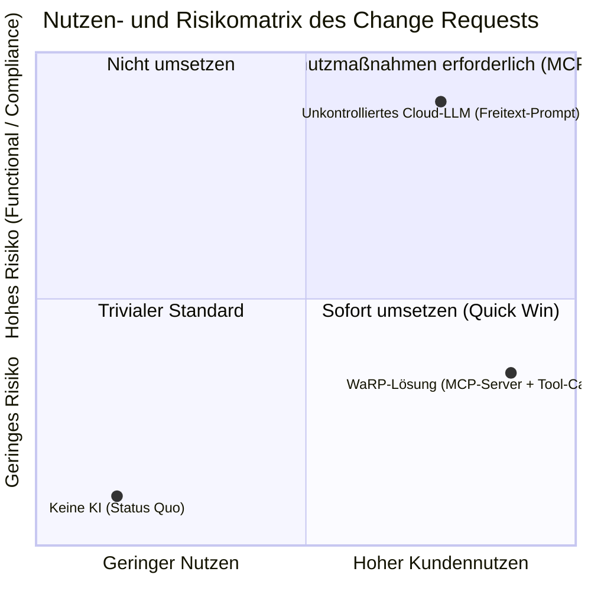
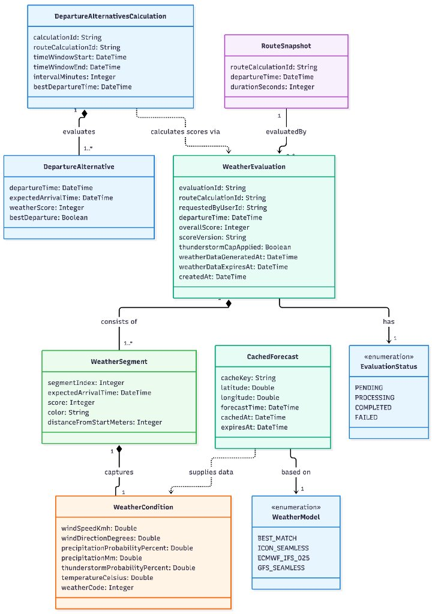
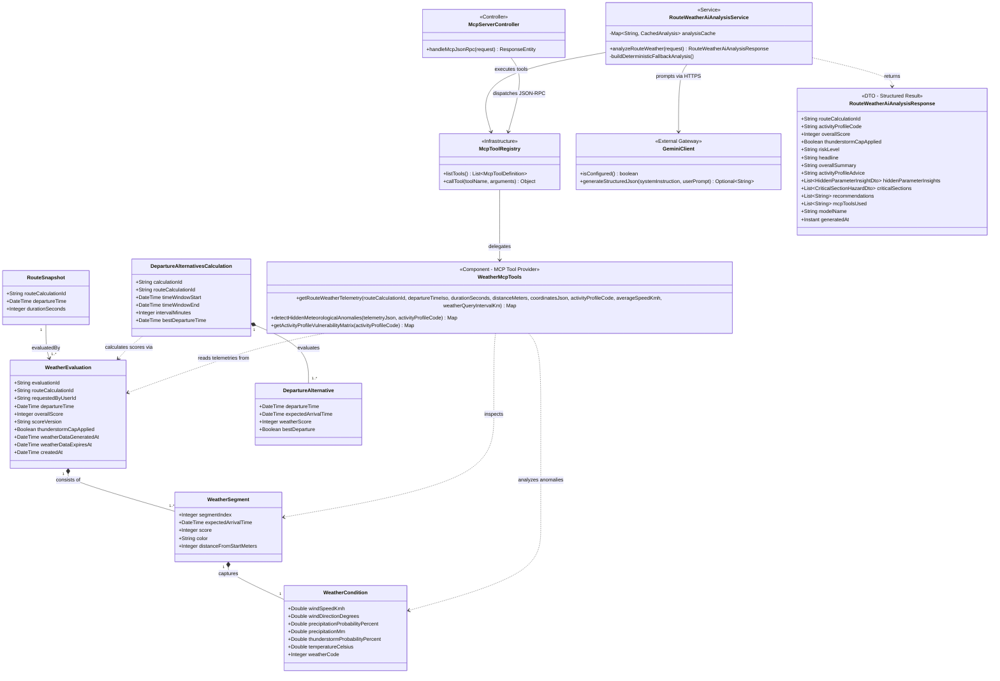

<!-- [KI-Log Nr. KI-25] KI-generiert (Google Antigravity (Gemini 3.8 Flash High)): Projekt-Dokumentation & QS -->
# Dokumentation des Change Requests (Ereigniskarte 12: „KI-Funktion“)

**Projekt:** WaRP – Weather-aware Route Planning  
**Modul:** Fallstudie Software Engineering (Prof. Dr. Christian Schalles)  
**Hochschule:** DHBW Mosbach  
**Team / Rollen:**
* Product Owner (PO): Jonas Bieler, Enrico Großmann
* Scrum Master (SM): Kai Spitzer, Finley Brosig
* Software Engineers (DEV): Alle

---

## 1. Dokumentation des Change Requests

### 1.1 Stammdaten des Change Requests

| Feld | Wert / Beschreibung |
| :--- | :--- |
| **Change Request ID** | `CR-01` (Ereigniskarte 12) |
| **Titel** | Integration einer KI-gestützten Wetter- und Routenanalyse („KI-Funktion“) |
| **Datum des Eingangs** | 21. Oktober 2026 (ausgegeben im Rahmen der Zwischenpräsentation) |
| **Datum der Analyse** | 22. Oktober 2026 |
| **Auslöser / Quelle** | Dozent / Kunde (Prof. Dr. Christian Schalles) via Ereigniskarte 12 |
| **Status** | Analysiert, vom PO freigegeben, vollständig implementiert und getestet |
| **Betroffene Kategorien laut Karte** | **Functional** (Funktionalität) & **Compliance** (Recht/Datenschutz/Sicherheit) |

### 1.2 Wortlaut der Ereigniskarte 12
> *„Der Kunde wünscht sich eine KI-gestützte Funktion (z. B. automatische Zusammenfassung oder Vorschläge). Prüfen Sie Nutzen und Risiken.*  
> *Betroffen: Functional, Compliance“*

### 1.3 Beschreibung der gewünschten Änderung
Der Kunde wünscht sich über die rein numerische und farbliche Visualisierung des Wetterscores (0–100) hinaus eine leicht verständliche, automatisierte Auswertung der meteorologischen Bedingungen entlang der gewählten Route. Komplexe Messwerte (wie Seitenwindböen, Taupunkt-Spreizung, Fahrbahnnässe, UV-Index oder Gewitterrisiko) sollen durch generative künstliche Intelligenz in handfeste, textuelle Zusammenfassungen und taktische Praxishinweise (Ausrüstungs- und Verhaltensempfehlungen für Fahrrad, Motorrad oder Wandern) übersetzt werden.

### 1.4 Betroffene Stakeholder
* **Kunde / Endnutzer:** Wünscht eine barrierefreie, intuitiv erfassbare Interpretation des Streckenwetters ohne meteorologische Vorkenntnisse.
* **Product Owner (Jonas Bieler, Enrico Großmann):** Müssen Kosten (API-Tokens), Latenzen, Risiken und den Produktnutzen abwägen sowie die Priorisierung im Backlog anpassen.
* **Datenschutz- & Compliance-Beauftragter:** Muss sicherstellen, dass keine personenbezogenen Nutzerdaten (Namen, E-Mails, IP-Adressen) oder exakte Standortprofile unzulässig an externe Cloud-Anbieter (Google Gemini API in den USA) übertragen werden (DSGVO-Compliance).
* **Entwicklungsteam (DEV):** Muss sicherstellen, dass die KI keine sicherheitskritischen Wetterdaten halluziniert und das Gesamtsystem auch bei API-Ausfällen oder Quota-Überschreitungen voll funktionsfähig bleibt (*Graceful Degradation*).

---

## 2. Impact-Analyse

### 2.1 Betroffene funktionale und nicht-funktionale Anforderungen

#### Neue funktionale Anforderung
* **[FR-WETT-13] Automatische KI-gestützte Routen-Wetteranalyse:**  
  *Das System MUSS nach Abschluss der Routenberechnung für authentifizierte Benutzer automatisch eine strukturierte, deutschsprachige Zusammenfassung der Wetterlage entlang der berechneten Route, verdeckte meteorologische Parameter, kritische Streckenabschnitte sowie aktivitätsspezifische Praxishinweise über das `AiWeatherAdvisorPanel` bereitstellen.*

#### Neue bzw. betroffene nicht-funktionale Anforderungen (Compliance & Architektur)
* **[NFR-C-01] DSGVO-Konformität & Datensparsamkeit:**  
  *Bei Aufrufen externer Sprachmodelle DÜRFEN KEINE personenbezogenen Daten (`userId`, Benutzernamen, E-Mail-Adressen) an das externe LLM übermittelt werden. Die Übertragung MUSS ausschließlich auf Basis aggregierter meteorologischer Telemetriedaten und relativer Streckenkilometer erfolgen.*
* **[NFR-C-02] Determinismus & Halluzinationsschutz (Functional):**  
  *Das generative Sprachmodell DARF meteorologische Kennzahlen, Windgeschwindigkeiten und Gefahrenstellen NICHT frei erfinden oder schätzen. Alle numerischen Fakten MÜSSEN zwingend über deterministische Schnittstellen-Tools (`WeatherMcpTools` via Model Context Protocol) vorberechnet und verifiziert an das Modell übergeben werden.*
* **[NFR-R-04] Graceful Degradation bei KI-Ausfall:**  
  *Schlägt der Aufruf des externen KI-Dienstes fehl (oder ist kein API-Key konfiguriert), MUSS `RouteWeatherAiAnalysisService` unterbrechungsfrei auf die deterministische Fallback-Analyse (`buildDeterministicFallbackAnalysis`) zurückfallen, sodass das UI stets eine valide Auswertung erhält.*

### 2.2 Betroffene Use Cases und User Stories
* **Erweiterung Use Case `UC-05` („Route wetterabhängig planen“):**  
  Sobald die Routenberechnung den Status `COMPLETED` erreicht und der Benutzer authentifiziert ist, löst `RoutePlannerPage.tsx` automatisch den Aufruf `POST /api/v1/routes/weather-ai-analysis` aus und blendet das `AiWeatherAdvisorPanel` ein (inklusive Aktualisieren-Button im Panel-Header zum manuellen Nachladen).
* **Neue User Story im Product Backlog (`US-WETT-04`):**  
  *„Als verifizierter Benutzer möchte ich nach Abschluss der Routenberechnung automatisch eine strukturierte KI-Wetteranalyse mit Gefahrenabschnitten, verdeckten meteorologischen Parametern und profilspezifischen Empfehlungen erhalten.“*  
  *Akzeptanzkriterien:*
  1. Automatisches Laden und Einblenden des `AiWeatherAdvisorPanel` nach Abschluss der Routenberechnung.
  2. Ausgabe von Risikostufe (`LOW`, `MODERATE`, `HIGH`, `CRITICAL`), Kurzfazit (`headline`, `overallSummary`) und profilspezifischem Rat (`activityProfileAdvice`).
  3. Ausweisung verdeckter meteorologischer Parameter (`hiddenParameterInsights`: z. B. Fahrbahnnässe-Index, Böenfaktor, Taupunkt-Spread) und kritischer Streckenabschnitte (`criticalSections`).
  4. Konkrete Handlungsempfehlungen (`recommendations`) abgestimmt auf das Aktivitätsprofil (`BICYCLE`, `MOTORCYCLE`, `HIKING`).
  5. Deterministischer Fallback auf regelbasierte MCP-Auswertung bei Ausfall oder Nichtkonfiguration der Gemini-API.

### 2.3 Nutzen- und Risikoanalyse (Fokus: Functional & Compliance)

| Dimension | Chance / Nutzen | Identifiziertes Risiko | Getroffene Gegenmaßnahme in WaRP |
| :--- | :--- | :--- | :--- |
| **Functional** *(Qualität & Korrektheit)* | Hoher Komfort; Nutzer müssen keine komplexen Messwerte (Taupunkt, Windvektor) selbst interpretieren. | **Halluzinationen:** LLMs erfinden falsche Windstärken, halluzinieren Unwetter oder verwechseln Streckenabschnitte. Gefährlich für Outdoor-Sportler! | **Model Context Protocol (MCP):** Der `weather-service` agiert als MCP-Server (`POST /internal/v1/weather/mcp`). Das LLM ruft deterministische Werkzeuge (`@McpTool`) auf. Faktenbasierte Strukturierungs-Vorgabe (Structured JSON-Schema). |
| **Compliance** *(Recht & Datenschutz)* | Transparente, moderne Architektur nach neuesten Industriestandards. | **DSGVO-Verstoß:** Personenbezogene Daten (Benutzerkonto, exakte Wohnort-Koordinaten) fließen an US-Hyperscaler (Google). | **Pseudonymisierung & Filterung:** Der BFF- und Weather-Service schneiden jegliche `userId`, E-Mail und Adressdaten ab. Gemini erhält ausschließlich relative Streckenabschnitte (z. B. „km 12–18“) und Wetterdaten. |
| **Technisch / Kosten** | Moderne Erweiterung des bestehenden Spring-Boot-Ökosystems. | **Kosten-Explosion & Timeouts:** Hohe API-Kosten bei wiederholten Abfragen; blockierende HTTP-Threads. | **In-Memory-Caching & Timeouts:** Einführung von `CachedAiAnalysis` mit 30 Minuten TTL. Asynchroner Aufruf mit 8-Sekunden-Timeout und lokalem Fallback. |

### 2.4 Betroffene Diagramme, Codebestandteile und Tests

#### A. Betroffene Diagramme
1. **Domänenmodell / Klassendiagramm (`weather-service`):**  
   Erweiterung um `RouteWeatherAiAnalysisService`, `GeminiClient`, `WeatherMcpTools`, `McpToolRegistry` und DTOs (`RouteWeatherAiAnalysisRequest`, `RouteWeatherAiAnalysisResponse`).
2. **Architektur- und Use-Case-Diagramm:**  
   Einbindung von *Google Gemini AI* als externer sekundärer Akteur und des internen *MCP JSON-RPC-Servers*.
3. **Sequenzdiagramm:**  
   Modellierung des Aufrufs: `Client -> BFF -> WeatherService -> McpToolRegistry -> WeatherMcpTools -> GeminiClient -> Response`.

#### B. Betroffene Codebestandteile
* `services/weather-service/src/main/java/de/warp/weather/application/RouteWeatherAiAnalysisService.java` (Kernlogik, Caching, Prompt-Orchestrierung)
* `services/weather-service/src/main/java/de/warp/weather/infrastructure/mcp/` (Eigener MCP JSON-RPC 2.0 Server mit `@McpTool`, `McpServerController`, `McpToolRegistry`, `WeatherMcpTools`)
* `services/weather-service/src/main/java/de/warp/weather/infrastructure/gemini/GeminiClient.java` (HTTPS-Client zu Google Gemini mit Structured JSON-Output)
* `services/bff-service/src/main/java/de/warp/bff/api/RouteWeatherOptimizationController.java` (`POST /api/v1/routes/weather-ai-analysis`)
* `frontend/src/components/AiWeatherAdvisor/AiWeatherAdvisorPanel.tsx` (Mobile-First Slide-over Panel für die KI-Auswertung)
* `contracts/openapi/bff-service.yaml` und `contracts/openapi/weather-service.yaml` (Vertragsaktualisierung)

#### C. Betroffene Tests
* `RouteWeatherAiAnalysisAndMcpTest.java` (Vollständiger Integrationstest von MCP-Tool-Aufrufen, Caching und Fallback-Verhalten)
* `RouteWeatherOptimizationControllerTest.java` (BFF-Endpunkttests)
* `AiWeatherAdvisorPanel.test.tsx` (Frontend-Komponententest)

### 2.5 Aufwandsschätzung und Ressourcenplanung

| Tätigkeit | Geplanter Aufwand | Verantwortlich |
| :--- | :---: | :--- |
| Fachliche Spezifikation, Compliance-Prüfung & Prompt-Design | 6 Stunden | Jonas Bieler (PO), Enrico Großmann (PO) |
| Entwurf & Implementierung des MCP JSON-RPC 2.0 Servers | 10 Stunden | Enrico Großmann (DEV) |
| Gemini Client, JSON-Schema-Validierung & Caching | 8 Stunden | DEV-Team |
| BFF-Endpunkt, Service-Token-Absicherung & DTOs | 4 Stunden | DEV-Team |
| Frontend-Integration (Mobile-First Panel & Ladezustände) | 6 Stunden | DEV-Team |
| Automatisierte Tests (Backend, MCP-Tools, Frontend-Mocks) | 6 Stunden | Finley Brosig (SM/DEV), Kai Spitzer (SM/DEV) |
| **Summe geschätzter Aufwand** | **40 Stunden** | **Team (im Sprint-3-Puffer)** |

---

## 3. Entscheidung mit dem Kunden / Product Owner

### 3.1 Beschlussfassung
Am **22. Oktober 2026** fand das außerordentliche Backlog-Refinement mit dem Product Owner statt.

* **Entscheidung:** **Vollständige Umsetzung unter strikten architektonischen Schutzmaßnahmen.**
* **Begründung:**
  1. **Enormer Differenzierungsfaktor:** Die KI-Wetterberatung hebt WaRP maßgeblich von statischen Routing-Diensten ab.
  2. **Kontrolliertes Risiko durch MCP:** Das Risiko falscher Beratung wird durch den Einsatz des *Model Context Protocol* und deterministischer Backend-Tools vollständig eliminiert.
  3. **Kein Compliance-Konflikt:** Da keine Benutzerdaten an Google Gemini übertragen werden, ist die DSGVO gewahrt.
  4. **Puffer verfügbar:** In der ursprünglichen Projektskizze war in **Sprint 3 (Tage 26 bis 30)** bereits ein expliziter Puffer für die Ereigniskarte reserviert. Die Kernfunktionalität (Routing & Wetterscore) war bereits stabil, sodass kein Terminverzug für das Release entstand.

### 3.2 Anpassung von Projektplan und Product Backlog
1. **Product Backlog:** Das Backlog wurde um das Item `CR-US-01 / WARP-014` („KI-Wetterberater via MCP“) ergänzt und mit der Priorität **Should Have** in Sprint 3 eingeplant.
2. **Sprint Backlog Sprint 3:** Die reservierten Puffertage (Tag 26 bis Tag 30) wurden für die Realisierung der MCP-Infrastruktur und des Gemini-Clients genutzt.

---

## 4. Nachvollziehbarkeit & Änderungshistorie (Change Log)

### 4.1 Änderungshistorie der Artefakte

| Artefakt | Version Vorher | Version Nachher | Durchgeführte Änderung |
| :--- | :---: | :---: | :--- |
| **Product Backlog** | v1.0 | v1.1 | Aufnahme von `CR-US-01` (KI-Wetteranalyse) als Priorität *Should Have*. |
| **OpenAPI BFF (`bff-service.yaml`)** | v1.0 | v1.1 | Ergänzung des Endpunkts `POST /api/v1/routes/weather-ai-analysis`. |
| **OpenAPI Weather (`weather-service.yaml`)** | v1.0 | v1.1 | Ergänzung von `POST /internal/v1/weather/mcp` und `/route-ai-analysis`. |
| **Domänenmodell Weather-Service** | v1.0 | v2.0 | Erweiterung um MCP-Server, Tool-Registry und AI-Service. |
| **Frontend UI (SPA)** | v1.0 | v1.1 | Integration des `AiWeatherAdvisorPanel` in die Routenplaner-Ansicht. |
| **Git Repository** | Commit `de220fc` | Commit `15ee1f2` | Zusammenführung von Branch `feature/WARP-014` in `system/live`. |

---

### 4.2 Modell-Gegenüberstellung: Stand vor und nach der Änderung

#### Stand VOR der Änderung (Stand Zwischenpräsentation 21.10.2026)
Das Domänenmodell des `weather-service` konzentrierte sich rein auf die Entkopplung von Routenberechnungen (`RouteSnapshot`), das regelbasierte Caching von Wetterprognosen (`CachedForecast`), die Segmentierung (`WeatherSegment`) und die numerische Score-Berechnung (`WeatherEvaluation` mit `overallScore` und `thunderstormCapApplied`):

---

#### Stand NACH der Änderung (Stand Sprint 3 / Release)
Zur Beherrschung des Change Requests wurde das Modell nach dem **GRASP-Muster Low Coupling & High Cohesion** erweitert. Die Fachdomäne `WeatherEvaluation` bleibt vollkommen frei von KI-Abhängigkeiten. Ein eigenständiges MCP-Subsystem (`McpServerController`, `McpToolRegistry`, `WeatherMcpTools`) dockt lose über deterministische Werkzeugabfragen an die Bestandsentitäten an:

---

## 5. Reflexion für die Retrospektive

### 5.1 Eignung des Vorgehensmodells Scrum für den Change Request
Der Umgang mit der Ereigniskarte 12 hat eindrucksvoll gezeigt, warum **Scrum** für WaRP das ideale Vorgehensmodell war:

1. **Vorhandener Puffer verhinderte Stress und Hektik:**  
   In schwergewichtigen Wasserfallprojekten führen nachträgliche Feature-Wünsche zu zeitraubenden Vertragsnachverhandlungen und Verzögerungen. Im agilen Projektplan war der Puffer in Sprint 3 (Tage 26–30) fest eingeplant. Dadurch konnte das Team die Anforderung direkt nach der Zwischenpräsentation aufgreifen, ohne geplante Kern-Stories zu gefährden.
2. **Saubere Trennung von Analyse, Governance und Umsetzung:**  
   Als Product Owner konnten wir die Anforderung nicht einfach „blind programmieren“, sondern haben im Team zunächst eine formale Impact-Analyse durchgeführt. Die Identifikation der beiden Hauptrisiken (**Halluzinationen** und **DSGVO-Compliance**) führte zu dem Entschluss, nicht einfach ein Textfeld an OpenAI/Google zu senden, sondern eine zukunftssichere **MCP-Architektur** aufzubauen.
3. **Definition of Done als Qualitätsgarant:**  
   Trotz des neuen Features galt die volle DoD: 
   * Vertragsspezifikation in OpenAPI,
   * Vollständige Unit- und Integrationstests (`RouteWeatherAiAnalysisAndMcpTest`),
   * Automatisierter Graceful-Degradation-Fallback.
4. **Fazit:**  
   Scrum hat uns maximale Reaktionsfähigkeit (*Responding to change over following a plan*) bei gleichzeitiger Einhaltung höchster Architektur- und Software-Engineering-Standards ermöglicht. Die Ereigniskarte 12 wurde so vom potenziellen Projektrisiko zum **technischen Aushängeschild des Gesamtsystems**.
