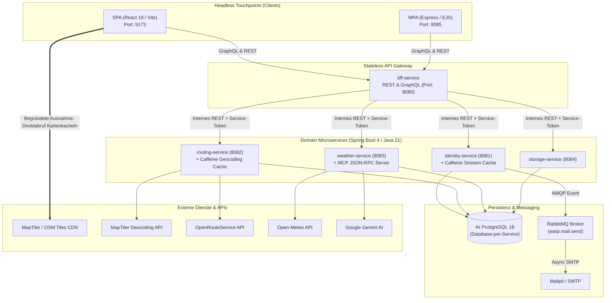

# Portfolio Webprogrammierung

## WaRP – Weather-aware Route Planning
**Konzeption und Implementierung einer verteilten, wetterbewussten Routenplanungsplattform nach den Prinzipien der Composable Architecture (MACH)**

---

**Hochschule / Studiengang:** Fortgeschrittene Systementwicklung / Webprogrammierung  
**Abgabetermin:** 08. November 2026  
**Präsentationstermin:** 09. November 2026  
**Repository / Projekt-Code:** `https://github.com/KeinDatenvolumen/warp`  

---

## Abstract (Deutsch & Englisch)

### Zusammenfassung (Deutsch)

Dieses Portfolio dokumentiert den technischen Lernprozess, die architektonischen Entscheidungen sowie die überwundenen Fehlentwicklungen bei der Konzeption und Realisierung von **WaRP (Weather-aware Route Planning)**. Ziel des Projekts war die Entwicklung eines verteilten Web-Services zur raum-zeitlich gekoppelten Routen- und Wetterplanung für Fahrradfahrer, Motorradfahrer und Wanderer unter strikter Vermeidung monolithischer Strukturen. 

Auf Basis der **MACH-Prinzipien** (*Microservices-based, API-first, Cloud-native, Headless*) wurde eine Systemlandschaft aus fünf entkoppelten Spring-Boot-Microservices (Java 21), vier isolierten PostgreSQL-Datenbanken (*Database-per-Service*) sowie zwei komplementären Frontend-Touchpoints – einer reaktiven Single-Page Application (React 19, TypeScript, Vite) und einer serverseitig gerenderten Multi-Page Application (Node.js, Express, EJS) – geschaffen. Ein zustandsloses Backend-for-Frontend (BFF) fungiert als zentrales API-Gateway und kombiniert GraphQL für flexible Domänenabfragen mit REST für sicherheitskritische Sitzungs- und Streaming-Operationen. 

Im Mittelpunkt dieser Arbeit steht die kritische Reflexion realer Entwicklungs- und Architekturentscheidungen im Projektverlauf. Beleuchtet werden unter anderem die asynchrone Orchestrierung externer Geodaten- und Wetterdienste (OpenRouteService, MapTiler, Open-Meteo, Google Gemini), der Übergang vom fehleranfälligen Caching mutabler JPA-Entitäten hin zu unveränderlichen Datenstrukturen im lokalen In-Memory-Cache (Caffeine), die Entkopplung des E-Mail-Versands von Datenbanktransaktionen über RabbitMQ sowie der Aufbau eines eigenen Model-Context-Protocol-Servers (MCP) für eine halluzinationsfreie KI-Routenanalyse.

---

### Abstract (English)

This portfolio documents the engineering learning process, architectural decisions, and technical pitfalls encountered during the design and implementation of **WaRP (Weather-aware Route Planning)**. The objective of the project was to build a distributed web service for spatio-temporal route and weather planning tailored to cyclists, motorcyclists, and hikers, strictly adhering to non-monolithic design paradigms.

Following **MACH principles** (*Microservices-based, API-first, Cloud-native, Headless*), we engineered a distributed architecture comprising five decoupled Spring Boot microservices (Java 21), four isolated PostgreSQL databases (*Database-per-Service*), and two distinct client touchpoints: an interactive Single-Page Application (React 19, TypeScript, Vite) and a server-side rendered Multi-Page Application (Node.js, Express, EJS). A stateless Backend-for-Frontend (BFF) serves as the single entry point, combining GraphQL for nested domain queries with REST for security-critical session lifecycle and AI analysis endpoints.

Rather than merely describing the final product, this work critically reflects on real engineering decisions and pitfalls encountered during development. Specifically, we examine the asynchronous orchestration of external geospatial and weather providers (OpenRouteService, MapTiler, Open-Meteo, Google Gemini), the transition from caching mutable JPA entities to immutable data records in local in-memory caches (Caffeine), the decoupling of SMTP mail delivery from database transactions via RabbitMQ, and the implementation of a custom Model Context Protocol (MCP) JSON-RPC server for hallucination-free AI route advisories.

---

## 1. Einführung und Projektmotivation

### 1.1 Ausgangsproblem und fachliche Motivation

Klassische Navigationssysteme (wie Google Maps oder Komoot) und klassische Wetterdienste arbeiten in getrennten Silos: Ein Routenplaner berechnet den geometrisch kürzesten oder schönsten Weg von Ort $A$ nach Ort $B$, während ein Wetterdienst lediglich die Prognose für einen einzelnen statischen Ort anzeigt. Für wetterexponierte Outdoor-Aktivitäten – insbesondere mehrstündige Fahrrad-, Motorrad- oder Wandertouren – greift diese Trennung zu kurz. 

Ein Fahrer befindet sich nicht zur selben Zeit auf der gesamten Strecke. Startet eine 120 km lange Radtour um 10:00 Uhr in Stuttgart bei Sonnenschein, erreicht der Fahrer den Albaufstieg erst gegen 13:30 Uhr und das Ziel in Ulm um 16:00 Uhr. Entscheidend ist nicht das Wetter am Zielort zum Zeitpunkt der Abfahrt, sondern die **raum-zeitliche Schnittmenge** $\text{Wetter}(x(t), y(t), t)$ entlang der Streckengeometrie unter Berücksichtigung der aktivitätsspezifischen Reisegeschwindigkeit.

Aus dieser Überlegung entstand **WaRP (Weather-aware Route Planning)**: Ein System, das Geodaten, Streckengeometrien, Aktivitätsprofile und stündliche Wetterprognosen entlang der erwarteten Durchfahrtszeiten korreliert, Risiken (wie Seitenwindböen, nasse Fahrbahnen oder Gewitterzellen) über einen 101-stufigen perzeptuellen Wetterscore bewertet, das optimale Abfahrtszeitfenster berechnet und mittels KI (Google Gemini + MCP-Server) taktische Empfehlungen gibt.

### 1.2 Architektonisches Leitbild: Composable Architecture & MACH

Um den Anforderungen moderner Web-Systemarchitekturen gerecht zu werden und monolithische Kopplungen konsequent auszuschließen, wurde WaRP von Beginn an nach den vier Säulen der **MACH-Architektur** entworfen:

1. **Microservices-based:** Zerlegung der Geschäftslogik in fünf fachlich geschnittene, unabhängig deploybare Services (`bff-service`, `identity-service`, `routing-service`, `weather-service`, `storage-service`), wobei jeder persistierende Dienst seine eigene Datenbank besitzt (*Database-per-Service*).
2. **API-first:** Jede Schnittstelle zwischen Frontends, BFF, internen Services und Message-Brokern wurde vor der Implementierung durch maschinenlesbare Verträge spezifiziert (`contracts/graphql/schema.graphqls`, `contracts/openapi/*.yaml`, `contracts/asyncapi/mail-events.yaml`).
3. **Cloud-native:** Containerisierung aller Komponenten über mehrstufige Dockerfiles, strikte Konfiguration über Umgebungsvariablen (*12-Factor App*), automatisierte Readiness-/Liveness-Probes und CI/CD-gestütztes Container-Deployment auf Heroku.
4. **Headless:** Vollständige Entkopplung der Präsentationsschicht von der Fachlogik. Dieselbe BFF-API bedient parallel zwei völlig unterschiedliche Touchpoints: eine React-basierte **SPA** (Port `5173`) für die kartenintensive Routenplanung und eine Express/EJS-basierte **MPA** (Port `8085`) als klassische Informationsseite.



---

## 2. API-Design und Kommunikationsarchitektur

### 2.1 Koexistenz von REST und GraphQL: Wann welches Paradigma?

Eine zentrale Entwurfsfrage zu Projektbeginn war die Aufteilung der Kommunikation zwischen **REST** und **GraphQL**.

Wir haben uns für eine **funktionale Aufgabenteilung am BFF** entschieden:

* **Öffentliche REST-API (`/api/v1/...`, spezifiziert in `contracts/openapi/bff-service.yaml`):**
  REST wird am BFF überall dort eingesetzt, wo HTTP-Protokollmechanismen (Statuscodes, `Set-Cookie`-Header, `Retry-After`-Header bei Rate-Limiting, CSRF-Token-Handshake) im Vordergrund stehen oder dedizierte Berechnungs-Pipelines angestoßen werden:
  * `POST /api/v1/sessions` & `DELETE /api/v1/sessions/current` (Setzen und Löschen des `HttpOnly`-, `Secure`-, `SameSite=None`-Session-Cookies `session` am BFF bzw. `SameSite=None` im Express-MPA-Proxy).
  * `GET /api/v1/csrf` (Abruf des CSRF-Tokens für zustandsverändernde Aufrufe).
  * `POST /api/v1/users`, `/api/v1/email-verifications/*`, `/api/v1/password-resets/*` und `/api/v1/users/me/*` (Konto-Lifecycle mit klaren HTTP-Semantiken wie `201 Created`, `204 No Content`, `403 Forbidden`, `409 Conflict`, `422 Unprocessable Content`).
  * `POST /api/v1/routes/weather-optimization` & `/api/v1/routes/weather-ai-analysis` (Rechenintensive Spezialanalysen).

* **Öffentliche GraphQL-API (`POST /graphql`, spezifiziert in `contracts/graphql/schema.graphqls`):**
  GraphQL spielt seine Stärke bei vernetzten Domänenabfragen und unterschiedlichen Client-Anforderungen (SPA vs. MPA) aus:
  * Die **MPA** benötigt auf ihrer Übersichtsseite (`/`) lediglich `activityProfiles { code displayName }` und auf der Profilseite (`/profile`) `currentUser { id name email emailVerified }` sowie `currentSession`.
  * Die **SPA** hingegen fragt im Routenplaner tief verschachtelte Strukturen ab (`routeCalculation` inklusive `geometry`, `segments`, `weatherEvaluation` und `weatherSegments` mit 10 Wettermetriken pro Segment).
  * Durch GraphQL vermeidet die MPA *Overfetching*, während die SPA *Underfetching* (N+1-Requests zwischen Routing- und Wetterdaten) eliminiert, da das BFF die Daten aus `routing-service` und `weather-service` transparent in einem einzigen GraphQL-Resolver-Baum zusammenführt.

* **Interne Service-to-Service-Kommunikation:**
  Zwischen BFF und den vier nachgelagerten Microservices wird konsequent **REST mit RFC-7807 Problem-Details (`application/problem+json`)** sowie JSON-RPC 2.0 (für den MCP-Server unter `/internal/v1/weather/mcp`) genutzt. Alle internen Aufrufe sind über den Header `X-WaRP-Service-Token` (`InternalServiceAuthenticationFilter`) abgesichert. Dadurch bleiben die internen Microservices schlank und frei von GraphQL-Abhängigkeiten.

* **Contract-First-Spezifikation & Living Documentation via Swagger UI:**
  Für alle fünf Services existieren vollständige OpenAPI-3.1-Verträge (`contracts/openapi/*.yaml`) sowie das GraphQL-Schema (`contracts/graphql/schema.graphqls`). Um die API-Verträge interaktiv erfahrbar zu machen, ist ein **Swagger-UI-Service** in die Docker-Compose-Umgebung (`http://localhost:8088`) integriert, der über ein Dropdown die Spezifikationen aller fünf Microservices bündelt. Ergänzend steht eine portable Standalone-HTML-Ansicht (`contracts/openapi/index.html`) für die lokale Begutachtung bereit. Der BFF gestattet CORS-Anfragen von `http://localhost:8088`, womit Endpunkte live im Browser getestet werden können („Try it out“).

### 2.2 Prinzip der strikten Zustandslosigkeit (Statelessness)

Ein Kernkriterium unseres API-Designs ist die **Zustandslosigkeit**:
1. **Zustandsloses BFF:** Der `bff-service` hält keinerlei lokalen Sitzungszustand (`SessionCreationPolicy.STATELESS`) und besitzt keine eigene Datenbank. Jeder eingehende Request trägt das `HttpOnly`-Session-Cookie (`session`); der BFF extrahiert das Token und validiert es gegen den `identity-service`.
2. **Kein In-Memory-Session-State im Web-Layer:** Selbst bei einem Neustart oder einer horizontalen Skalierung des BFF geht keine Benutzersitzung verloren.
3. **Idempotenz bei Schreiboperationen:** Sowohl beim Start einer Routenberechnung (`POST /internal/v1/route-calculations`) als auch beim Speichern einer Route (`POST /internal/v1/users/{userId}/saved-routes`) wird ein `Idempotency-Key`-Header unterstützt. Wiederholt ein Client bei Netzwerk-Timeouts denselben Request, wird kein Duplikat angelegt, sondern das bereits berechnete bzw. gespeicherte Objekt zurückgegeben.

### 2.3 Asynchronität und begründete Ausnahmen

Die Architekturvorgabe verlangt asynchrone Kommunikation zwischen Komponenten, lässt jedoch **begründete Ausnahmen** zu. In WaRP haben wir diese Unterscheidung bewusst architektonisch modelliert:

* **Asynchrone Entkopplung (Regelfall für langlaufende / externe Prozesse):**
  1. *Routenberechnung (`routing-service`):* Ein Aufruf an `POST /internal/v1/route-calculations` blockiert nicht, bis OpenRouteService antwortet, sondern persistiert den Auftrag in PostgreSQL mit Status `PENDING`, publiziert ein `RouteCalculationCreatedEvent` und antwortet sofort mit `202 Accepted` sowie einem `Location`-Header. Ein `@Async`-Worker (`RouteCalculationProcessor`) übernimmt die Berechnung im Hintergrund; das Frontend fragt den Fortschritt nicht-blockierend per Polling ab.
  2. *E-Mail-Versand (`identity-service` + RabbitMQ):* Der SMTP-Versand ist über RabbitMQ (`warp.mail.send`) vollständig aus der HTTP- und DB-Transaktion entkoppelt (siehe Abschnitt 3.4).
* **Begründete Ausnahmen (Synchron / Direkt):**
  1. *Direktabruf der Kartenkacheln im Browser (`SPA -> MapTiler CDN`):* Würde jede einzelne $512 \times 512$ PNG-Kartenkachel beim Verschieben der Leaflet-Karte durch das BFF und ein Backend geproxyt, entstünde ein massiver I/O-Flaschenhals, der zudem das globale CDN- und Browser-Caching aushebelt. Daher lädt die `TileLayer` in `RouteMap.tsx` die Kacheln mit einem eingeschränkten Public-Key direkt vom MapTiler/OpenStreetMap-CDN.
  2. *Sitzungsvalidierung (`BFF -> identity-service`):* Authentifizierungsprüfungen müssen vor der Ausführung geschützter Operationen deterministisch abgeschlossen sein. Um die Latenz dieser synchronen Abfrage auf unter 1 ms zu drücken, wurde sie durch den lokalen Caffeine In-Memory-Cache optimiert.

### 2.4 Vollständige API-Design-Spezifikation (Template nach Vorlesungsvorgabe, Folie 25)

> Die vollständige Spezifikation aller 41 Operationen über alle fünf Services (`bff-service`, `identity-service`, `routing-service`, `weather-service`, `storage-service`) ist im Begleitdokument [04_API_DESIGN.md] hinterlegt. Nachfolgend sind alle öffentlichen Endpunkte des API-Gateways (BFF) im geforderten Format dargestellt.

#### Endpunkt : /api/v1/system

| Method | URI | Description | Data In | Data Out |
| :--- | :--- | :--- | :--- | :--- |
| `GET` | `/api/v1/system/health` | Aggregierter System- und Readiness-Check aller fünf WaRP-Dienste inklusive individueller Latenzmessung (`Cache-Control: no-store`). | *Keine Parameter* | **200 OK**:<br>`{ "status": "UP" \| "DEGRADED", "checkedAt": date-time, "healthyServices": number, "totalServices": number, "services": [ { "service": string, "status": string, "reachable": boolean, "responseTimeMs": number } ] }` |

#### Endpunkt : /api/v1/csrf

| Method | URI | Description | Data In | Data Out |
| :--- | :--- | :--- | :--- | :--- |
| `GET` | `/api/v1/csrf` | Ruft ein frisches CSRF-Token nach dem Double-Submit-Cookie-Pattern (`XSRF-TOKEN`) ab. Erforderlich für alle zustandsverändernden REST- und GraphQL-Aufrufe. | *Keine Parameter* | **200 OK**:<br>`{ "token": string, "headerName": "X-CSRF-TOKEN", "parameterName": "_csrf" }` |

#### Endpunkt : /api/v1/users

| Method | URI | Description | Data In | Data Out |
| :--- | :--- | :--- | :--- | :--- |
| `POST` | `/api/v1/users` | Registriert ein neues Benutzerkonto mit Name, E-Mail und Passwort (min. 12 Zeichen). Stößt nach DB-Commit asynchron eine Verifikations-E-Mail über RabbitMQ an. | **Header:** `X-CSRF-TOKEN`<br><br>**Body (`application/json`):**<br>`{ "name": string, "email": string, "password": string (min 12) }` | **201 Created**:<br>`{ "id": "usr_...", "name": string, "email": string, "emailVerified": false, "createdAt": date-time, "message": "Das Benutzerkonto wurde erfolgreich erstellt." }`<br><br>**409 Conflict**:<br>`{ "status": 409, "code": "EMAIL_ALREADY_EXISTS" }`<br><br>**422 Unprocessable Content**:<br>`{ "status": 422, "code": "INVALID_REGISTRATION_REQUEST", "fieldErrors": [...] }` |
| `POST` | `/api/v1/users/me/password-changes` | Ändert das Passwort des aktuell angemeldeten Benutzers nach Prüfung des bisherigen Passworts. | **Header:** `X-CSRF-TOKEN`, `Cookie: session`<br><br>**Body (`application/json`):**<br>`{ "currentPassword": string, "newPassword": string (min 12) }` | **204 No Content**<br><br>**401 Unauthorized**: `{ "code": "NOT_AUTHENTICATED" }`<br>**403 Forbidden**: `{ "code": "INVALID_PASSWORD" }`<br>**422 Unprocessable Content**: `{ "code": "PASSWORD_REQUIREMENTS_NOT_MET" \| "INVALID_ACCOUNT_CHANGE_REQUEST" }` |
| `POST` | `/api/v1/users/me/email-changes` | Beantragt eine E-Mail-Änderung (`pending_email`) nach Passwortprüfung und versendet einen Bestätigungslink an die neue Adresse. Die aktive E-Mail wechselt erst nach Klick auf den Verifikationslink. | **Header:** `X-CSRF-TOKEN`, `Cookie: session`<br><br>**Body (`application/json`):**<br>`{ "newEmail": string, "password": string }` | **204 No Content**<br><br>**401 Unauthorized**: `{ "code": "NOT_AUTHENTICATED" }`<br>**403 Forbidden**: `{ "code": "INVALID_PASSWORD" }`<br>**409 Conflict**: `{ "code": "EMAIL_ALREADY_EXISTS" }`<br>**422 Unprocessable Content**: `{ "code": "INVALID_ACCOUNT_CHANGE_REQUEST" }` |

#### Endpunkt : /api/v1/email-verifications & /api/v1/password-resets

| Method | URI | Description | Data In | Data Out |
| :--- | :--- | :--- | :--- | :--- |
| `POST` | `/api/v1/email-verifications/confirm` | Bestätigt ein E-Mail-Verifikationstoken (initiale Verifikation oder Übernahme von `pending_email`) und invalidiert gecachte Sessions (`evictAllSessions`), sodass aktive Sitzungen sofort als verifiziert gelten. | **Header:** `X-CSRF-TOKEN`<br><br>**Body (`application/json`):**<br>`{ "token": string }` | **204 No Content**<br><br>**400 Bad Request**:<br>`{ "status": 400, "code": "INVALID_VERIFICATION_TOKEN" }` |
| `POST` | `/api/v1/email-verifications/resend` | Fordert den erneuten Versand einer Verifikations-E-Mail an (antwortet aus Datenschutzgründen stets mit `204`, um User-Enumeration zu verhindern). | **Header:** `X-CSRF-TOKEN`<br><br>**Body (`application/json`):**<br>`{ "email": string }` | **204 No Content** |
| `POST` | `/api/v1/password-resets/send` | Versendet einen Passwort-Reset-Link über RabbitMQ (antwortet unabhängig von der Existenz der E-Mail mit `204 No Content`). | **Header:** `X-CSRF-TOKEN`<br><br>**Body (`application/json`):**<br>`{ "email": string }` | **204 No Content** |
| `POST` | `/api/v1/password-resets/confirm` | Setzt das Passwort mithilfe eines gültigen Reset-Tokens neu und invalidiert alle bestehenden Sessions des Benutzers. | **Header:** `X-CSRF-TOKEN`<br><br>**Body (`application/json`):**<br>`{ "token": string, "newPassword": string (min 12) }` | **204 No Content**<br><br>**400 Bad Request**: `{ "code": "INVALID_RESET_TOKEN" }`<br>**422 Unprocessable Content**: `{ "code": "PASSWORD_REQUIREMENTS_NOT_MET" }` |

#### Endpunkt : /api/v1/sessions

| Method | URI | Description | Data In | Data Out |
| :--- | :--- | :--- | :--- | :--- |
| `POST` | `/api/v1/sessions` | Authentifiziert den Benutzer gegen den Identity-Service. Prüft Passwörter timing-resistent gegen Dummy-Hashes (`dummyPasswordHash`), setzt ein `HttpOnly`-Session-Cookie (serverseitige Gültigkeit `PT12H`) und schützt über `LoginRateLimiter` (max. 5 Versuche / 60s pro `email\|ip`) vor Brute-Force. | **Header:** `X-CSRF-TOKEN`<br><br>**Body (`application/json`):**<br>`{ "email": string, "password": string }` | **200 OK**:<br>**Header:** `Set-Cookie: session=<token>; Path=/; Secure; HttpOnly; SameSite=None`<br>**Body:** `{ "userId": "usr_...", "expiresAt": date-time }`<br><br>**401 Unauthorized**:<br>`{ "code": "INVALID_CREDENTIALS" }`<br><br>**422 Unprocessable Content**:<br>`{ "code": "INVALID_SESSION_REQUEST", "fieldErrors": [...] }`<br><br>**429 Too Many Requests**:<br>**Header:** `Retry-After: 60`<br>`{ "code": "TOO_MANY_LOGIN_ATTEMPTS" }` |
| `DELETE` | `/api/v1/sessions/current` | Beendet die aktuelle Sitzung, invalidiert den Token-Hash in PostgreSQL sowie im Caffeine-Cache und löscht das Session-Cookie im Browser. | **Header:** `X-CSRF-TOKEN`, `Cookie: session` | **204 No Content**:<br>**Header:**<br>`Set-Cookie: session=; Path=/; Max-Age=0; Secure; HttpOnly; SameSite=None` |

#### Endpunkt : /api/v1/routes

| Method | URI | Description | Data In | Data Out |
| :--- | :--- | :--- | :--- | :--- |
| `POST` | `/api/v1/routes/weather-optimization` | Simuliert Abfahrtszeitfenster entlang der Streckengeometrie, wendet Gauß-Glättung (`0.20 / 0.60 / 0.20`) an und ermittelt das optimale Abfahrtszeitfenster mit dem höchsten Wetterscore. | **Header:** `X-CSRF-TOKEN`, optional `Cookie: session`<br><br>**Body (`application/json`):**<br>`{ "routeCalculationId": string, "activityProfile": string, "departureTime": date-time, "durationSeconds": number, "distanceMeters": number, "coordinates": [[lon, lat], ...], "windowStart": date-time, "windowEnd": date-time }` | **200 OK**:<br>`{ "recommendedSlotIndex": number, "optimalWindowSummary": { "bestDeparture": string, "bestDepartureIso": string, "bestScore": number, "stableWindow": string, "advantageVsWorst": string, "worstDeparture": string, "worstScore": number }, "departureSlots": [ { "departureIso": string, "departureTime": string, "arrivalIso": string, "arrivalTime": string, "routeScore": number, "robustScore": number, "hasThunderCap": boolean, "reachesNightfall": boolean, "segmentScores": [number], "segmentReasons": [string], "summaryDeltaText": string } ] }` |
| `POST` | `/api/v1/routes/weather-ai-analysis` | Führt eine deterministische Tool-basierte KI-Wetteranalyse (Google Gemini + MCP-Server mit 10s Timeout & Physik-Engine-Fallback) durch. Erfordert Login und verifizierte E-Mail. | **Header:** `X-CSRF-TOKEN`, `Cookie: session`<br><br>**Body (`application/json`):**<br>`{ "routeCalculationId": string, "startLabel": string, "destinationLabel": string, "activityProfile": string, "departureTime": date-time, "durationSeconds": number, "distanceMeters": number, "coordinates": [[lon, lat], ...] }` | **200 OK**:<br>`{ "routeCalculationId": string, "activityProfileCode": string, "activityProfileDisplayName": string, "departureTime": date-time, "overallScore": number, "thunderstormCapApplied": boolean, "riskLevel": string, "headline": string, "overallSummary": string, "activityProfileAdvice": string, "hiddenParameterInsights": [...], "criticalSections": [...], "recommendations": [string], "mcpToolsUsed": [string], "modelName": string, "generatedAt": date-time }`<br><br>**401 Unauthorized**: `{ "code": "SESSION_INVALID" }`<br>**403 Forbidden**: `{ "code": "EMAIL_NOT_VERIFIED" }` |

#### Endpunkt : /graphql

| Method | URI | Description | Data In | Data Out |
| :--- | :--- | :--- | :--- | :--- |
| `POST` | `/graphql` | Zentraler GraphQL-Endpunkt (`contracts/graphql/schema.graphqls`) für Queries (`systemHealth`, `currentSession`, `currentUser`, `activityProfiles`, `activityProfile`, `searchPlaces`, `savedRoutes`, `savedRoute`, `routeCalculation`) und Mutations (`startRouteCalculation`, `saveRoute`, `updateSavedRoute`, `deleteSavedRoute`). | **Header:** `X-CSRF-TOKEN`, optional `Cookie: session`<br><br>**Body (`application/json`):**<br>`{ "query": string, "operationName": string, "variables": object }` | **200 OK (`application/graphql-response+json`)**:<br>`{ "data": { ... }, "errors": [ { "message": string, "extensions": { "code": "SESSION_INVALID" \| "EMAIL_NOT_VERIFIED" \| ... } } ] }` |

---

## 3. Implementierung: Lernverlauf, Fehlentwicklungen und Architekturentscheidungen

In diesem Kapitel dokumentieren wir unseren realen Entwicklungsprozess anhand der wichtigsten technischen Herausforderungen. Im Fokus steht nicht eine Aufzählung fertiger Features, sondern die Analyse von **Fehlern, Erkenntnissen und Architekturentscheidungen** anhand konkreter Code-Ausschnitte.

---

### 3.1 Touchpoints im Vergleich: SPA (React 19) vs. MPA (Express & EJS)

#### Entscheidung und Umsetzung
Um die Unterschiede zwischen einer Client-Side Single-Page Application und einer Server-Side Rendered Multi-Page Application unter realen Bedingungen zu untersuchen, haben wir beide Touchpoints gegen exakt dasselbe BFF implementiert:
* Die **SPA (`frontend/`)** nutzt React 19, Apollo Client und einen clientseitigen `AuthContext`, der den Sitzungsstatus (`loading`, `authenticated`, `unauthenticated`) im Speicher verwaltet.
* Die **MPA (`mpa/`)** nutzt Node.js mit Express und EJS-Templates. Da der Browser bei einer MPA klassische Seitennavigationen (`GET /profile`, `POST /login`) an den Express-Server sendet, fungiert der Express-Server selbst als HTTP-/GraphQL-Client gegenüber dem BFF (`mpa/src/services/bffClient.ts`).

#### Gemachter Fehler 1: Abgebrochene Startup-Queries in der SPA (`sessionInvalidLink`)
In der SPA implementierten wir einen benutzerdefinierten Apollo-Link (`sessionInvalidLink`), der bei jedem GraphQL-Fehler mit dem Code `SESSION_INVALID` automatisch `apolloClient.clearStore()` aufrief, um sensible Daten aus dem In-Memory-Cache des Browsers zu löschen.

**Das Problem:** Wenn ein **nicht angemeldeter** Besucher den Routenplaner (`/route-planner`) öffnete, feuerte die App beim Start parallel zwei GraphQL-Queries ab:
1. `CurrentSession` (durch den `AuthProvider` zur Prüfung, ob ein Login vorliegt)
2. `ActivityProfiles` (durch den Routenplaner zum Laden der Profile Fahrrad, Motorrad, Wandern)

Da der Besucher nicht eingeloggt war, antwortete `CurrentSession` erwartungsgemäß mit `SESSION_INVALID`. Unser `sessionInvalidLink` rief daraufhin sofort `apolloClient.clearStore()` auf – und **brach damit die noch laufende Query `ActivityProfiles` mitten im Flug ab**! Die Folge war, dass unauthentifizierte Nutzer beim ersten Seitenaufruf keine Aktivitätsprofile sahen.

**Erkenntnis und Lösung (Commit `d6e6dbb`):**
Ein `SESSION_INVALID` bei der initialen `CurrentSession`-Prüfung ist kein unerwarteter Sitzungsverlust während einer aktiven Sitzung, sondern der normale Ausgangszustand eines anonymen Nutzers. Zudem darf `clearStore()` nur getriggert werden, wenn der Nutzer zuvor tatsächlich authentifiziert war:

```typescript
// frontend/src/api/apolloClient.ts – Korrigierte Behandlung in sessionInvalidLink
export const sessionInvalidLink = new ApolloLink(
    (operation, forward) =>
        forward(operation).pipe(
            tap((result) => {
                if (
                    operation.operationName !== 'CurrentSession' &&
                    !operation.getContext().skipSessionInvalidNotification &&
                    containsSessionInvalidCode(result.errors)
                ) {
                    notifySessionInvalid()
                }
            })
        )
)
```
Und im `AuthContext.tsx` wird `clearApolloCache()` bei einem `SESSION_INVALID`-Event nur noch ausgeführt, wenn der bisherige Status `authenticated` war.

#### Gemachter Fehler 2: Cookie- und CSRF-Forwarding in der MPA
In der MPA fiel uns zunächst auf, dass ein Login über `POST /login` zwar am BFF eine gültige Session erzeugte, der anschließende Aufruf von `GET /profile` jedoch behauptete, der Nutzer sei nicht eingeloggt.

**Ursache & Lerneffekt:** Bei einer SPA läuft der GraphQL-Client direkt im Browser, sodass der Browser das `HttpOnly`-Cookie automatisch an das BFF mitsendet. Bei der MPA liegt der Express-Server dazwischen (`Browser -> Express-MPA -> BFF`). Empfängt der `BffClient` (`mpa/src/services/bffClient.ts`) beim Login den `Set-Cookie`-Header vom BFF, muss er das `session`-Token extrahieren und in `mpa/src/routes/auth.ts` per `res.cookie('session', result.sessionToken, { httpOnly: true, sameSite: 'none', path: '/' })` an den Browser weiterreichen; und bei jedem nachfolgenden GraphQL- oder REST-Aufruf vom Express-Server an das BFF muss `BffClient` das eingehende Cookie manuell in den ausgehenden `fetch`-Request setzen (`headers['Cookie'] = 'session=' + sessionToken`). Für zustandsverändernde Aufrufe (Passwort- und E-Mail-Änderung) ruft `BffClient` zudem vorab `/api/v1/csrf` auf und reicht sowohl das `XSRF-TOKEN`-Cookie als auch den Header `X-CSRF-TOKEN` an das BFF weiter.

---

### 3.2 Fremdservice-Integration und raum-zeitliche Wetterkorrelation

#### Warum ein einfacher GET-Request keine Integration ist
Die Projektanforderung legt fest, dass ein singulärer GET-Request nicht als Fremdservice-Integration gewertet wird und Asynchronität sowie Fehlerbehandlung eingehalten werden müssen. In WaRP greifen vier externe Systeme in einer mehrstufigen Pipeline ineinander:

1. **MapTiler Geocoding API (`GET` mit Query-Normalisierung & Caching):** Auflösung von Freitext-Ortsnamen in Koordinaten (`MapTilerGeocodingClient`).
2. **OpenRouteService API (`POST /openrouteservice/v2/directions/{profile}/geojson`):** Der `routing-service` hält die Aktivitätsprofile (`ActivityProfileService`) inklusive Durchschnittsgeschwindigkeit (`18.0`, `60.0`, `5.0` km/h), Wetter-Abfrageintervall (`5`, `15`, `2` km) und Wegepräferenzen (`WayPreferences`) zentral im Backend und übersetzt das gewählte Profil über `RoutingProfileCode` auf die ORS-Routing-Profile `cycling-regular` (Fahrrad), `driving-car` (Motorrad) und `foot-hiking` (Wandern), bevor `OpenRouteServiceClient` die GeoJSON-Route asynchron im Hintergrund berechnet.
3. **Raum-Zeit-Interpolation & Open-Meteo API:** Aus der von OpenRouteService gelieferten GeoJSON-LineString-Geometrie berechnet der `RouteSegmenter` im `weather-service` anhand der Durchschnittsgeschwindigkeit und des Abfrageintervalls des Aktivitätsprofils (Wandern: alle 2 km, Fahrrad: alle 5 km, Motorrad: alle 15 km), **wann** (`expectedArrivalTime`) der Nutzer welchen Koordinatenpunkt erreicht, und ruft über `OpenMeteoClient` die stündlichen Prognosen (inklusive CAPE, 0-cm-Bodentemperatur, Kurzwellenstrahlung, Taupunkt und Sichtweite) ab.
4. **101-stufiger Perzeptueller Wetterscore & Sicherheits-Deckelungen (`WeatherScoringService` v2.0):**
   Ein früher Fehler unseres ersten Score-Entwurfs war ein einfacher linearer Mittelwert über wenige Wetterparameter. Das führte zu einem gefährlichen Ergebnis: Wenn Temperatur (22 °C) und Sonnenschein perfekt waren, aber eine Gewitterzelle oder starker Seitenwind vorlag, lag der Durchschnittswert immer noch im grünen Bereich.
   **Korrektur:** In `WeatherScoringService.evaluateSegmentBreakdown` berechnet WaRP vier physikalische Teilscores – Temperatur/Windchill ($S_{\text{temp}}$), Niederschlag & Fahrbahnnässe ($S_{\text{precip}}$ inkl. 2h-Verdunstungsträgheit `wetRoadIndex`), Vektor-Aerodynamik aus Gegen-/Seitenwind ($S_{\text{wind}}$) sowie Sichtweite/Visierbeschlag/UV ($S_{\text{vis}}$) – mit profilspezifischen Gewichten $(w_{\text{precip}}, w_{\text{wind}}, w_{\text{temp}}, w_{\text{vis}})$. Um zu verhindern, dass gute Teilwerte einen kritischen Faktor überdecken, wird das gewichtete Mittel $S_{\text{lin}}$ mit einer nichtlinearen **Bottleneck-Dämpfung** multipliziert:
   $$S_{\text{raw}} = S_{\text{lin}} \cdot \left(0.45 + 0.55 \cdot \left(\frac{\min(S_{\text{temp}}, S_{\text{precip}}, S_{\text{wind}}, S_{\text{vis}})}{100}\right)^{0.6}\right)$$
   Zusätzlich greifen drei harte Sicherheitsdeckelungen (`cThunder`, `cIce`, `cStorm`): Bei Gewittergefahr (`thunderstormCapApplied`) wird der Routen-Gesamtscore (kombiniert aus 35 % zeitgewichtetem Mittel $\mu_S$ und 65 % pessimistischem Log-Sum-Exp Soft-Minimum $M_\tau$) hart auf maximal 50 Punkte gedeckelt und der konkrete Engpassfaktor (`limitingFactor`, `reasonLabel`) im Segment ausgewiesen.

---

### 3.3 Infrastruktur-Optimierung I: In-Memory Caching mit Caffeine (`WARP-035`)

#### Motivation und Auswahl der Cache-Kandidaten
Bei Last- und Klicktests stellten wir zwei gravierende Ineffizienzen fest:
1. **Hotspot Session-Validierung (`identity-service`):** Da das BFF strikt zustandslos ist, führt **jeder einzelne** authentifizierte Request (jede GraphQL-Query, jeder Klick im Frontend) zu einem internen Aufruf an `POST /internal/v1/sessions/validation`, was jedes Mal einen Datenbank-Lookup auf `sessions` und `users` in PostgreSQL auslöste.
2. **Hotspot Geocoding (`routing-service`):** Tippen Nutzer Ortsnamen wie `"Stuttgart"` oder `"Berlin"` in die Suche ein, führte jede identische Anfrage zu einem langsamen HTTPS-Aufruf an die externe MapTiler-API und verbrauchte API-Quota.

Wir entschieden uns für **Caffeine** (`com.github.ben-manes.caffeine:caffeine`) als lokalen In-Memory-Cache in dedizierten Spring-Service-Beans (`CachedSessionService` und `CachedGeocodingService`, sodass Aufrufe aus `SessionService` bzw. `GeocodingService` sauber durch den Spring-AOP-Cache-Proxy laufen) mit fachlich begründeten Eviction-Policies:
* `session-lookups`: `maximumSize=10000, expireAfterWrite=5m` (kurze TTL aus Sicherheitsgründen).
* `geocoding-results`: `maximumSize=5000, expireAfterWrite=24h` (lange TTL, da sich geografische Koordinaten von Städten und Straßen praktisch nicht ändern).

#### Gemachter Fehler 1: Caching mutabler JPA-Entities (`SessionEntity`) und fehlende Query-Normalisierung (Commit `201cf90`)
In der ersten Implementierung von `CachedSessionService` (Commit `201cf90`) gaben wir direkt die Hibernate-Entität `SessionEntity` (inklusive der per `@ManyToOne(fetch = FetchType.LAZY)` verknüpften `UserEntity`) zurück und speicherten sie im Caffeine-Cache:

```java
// ERSTVERSION in Commit 201cf90 (Anti-Pattern: mutable JPA-Entity im Cache):
@Cacheable(cacheNames = SESSION_CACHE, key = "#p0")
public SessionEntity findByTokenHash(String tokenHash) {
    return sessionRepository
            .findByTokenHash(tokenHash)
            .orElseThrow(SessionNotFoundException::new);
}
```

Beim anschließenden Code-Review und der Architektur-Analyse (Commit `d313c4e`) erkannten wir vier Probleme dieser Erstversion:
1. **Detached Entities & Lazy-Loading-Risiko:** Sobald die ursprüngliche Datenbank-Transaktion endet, ist die gecachte `SessionEntity` vom Hibernate `EntityManager` getrennt (*detached*). Greifen nachfolgende Requests auf `session.getUser()` zu, drohen `LazyInitializationException` oder unerwartete Seiteneffekte.
2. **Fehlende Thread-Safety durch Mutabilität:** `SessionEntity` besitzt zustandsverändernde Methoden wie `invalidate(Instant)`. Da ein In-Memory-Cache dieselbe Objektreferenz an parallele Threads ausliefert, verletzt eine mutable Entität die Thread-Sicherheit.
3. **Fehlender Schutz gegen Cache Stampedes (`sync = true`):** Ohne `sync = true` lösen parallele Requests bei einem Cache-Miss (z. B. beim gleichzeitigen Start mehrerer GraphQL-Queries im Browser) identische Datenbank- bzw. MapTiler-Abfragen parallel aus.
4. **Nicht-normalisierte Geocoding-Schlüssel:** Im `GeocodingService` wurde der Suchbegriff in `201cf90` lediglich mit `query.trim()` bereinigt, sodass `"Stuttgart"` und `"stuttgart"` unterschiedliche Cache-Keys erzeugten.

**Unsere Lösung (Refactoring in Commit `d313c4e`):**
Wir entkoppelten den Cache vollständig von JPA, indem wir ein unveränderliches (*immutables*) Java `record` namens `CachedSession` einführten, das nur die reinen Wertdaten kapselt:

```java
// services/identity-service/src/main/java/de/warp/identity/service/CachedSession.java
public record CachedSession(
        String id,
        String userId,
        Instant createdAt,
        Instant expiresAt,
        Instant invalidatedAt,
        boolean emailVerified
) {
    public boolean isValidAt(Instant instant) {
        return invalidatedAt == null && expiresAt.isAfter(instant);
    }

    public static CachedSession from(SessionEntity session) {
        return new CachedSession(
                session.getId(),
                session.getUser().getId(),
                session.getCreatedAt(),
                session.getExpiresAt(),
                session.getInvalidatedAt(),
                session.getUser().isEmailVerified()
        );
    }
}
```

#### Gemachter Fehler 2: Veraltetes `emailVerified`-Flag im Session-Cache nach Live-Verifikation (`KI-245`)
Da `CachedSession` auch den Status `emailVerified` für bis zu 5 Minuten zwischenspeichert, trat im Integrationstest ein subtiler Fehler auf: Wenn sich ein neu registrierter Benutzer direkt einloggte (`emailVerified = false` wurde im Caffeine-Cache hinterlegt) und anschließend in einem zweiten Browser-Tab auf den Verifikationslink in seiner E-Mail klickte, wurde in der Datenbank zwar `email_verified = true` gesetzt – die laufende Sitzung im ersten Tab lieferte aus dem Caffeine-Cache jedoch weiterhin `emailVerified = false`, bis sich der Nutzer neu anmeldete.

**Unsere Lösung:** Wir erweiterten `CachedSessionService` um eine globale Cache-Invalidierung `evictAllSessions()` (`@CacheEvict(cacheNames = SESSION_CACHE, allEntries = true)`), die in `EmailVerificationService.confirmEmail()` unmittelbar nach erfolgreicher Token-Bestätigung aufgerufen wird, ergänzt um einen automatischen `focus`/`visibilitychange`-Refetch im React `AuthContext`:

```java
// services/identity-service/src/main/java/de/warp/identity/service/CachedSessionService.java
@Cacheable(cacheNames = SESSION_CACHE, sync = true)
public CachedSession findByTokenHash(String tokenHash) {
    return sessionRepository
            .findByTokenHash(tokenHash)
            .map(CachedSession::from)
            .orElseThrow(SessionNotFoundException::new);
}

@CacheEvict(cacheNames = SESSION_CACHE)
public void evictByTokenHash(String tokenHash) {
    // Die Annotation entfernt den Cache-Eintrag.
}

@CacheEvict(cacheNames = SESSION_CACHE, allEntries = true)
public void evictAllSessions() {
    // Die Annotation entfernt alle gecachten Session-Lookups (z. B. nach E-Mail-Verifikation).
}
```

Zusätzlich normalisiert `GeocodingService` alle Suchanfragen vor dem Aufruf von `CachedGeocodingService` über `query.trim().toLowerCase(Locale.ROOT)` bei aktiviertem `sync = true`.

#### Kritische Reflexion der Cache-Entscheidung
Für unsere Einzelinstanz-Architektur (Docker Compose / einzelne Heroku-Dynos pro Service) war Caffeine die beste Wahl (null Netzwerk-Overhead, Sub-Millisekunden-Zugriff). Würde man den `identity-service` in Zukunft jedoch horizontal auf mehrere Instanzen hinter einem Load-Balancer skalieren, würde ein lokaler `@CacheEvict` beim Logout oder bei der E-Mail-Verifikation nur den Cache einer Instanz leeren, während andere Instanzen die Sitzung noch bis zu 5 Minuten unverändert im Speicher halten könnten. In einem solchen Multi-Instance-Szenario würden wir künftig entweder auf einen verteilten Cache (**Redis**) wechseln oder ein Cache-Invalidierungs-Event über unseren bestehenden **RabbitMQ**-Broker an alle Instanzen broadcasten.

---

### 3.4 Infrastruktur-Optimierung II: Entkopplung via RabbitMQ (`WARP-036`)

#### Das Problem synchroner E-Mail-Zustellung
Ursprünglich versendete der `identity-service` Bestätigungs- und Passwort-Reset-E-Mails synchron per `JavaMailSender` direkt innerhalb der `@Transactional`-Methode der Benutzerregistrierung.

**Warum diese Entscheidung falsch war:**
1. **Blockierte DB-Transaktionen:** Ein langsamer SMTP-Handshake (bis zu 5 Sekunden Timeout) hielt die Datenbank-Transaktion und die HikariCP-Connection über die gesamte Dauer offen.
2. **Verstoß gegen Transaktionsgrenzen:** Schlug der Commit nach dem Mailversand fehl, hatte der Nutzer eine E-Mail mit einem Token erhalten, das in der Datenbank gar nicht existierte. War umgekehrt der SMTP-Server kurzzeitig nicht erreichbar, brach die gesamte Benutzerregistrierung mit einem `500 Internal Server Error` ab.

#### Unsere Lösung: Transactional Event Listener + RabbitMQ + Dead-Letter-Queue
Wir trennten die fachliche Transaktion strikt vom Versandprozess:
1. Innerhalb der DB-Transaktion wird lediglich ein Spring-Application-Event (`EmailRequestedEvent`) publiziert. Das Record `EmailRequestedEvent(String eventId, MailType type, String userId, String token, Instant occurredAt)` enthält aus Datenschutzgründen bewusst **keine** E-Mail-Adresse im Klartext (der Konsument lädt den Nutzer inkl. etwaiger `pendingEmail` erst bei Zustellung anhand der `userId`) und überschreibt `toString()`, damit das geheime Token niemals in Logdateien landet.
2. Erst **nach erfolgreichem Datenbank-Commit** (`@TransactionalEventListener(phase = TransactionPhase.AFTER_COMMIT, fallbackExecution = true)`) greift der `QueueMailEventRelay` und publiziert die Nachricht an den RabbitMQ-Exchange `warp.mail` (Routing-Key `mail.send`, Queue `warp.mail.send`).
3. Ein asynchroner Consumer (`MailQueueConsumer`) verarbeitet die Queue mit exponentiellem Retry (`max-attempts: 3`, `retry-backoff: PT2S`). Schlägt die SMTP-Zustellung nach dem letzten Versuch fehl, wirft der Consumer eine `AmqpRejectAndDontRequeueException`, wodurch die Nachricht über den Dead-Letter-Exchange `warp.mail.dlx` (Routing-Key `mail.send.dead`) automatisch in der **Dead-Letter-Queue (`warp.mail.send.dlq`)** landet, ohne den Hauptstrom zu blockieren.
4. **Resilienz durch Graceful Degradation:** Ist RabbitMQ in einer Umgebung deaktiviert (`warp.messaging.enabled=false`) oder im Betrieb kurzzeitig nicht erreichbar, übernimmt `DirectMailEventRelay` bzw. der Catch-Block `deliverDirectly(event)` in `QueueMailEventRelay` die direkte Zustellung nach dem Commit. Damit bleibt das System selbst bei einem Broker-Ausfall voll funktionsfähig.

---

### 3.5 Infrastruktur-Optimierung III: Model Context Protocol (MCP) Server & Generative AI (`WARP-014`)

#### Motivation und Architektur
Reine Zahlenwerte (z. B. „18 km/h Wind aus 240°, 1,2 mm Niederschlag, WetRoadIndex 0.65“) sind für Endnutzer oft schwer in konkrete Handlungsentscheidungen für eine mehrstündige Tour zu übersetzen. Statt jedoch einfach rohe Open-Meteo-Zeitreihen als Freitext-Prompt an ein Sprachmodell zu schicken (was bei physikalischen Ableitungen wie Verdunstungsträgheit oder Seitenwind-Scherung regelmäßig zu Halluzinationen führt), haben wir im `weather-service` einen standardkonformen **Model Context Protocol (MCP) JSON-RPC 2.0 Server** (`McpServerController`, Protokollversion `2024-11-05`) implementiert.

#### Funktionsweise des eigenen MCP-Servers & zweistufige Resilienz
Über eigene Annotationen (`@McpTool`, `@McpParam`) und eine Reflection-basierte Registry (`McpToolRegistry`) stellt der `weather-service` unter `POST /internal/v1/weather/mcp` drei deterministische Analyse-Werkzeuge (`WeatherMcpTools`) bereit:
* `get_route_weather_telemetry`: Liefert pro Segment `knownParameters` (Score, Wind, Regen, Gewitter) sowie 13 `hiddenParameters` (u. a. `wetRoadIndex`, Taupunkt-Spread, Böendifferenz, 0-cm-Bodentemperatur, CAPE, Sichtweite, UV-Index).
* `detect_hidden_meteorological_anomalies`: Extrahiert deterministisch verdeckte Extremwerte entlang der Route (z. B. nasse Fahrbahn trotz 0 mm aktuellem Niederschlag, Visierbeschlag-Risiko, Bodenfrost-Glätte, Seitenwind-Scherung).
* `get_activity_profile_vulnerability_matrix`: Liefert die physikalischen Grenzwerte und Verwundbarkeiten des gewählten Profils (`BICYCLE`, `MOTORCYCLE`, `HIKING`).

Bei einer Anfrage an `POST /api/v1/routes/weather-ai-analysis` ruft `RouteWeatherAiAnalysisService` diese drei MCP-Tools auf, übergibt die vorberechneten Fakten bei `temperature = 0.2` mit festem JSON-Schema an `GeminiClient` und prüft die Antwort im `WeatherAiResponseValidator` gegen die realen Segmentgrenzen. Um eine schnelle und ausfallsichere Antwort zu garantieren, implementierten wir eine **zweistufige Resilienz-Architektur**:
1. **Modell-Kaskade & hartes 10-Sekunden-Zeitlimit:** Bei HTTP 404, 429 (Rate-Limit) oder 503 wechselt `GeminiClient` automatisch durch die Modell-Kaskade (`gemini-3.5-flash` → `gemini-3.6-flash` → `gemini-3.8-flash`). Überschreitet der gesamte KI-Aufruf das Zeitlimit von **10 Sekunden** (`DEFAULT_AI_REQUEST_TIMEOUT = Duration.ofSeconds(10)` via `CompletableFuture.get`), wird der Request abgebrochen.
2. **Deterministische Physik-Engine als Fallback (`warp-mcp-physics-engine (Fallback)`):** Bei Timeout, fehlendem API-Key oder Ausfall der Gemini-API generiert `resultMapper.buildPhysicsFallbackResponse(...)` mithilfe des `WeatherHazardDetector` vollautomatisch alle fünf Tiefenparameter-Analysen (`hiddenParameterInsights`), die kritischen Gefahrenabschnitte (`criticalSections`) sowie konkrete Handlungsempfehlungen (`recommendations`).

---

### 3.6 Datenpersistenz, Sicherheit und Cloud-Betrieb

1. **Database-per-Service & Flyway:**
   Jeder der vier zustandsbehafteten Services (`identity`, `routing`, `weather`, `storage`) besitzt ein eigenes PostgreSQL-Schema bzw. eine eigene Datenbankinstanz. Ein direkter SQL-Zugriff über Servicegrenzen hinweg ist architektonisch ausgeschlossen. Alle Tabellenänderungen werden versioniert über **Flyway** (`V1__...sql` bis `V6__add_pending_email_to_users.sql`) eingespielt, während Hibernate mit `ddl-auto: validate` beim Start prüft, ob JPA-Entities und DB-Schema exakt übereinstimmen.
2. **Defense-in-Depth Sicherheitsarchitektur:**
   * **Passwörter & Timing-Attack-Schutz:** Passwörter werden mit BCrypt gehasht. Existiert bei einem Login-Versuch die E-Mail-Adresse nicht in der Datenbank, führt `SessionService` dennoch ein `passwordEncoder.matches(request.password(), dummyPasswordHash)` gegen einen beim Start generierten Dummy-Hash aus. So lässt sich über die Antwortzeit nicht ausspähen, ob eine E-Mail-Adresse registriert ist.
   * **Gehashte Session-Tokens:** Selbst bei einem Datenbank-Leak im `identity-service` kann ein Angreifer keine Sitzungen übernehmen, da in der Tabelle `sessions` niemals das rohe Session-Token, sondern ausschließlich dessen **SHA-256-Hash (`token_hash`)** gespeichert wird.
   * **Verzögerte E-Mail-Änderung (`pending_email`):** Beantragt ein Nutzer eine neue E-Mail-Adresse, bleibt die bisherige Adresse aktiv, bis der Bestätigungslink im Postfach der neuen Adresse (`pending_email`) geklickt wurde.
   * **Service-to-Service-Absicherung in konstanter Zeit:** Alle internen Endpunkte (`/internal/v1/...`) sämtlicher vier Backend-Services (`identity`, `routing`, `weather`, `storage`) werden durch einen Filter (`InternalServiceAuthenticationFilter`) geschützt, der das Shared Secret im Header `X-WaRP-Service-Token` mittels `MessageDigest.isEqual(...)` timing-sicher prüft.

---

### 3.7 Zusammenfassung: Was würden wir wieder genauso und was anders machen?

| Entscheidung / Bereich | Bewertung | Fazit für zukünftige Projekte |
| :--- | :---: | :--- |
| **BFF-Pattern mit Kombination aus GraphQL (Queries/Domäne) & REST (Auth/Cookies)** | ✅ **Sehr gut** | **Genauso wieder machen:** Vereint höchste Sicherheit bei Cookies/CSRF mit maximaler Flexibilität für unterschiedliche Frontends (SPA & MPA). |
| **Contract-First mit automatischer Schema-Einbindung im Build (`schema.graphqls`)** | ✅ **Sehr gut** | **Genauso wieder machen:** Verhindert effektiv das Auseinanderlaufen von Dokumentation und Implementierung. |
| **Entkopplung von SMTP/Drittsystemen über RabbitMQ & `@Async`-Events** | ✅ **Sehr gut** | **Genauso wieder machen:** Macht die Kernanwendung schnell und resilient gegen Ausfälle externer Systeme. |
| **Anfängliches Caching von JPA-Entities statt immutabler Records** | ⚠️ **Lernfehler (behoben)** | **Anders machen:** Von Anfang an ausschließlich unveränderliche DTOs/Records (`CachedSession`, `Place`) in Application-Caches ablegen. |
| **Manuelles Mapping großer DTO-Bäume zwischen Services** | 🔄 **Ausbaufähig** | **Anders machen:** Ab einer gewissen Projektgröße Code-Generatoren (z. B. OpenAPI Generator oder MapStruct) einsetzen, um Boilerplate-Code im BFF zu reduzieren. |

---

## 4. Wissenschaftliche Einzelreflexion (Individueller Teil pro Teammitglied)

### 4.1 Einzelreflexion – Enrico Großmann (Co-Product Owner & Technical Lead)

#### 4.1.1 Rollenverständnis und persönlicher Verantwortungsbereich
Im Rahmen des Projekts *WaRP (Weather-aware Route Planning)* übernahm ich die Doppelrolle des **Technical Lead** sowie des **Co-Product Owners**. Diese Kombination erforderte eine permanente Abstimmung zwischen der konzeptionellen Produktvision und der kompromisslosen Durchsetzung nichtfunktionaler Architektur- und Qualitätsanforderungen. 

Mein primärer technischer Schwerpunkt lag im architektonischen Entwurf und der Realisierung des Gesamtsystems nach den Prinzipien der **Composable Architecture (MACH)**:
* **Backend-for-Frontend (BFF):** Konzeption und Implementierung der hybriden Schnittstellenarchitektur aus GraphQL für hierarchische Domänenabfragen und REST für zustandsbehaftete Authentifizierungs-, Cookie- und KI-Endpunkte.
* **Microservices & Domänenlogik:** Entwicklung des raum-zeitlichen Wetterkorrelationsalgorithmus im `weather-service` (101-stufiges Perceptual Scoring, Segmentierung und Gewitterkappung), Anbindung externer Geodaten-APIs (Open-Meteo, MapTiler, OpenRouteService) sowie Bereitstellung des `identity-service`.
* **Infrastruktur, Resilienz & Performance:** Containerisierung via Docker Compose (`docker-compose.dev.yaml`), Flyway-Datenbankmigrationen, Cloud-Deployment auf Heroku mit PostgreSQL (Neon), Einführung des Caching-Konzepts mittels **Caffeine** (`WARP-035`), transaktionale Entkopplung des E-Mail-Versands über **RabbitMQ** (`WARP-036`) sowie die Entwicklung eines serverseitig gerenderten Touchpoints (**MPA** via Express/EJS, `WARP-034`).
* **Schnittstelle zu generativer KI:** Spezifikation und Programmierung eines standardkonformen **Model Context Protocol (MCP)** JSON-RPC-Servers (`WARP-014`), um der Google Gemini API deterministische Rechenwerkzeuge bereitzustellen.
* **Qualitäts-Gatekeeping:** Technische Begleitung sämtlicher Feature-Branches über KI-gestützte Pull-Request-Reviews vor dem Merge in den Integrationszweig `system/live`.

#### 4.1.2 Strukturierte und organisierte Arbeitsweise
* **Lean- und Kanban-Methodik statt formalistischem Prozess-Overhead:**  
  Ein wesentlicher Erfolgsfaktor war der bewusste Verzicht auf künstlichen administrativen Overhead. Anstelle einer starren Scrum-Bürokratie (Story-Point-Schätzungen, Velocity-Tracking, zeitraubende Retrospektiven) entschieden wir uns für ein **schlankes Kanban-Vorgehen**, abgebildet über *GitHub Projects*. Aus Sicht des **Lean Software Development** (*Eliminate Waste*) bindet ein vollumfängliches Projektmanagement in einem vierköpfigen Team erhebliche Ressourcen, die der technischen Umsetzung entzogen werden. Unser Rhythmus basierte auf einem wöchentlichen Fixpunkt: dem **Montags-Review**, in dem Features demonstriert, Schnittstellenkonflikte aufgelöst und Sprint-Ziele für die Tickets `WARP-001` bis `WARP-036` festgelegt wurden.
* **Reifegrad der Infrastruktur und Pufferzeit-Management:**  
  Durch die frühe Standardisierung der containerisierten Entwicklungsumgebung (`docker-compose.dev.yaml`) und automatisierte Flyway-Migrationen wurden Integrationsprobleme im Team frühzeitig minimiert. Die Umsetzung der Kernfeatures verlief dadurch so planmäßig, dass rund **eine Woche vor dem finalen Abgabetermin ein echter Pufferzeitraum** entstand. Diese Phase wurde strategisch genutzt, um nichtfunktionale Qualitätsoptimierungen umzusetzen (Caching, asynchrone Message Queues, Timing-Attack-Schutz).
* **Reflektierte Anforderungsanalyse ohne Modell-Monokultur:**  
  Die fachliche Produktvision (Aktivitätsprofile für Rad, Motorrad und Wandern, Score-Gewichtungen, Gleichstandsregeln) wurde **vollständig eigenständig und ohne KI-Beteiligung** im Team (Edupad) erarbeitet. Erst nach fachlicher Konsolidierung wurden LLMs genutzt, um die Anforderungen in IEEE/IECC-konforme User Stories und Akzeptanzkriterien zu überführen. Dies sicherte ein echtes Domänenverständnis und verhinderte am Nutzwert vorbeigehende Spezifikationen.

#### 4.1.3 Eigene Stärken und Schwächen im Projektverlauf
* **Persönliche Stärken:**
  1. *Ganzheitliches Systemverständnis & Composable Architecture:* Schnelles Erfassen verteilter Systemzusammenhänge, Zerlegung der Domäne in lose gekoppelte Microservices nach MACH-Prinzipien und saubere Ausgestaltung des BFF-Gateways ohne zirkuläre Abhängigkeiten.
  2. *Pragmatische Ursachenanalyse (Root-Cause Analysis):* Schnelle Behebung komplexer Laufzeitprobleme – wie dem `sessionInvalidLink`-Fehler im Apollo Client bei nicht-authentifizierten Startup-Queries oder SSL-Handshake-Fehlern zu Neon PostgreSQL – durch zielgerichtetes Trace-Debugging in Browser-DevTools und Docker-Logs.
  3. *Hohe Umsetzungsgeschwindigkeit im Querschnittsbereich:* Zügige Überführung anspruchsvoller Konzepte (Event-Driven Architecture mit RabbitMQ, MCP-JSON-RPC-Server) in produktionsreife Implementierungen.
* **Kritisch reflektierte Schwächen:**
  1. *Die „Tech-Lead-Falle“ bei der Delegation:* Bei Code-Reviews von Pull Requests der Teamkollegen führte meine Ungeduld und der Drang nach zügiger Fertigstellung häufig dazu, Korrekturen oder Refactorings eigenhändig zu committen und zu mergen, statt auf die Nachbesserung durch die Autoren zu warten. Dies beschleunigte zwar den Durchsatz, hemmte jedoch den teamweiten Lerneffekt und erhöhte temporär den *Bus-Faktor* des Projekts in Richtung einer riskanten Personenabhängigkeit.
  2. *Konzeptionelle Fehleinschätzungen bei Caching- und Persistenz-Interna:* Bei der Einführung des In-Memory-Caches unterschätzten wir zunächst die Wechselwirkungen zwischen Hibernate und lokalem Caching: Das anfängliche Ablegen mutabler JPA-Entities (`SessionEntity`) im Caffeine-Cache barg Risiken durch *Detached-Entity*-Zustände und fehlende Thread-Sicherheit, und nach einer Live-E-Mail-Verifikation blieb das gecachte Flag `emailVerified = false` bis zum Ablauf der TTL bestehen. Dies erforderte nachträgliche Refactorings hin zu unveränderlichen Java-Records (`CachedSession`), `sync = true` und gezielter Cache-Eviction (`evictAllSessions()`).

#### 4.1.4 Was ich in einem ähnlichen Projekt anders machen würde
1. *Disziplinierte Delegation und Peer-Reviews:* Einführung einer strikten „No-Self-Merge“-Regel für die technische Leitung. Review-Kommentare müssen von den Ticket-Inhabern selbst abgearbeitet werden, um Wissen nachhaltig im Team zu verankern.
2. *Modulare Ticket-Entkopplung:* Aufgabenpakete noch granularer nach Modul- und Dateigrenzen strukturieren, um paralleles Arbeiten an identischen Komponenten zu verhindern und Merge-Konflikte strukturell auszuschließen (*Conway’s Law*).
3. *Automatisierung von DTO-Mappings:* Ablösung fehleranfälliger, manueller DTO-Mapping-Schichten im BFF durch Codegeneratoren wie **MapStruct** oder automatisierte DTO-Codegenerierung via OpenAPI-Generator.
4. *Verteiltes Caching für horizontale Skalierbarkeit:* In Multi-Instance-Szenarien von Beginn an auf einen verteilten Cache (**Redis**) oder Event-basierte Cache-Invalidierung via RabbitMQ setzen, da prozesslokale Caches (Caffeine) bei horizontaler Skalierung Inkonsistenzen bei `@CacheEvict` erzeugen.

#### 4.1.5 Handlungsempfehlungen für nachfolgende Studierende
1. **Containerisierung und Cloud-Deployment ab Tag 1:** Niemals isoliert auf dem Host-System („Works on my machine“) entwickeln. Sofortiges Aufsetzen einer `docker-compose`-Umgebung und frühe Bereitstellung auf der Zielinfrastruktur (z. B. Heroku, Neon). Fallstricke wie Cross-Origin-Cookies (`SameSite=None`, `Secure`), SSL-Zertifikate und CORS lassen sich in der letzten Projektwoche kaum noch ohne Panik beheben.
2. **Contract-First als Kommunikationsanker:** Vor der ersten Zeile Code maschinenlesbare Schnittstellenverträge (OpenAPI, GraphQL) definieren. Nur so können Frontend- und Backend-Entwickler unabhängig voneinander und ohne Integrationsbrüche arbeiten.
3. **Modularer Ticketschnitt nach Conway’s Law:** Aufgabenpakete so schneiden, dass Entwickler nicht zeitgleich dieselben Quellcodedateien bearbeiten. Das spart Stunden frustrierender Konfliktbereinigungen.
4. **Pragmatismus statt Prozessbürokratie:** Ein sauberes Kanban-Board mit wöchentlichen Reviews und klaren Akzeptanzkriterien ist für kleine Semesterteams produktiver als formale Scrum-Bürokratie ohne Mehrwert.
5. **Reflektierter KI-Einsatz als Beschleuniger, nicht als Autopilot:** LLMs beschleunigen Scaffolding, Boilerplate und Review-Vorprüfungen enorm. Ohne fundiertes eigenes Verständnis von Netzwerkprotokollen, Transaktionsgrenzen und Debugging-Tools (Browser-DevTools, Docker-Logs) führt unkritischer KI-Einsatz jedoch unausweichlich zu schwer wartbarem Code.

---

### 4.2 Einzelreflexion – Jonas Bieler (Co-Product Owner & Developer)

#### 4.2.1 Meine Arbeit und meine Rolle im Projekt
Im Projekt habe ich neun Tickets umgesetzt, die sich in drei übergeordnete Themenblöcke einteilen lassen:

1. **Benutzerkonto und Einstieg in die Anwendung (`WARP-004`, `WARP-005`, `WARP-006`, `WARP-033`):**  
   Hierzu gehörten die Realisierung der globalen Navigation mit Mobile-First-Layout, die Benutzerregistrierung mit clientseitiger Validierung und Anbindung von BFF und `identity-service` sowie Login, Logout und Sitzungsstatusverwaltung unter Berücksichtigung des CSRF-Schutzes. Ergänzend habe ich die Profilseite aufgebaut, auf der Benutzer E-Mail und Passwort ändern sowie zwischen Light- und Dark-Mode wechseln können.
2. **Fachdomäne Routen (`WARP-011`, `WARP-020`, `WARP-021`, `WARP-022`):**  
   In diesem Bereich setzte ich die drei Aktivitätsprofile Fahrrad, Motorrad und Wandern mit festen, unveränderbaren Parametern um. Im `storage-service` entwickelte ich das relationale Datenmodell und Backend für gespeicherte Routen (inklusive Besitzprüfung über die `userId`, Idempotenz-Absicherung und Paginierung). Im Frontend entstand die Benutzeroberfläche zum Speichern, Auflisten, Öffnen und Löschen von Touren sowie die Favoriten-Funktionalität mit optischer Hervorhebung, Sortierung und Filterung.
3. **Infrastruktur und Messaging (`WARP-036`):**  
   Zur Entkopplung des E-Mail-Versands implementierte ich die asynchrone Anbindung an RabbitMQ inklusive Retry-Mechanismen, Dead-Letter-Queue (`warp.mail.send.dlq`) und automatischer Ausfallbehandlung (*Fallback auf Direktversand*).

Damit erstreckte sich meine Arbeit über nahezu alle Systemschichten: React-Frontend, BFF, `identity-service`, `routing-service`, `storage-service` und AMQP-Messaging. Die Einarbeitung war zu Beginn von leichten Startschwierigkeiten geprägt, verlief mit Unterstützung von KI-Tools jedoch zügig.

#### 4.2.2 Strukturierte und organisierte Arbeitsweise
Die vorab definierte Ticketstruktur bot mir eine verlässliche Arbeitsgrundlage. Jede Aufgabe wurde in einem isolierten Feature-Branch bearbeitet und über Pull Requests in den Hauptzweig `system/live` überführt. Durch diese Aufteilung blieben Änderungen atomar und nachvollziehbar; Fehler ließen sich zügig eingrenzen.

Einen wesentlichen Beitrag leistete der **Contract-First-Ansatz**: Da Schnittstellen vorab spezifiziert waren, konnten Teilsysteme parallel entstehen – beispielsweise der `storage-service` und das zugehörige Frontend bei den gespeicherten Routen (`WARP-020` / `WARP-021`). Für die Bearbeitung nutzte ich strukturierte Prompts, denen ich den jeweiligen API-Vertrag, die Modulstruktur und die Akzeptanzkriterien als Kontext mitgab.

#### 4.2.3 Eigene Stärken und Schwächen
* **Stärken:**  
  Meine größte Stärke lag in der thematischen Bandbreite: Ich konnte von der UI-Oberfläche über das BFF-Gateway und relationale Datenmodelle bis hin zur Message Queue durchgängig Werte schaffen. Zudem erlernte ich rasch ein präzises, kontextreiches Prompting mit KI-Systemen. Beim Zeitmanagement half mir der einwöchige Sprint-Rhythmus mit festen Abgabezielen.
* **Schwächen:**  
  Rückblickend lag meine größte Schwäche darin, viele Tickets umgesetzt zu haben, ohne die theoretischen Kernkonzepte in der Tiefe durchdrungen zu haben. Durch die bequeme KI-Nutzung entstand lauffähiger Code, den ich zwar starten und dessen Akzeptanzkriterien ich abhaken konnte, dessen interne Mechanismen ich jedoch nicht immer lückenlos erklären konnte (insbesondere bei CSRF-Schutz in `WARP-006`, JPA-Datenbankzugriffen in `WARP-005`/`WARP-020`, GraphQL-Resolvern und RabbitMQ). Trat ein tiefergehender Fehler auf, fehlte mir mitunter die Erfahrung für systematisches Debugging, weshalb ich Probleme teilweise vorschnell an die KI zurückdelegierte. Der tatsächliche Wissenszuwachs blieb dadurch hinter der schieren Menge geschriebenen Codes zurück.

#### 4.2.4 Einsatz von KI und Lerneffekt
Der Großteil meines Quellcodes entstand KI-gestützt; Validierung und Fehlerbereinigung lagen in meiner Verantwortung. Dass KI-Ergebnisse keineswegs fehlerfrei sind, zeigten mehrere Praxisfälle:
* *Aktivitätsprofile (`WARP-011`):* Die KI generierte ein im Frontend editierbares Abfrageintervall, obwohl die Anforderung (`FR-ROUT-04`) feste Werte vorschreibt. Ich korrigierte dies serverseitig (Wandern 2 km, Fahrrad 5 km, Motorrad 15 km) und blendete das Feld im UI aus.
* *Registrierung (`WARP-005`):* Die generierte DTO-Antwort wich vom OpenAPI-Vertrag ab und erforderte manuelle Nachbesserung im BFF.
* *Gespeicherte Routen (`WARP-020` / `WARP-021`):* Beim manuellen Speichern schlug der Aufruf aufgrund einer ungültigen `weatherEvaluationId` und fehlender Fallback-Snapshots fehl; dies konnte ich durch manuelles Debugging beheben.
* *Theme & Profil (`WARP-033`):* Im Dark Mode traten zunächst Layoutfehler auf, die korrigiert werden mussten.
* *Message Queue (`WARP-036`):* Den generierten RabbitMQ-Code sicherte ich mit Testcontainers in `MailQueueIntegrationTest` und `QueueMailEventRelayTest` ab, um das Verhalten bei Broker-Ausfall und den Fallback auf Direktzustellung deterministisch zu verifizieren.

Daraus habe ich gelernt, dass KI Code schnell liefert, Anforderungen, Verträge und Betriebsumgebung aber nicht von selbst kennt. Ohne eigene Prüfung gegen die Tickets hätte ich diese Abweichungen übersehen.

#### 4.2.5 Was ich in einem ähnlichen Projekt anders machen würde
1. *Wissensfundierung vor Tool-Einsatz:* KI erst heranziehen, wenn die architektonischen Grundlagen und Funktionsweisen selbst verstanden wurden.
2. *Granulares Prompting mit Negativvorgaben:* Prompts mit strikten Randbedingungen aus den Akzeptanzkriterien formulieren (z. B. explizit „Parameter unveränderbar halten“) und Ergebnisse systematisch gegen Prüflisten abgleichen.
3. *Kleinere Ticket-Schnitte:* Große Aufgabenpakete (wie `WARP-033`, das Profilverwaltung, Kennwortänderung und Theme-System bündelte) weiter zerlegen, um fokussiertere Reviews zu ermöglichen.

#### 4.2.6 Empfehlungen für Studierende des nächsten Jahrgangs
* **DevOps und Deployment ab Tag 1:** Docker, Continuous Integration und das Cloud-Deployment in der ersten Woche aufsetzen. Lokale Insellösungen kosten am Projektende unkalkulierbare Zeit.
* **Verbindliche API-Verträge:** Spezifikationen vor der Programmierung fixieren und diszipliniert einhalten.
* **Kritische KI-Nutzung:** Grüne Tests garantieren keinen fehlerfreien Code. Akzeptanzkriterien scharf formulieren und Code Reviews sorgfältig durchführen.
* **Puffer für Sicherheitsthemen einplanen:** Sitzungsverwaltung, Cookies, CSRF und Zugriffsberechtigungen wirken im Entwurf simpel, sind im Detail jedoch fehlerträchtig.
* **Infrastruktur frühzeitig isoliert testen:** Erweiterungen wie Message Queues isoliert mit Testcontainers absichern, anstatt sie kurz vor Abgabe ungetestet anzuflanschen.
* **Feingliedrige Commits:** Änderungen in kleine, logisch zusammenhängende Commits unterteilen, um Review und Nachvollziehbarkeit zu wahren.

---

### 4.3 Einzelreflexion – Finley Brosig (Scrum Master & Developer)

#### 4.3.1 Rollenverständnis und eigener Verantwortungsbereich
Im Projektteam übernahm ich neben Entwicklungsaufgaben die Rolle des **Scrum Masters**. Fachlich und technisch lag mein Schwerpunkt vor allem im Bereich der Authentifizierung und Autorisierung: Ich beschäftigte mich intensiv mit dem Token-System, der Generierung und Validierung von Sitzungs-Tokens sowie deren Bedeutung für den sicheren Schutz der Endpunkte. Zudem war ich an der Implementierung der Benutzerregistrierung sowie an der Ausgestaltung des responsiven Webdesigns beteiligt.

Zu Beginn des Projekts stellte die weitläufige, verteilte Microservice-Architektur eine erhebliche Einstiegshürde für mich dar. Insbesondere das Erweitern bestehender Komponenten und das Verknüpfen neuer Endpunkte mit vorhandenem Code fiel mir anfangs schwer, da es sich um eines der ersten größeren Softwareprojekte handelte, zu dem ich eigenständig substanziellen Code beisteuerte. Im Verlauf der Sprints vertiefte sich mein Systemverständnis jedoch kontinuierlich: Ich lernte, Kontrollflüsse über Servicegrenzen hinweg nachzuvollziehen, Abhängigkeiten zwischen BFF und Backend zu erkennen und funktionale Anpassungen gezielt vorzunehmen.

#### 4.3.2 Strukturierte und organisierte Arbeitsweise
Unsere Zusammenarbeit war von hoher Struktur und methodischer Disziplin geprägt. Die Organisation über *GitHub Projects* und ein zentrales Monorepo ermöglichte eine agile Sprint-Planung. Durch den konsequenten Einsatz getrennter Feature-Branches konnten mehrere Teammitglieder parallel arbeiten, ohne bestehenden Code versehentlich zu überschreiben.

Als Scrum Master legte ich besonderen Wert auf einen verlässlichen Kommunikationsfluss im Team. Bei unklaren Schnittstellen oder technischen Blockern stimmten wir uns eng ab und lösten Konflikte gemeinschaftlich. Diese transparente Vorgehensweise erleichterte sowohl die Aufgabenkoordination als auch das spätere Mergen der Pull Requests, da der aktuelle Projektstand zu jedem Zeitpunkt für alle nachvollziehbar blieb.

#### 4.3.3 Eigene Stärken und Schwächen
* **Persönliche Stärken:**  
  Meine größte Stärke liegt in der sorgfältigen Analyse, Überarbeitung und Optimierung vorhandener Quellcode-Strukturen. Liegt ein architektonisches Grundgerüst vor, kann ich mich schnell einarbeiten, bestehende Ansätze verfeinern, die Lesbarkeit verbessern und die Implementierung passgenau auf die Anforderungen des Teams ausrichten. Im Projektverlauf konnte ich diese Fähigkeit vor allem bei der Konsolidierung der Registrierungslogik, der Härtung des Token-Systems und den Feinabstimmungen im Webdesign einbringen.
* **Kritisch reflektierte Schwächen:**  
  Eine erkannte Schwäche liegt im vollständig eigenständigen Entwurf neuer Komponenten „von Grund auf“. Wenn Aufgabenstellungen sehr offen formuliert sind oder mehrere Teilsysteme gleichzeitig berühren, fällt mir die initiale Strukturierung und das Finden eines geeigneten Startpunkts schwer. Zudem war mein Aufgabenbereich im Projekt relativ stark auf Authentifizierung, Token und Design fokussiert, wodurch ich weniger Berührungspunkte mit den algorithmischen Kernfunktionen (Wetterscoring, Routing-Algorithmen) hatte.

#### 4.3.4 Erkenntnisse und Vorhaben für zukünftige Projekte
Die grundlegende Arbeitsweise mit GitHub Projects, Feature-Branches und regelmäßigen Review-Meetings hat sich hervorragend bewährt und soll in Folgeprojekten beibehalten werden. Veränderungsbedarf sehe ich jedoch in der inhaltlichen Aufgabenteilung: Zukünftig möchte ich meinen persönlichen Aufgabenbereich bewusst breiter streuen und auch Kernfunktionen aus anderen Domänenbereichen übernehmen. Auf diese Weise kann ich mein Verständnis für die Gesamtanwendung weiter vertiefen, weitere Schnittstellenarten kennenlernen und meine Fähigkeiten bei der autonomen Neuentwicklung von Services gezielt schärfen.

#### 4.3.5 Handlungsempfehlungen für nachfolgende Studierende
* **Kritischer Umgang mit KI:**  
  Generierte Codevorschläge und Architekturskizzen dürfen keinesfalls ungeprüft übernommen werden. Jeder Lösungsvorschlag muss fachlich verstanden, manuell getestet und harmonisch in die vorhandene Codebasis eingepasst werden. KI ist ein wertvoller Assistent, kann und darf jedoch das eigene Problemverständnis nicht ersetzen.
* **Gemeinsames Monorepo und transparente Sprint-Planung:**  
  Nutzen Sie agile Boards wie GitHub Projects mit klar definierten Issues und Zuweisungen. Saubere Branching- und Merge-Regeln sind unerlässlich, um paralleles Arbeiten ohne gegenseitige Blockaden zu ermöglichen.
* **Lokale Standardisierung via Docker:**  
  Das lokale Ausführen der gesamten Systemlandschaft mit Docker Desktop war für unser Team von unschätzbarem Wert. Schnelle lokale Feedbackschleifen ersparen mühsame Debugging-Zyklen auf Cloud-Instanzen und stellen sicher, dass Fehler vor dem Deployment aufgedeckt werden.

#### 4.3.6 Fazit
Die Fallstudie war eine herausragende Praxiserfahrung. Neben vertieften technischen Kenntnissen im Bereich von Session- und Token-Systemen sowie dem Umgang mit komplexen Codebasen konnte ich wertvolle Erfahrungen in der agilen Teamleitung als Scrum Master sammeln. Das Projekt hat mir verdeutlicht, worin meine Stärken liegen und in welchen Bereichen – insbesondere beim selbstständigen Architektur-Scaffolding – ich mich künftig weiterentwickeln möchte.

---

### 4.4 Einzelreflexion – Kai Spitzer (Scrum Master & Developer)

#### 4.4.1 Rollenverständnis und eigener Verantwortungsbereich
Im Projekt WaRP fungierte ich als **Scrum Master** und Entwickler mit klarem Schwerpunkt auf der Fachdomäne des **Routing-Service**. Zu meinen Kernaufgaben zählten die Anbindung des externen Routing-Providers OpenRouteService, die Realisierung der Berechnungslogik für Wegstrecken und Fahrzeiten sowie die Implementierung des GPX-Dateiexports für berechnete Touren. Durch diese Aufgaben konnte ich mein Verständnis für die vielschichtige Interaktion zwischen Frontend-Komponenten, dem BFF-Gateway und externen REST-Geodiensten vertiefen.

#### 4.4.2 Strukturierte und organisierte Arbeitsweise
Die Zusammenarbeit in unserem Team verlief zielgerichtet und gut organisiert. Die Aufgabenverteilung war transparent und jedes Teammitglied brachte sich aktiv ein. Ein zentraler Erfolgsbaustein waren die wöchentlichen Scrum-Meetings und die offene, kontinuierliche Kommunikation, wodurch wir Arbeitsfortschritte transparent abgleichen, aufkommende Probleme frühzeitig identifizieren und nachfolgende Meilensteine planen konnten.

In der Anfangsphase traten organisatorische Engpässe auf, da mehrere Teammitglieder zeitgleich an Tickets für den `identity-service` arbeiteten. Hierdurch entstanden wechselseitige Abhängigkeiten, da nachfolgende Aufgaben blockiert wurden, bis ein vorheriges Ticket abgeschlossen war. Dieses Problem überwanden wir durch eine gezielte Aufteilung nach Fachservices: Ein Entwickler fokussierte sich auf den `identity-service`, einer auf den `weather-service` und ich übernahm den `routing-service`. Diese Entkopplung steigerte unsere Umsetzungsgeschwindigkeit und Autonomie signifikant. Ein begleitender Nachteil dieser Spezialisierung bestand jedoch darin, dass nicht jedes Teammitglied gleichermaßen tief in sämtliche Services eingearbeitet war.

#### 4.4.3 Eigene Stärken und Schwächen
* **Persönliche Stärken:**  
  Meine größte Stärke lag in der zuverlässigen und gewissenhaften Umsetzung der mir zugewiesenen Aufgabenpakete. Durch die thematische Spezialisierung auf den `routing-service` konnte ich mich intensiv in Geodatenverarbeitung, Wegpunkt-Strukturen und die Besonderheiten von OpenRouteService einarbeiten und stabile Lösungen bereitstellen.
* **Kritisch reflektierte Schwächen:**  
  Rückblickend lag eine deutliche Schwäche in meinem persönlichen Zeitmanagement: Häufig begann ich mit der Bearbeitung von Wochen-Tickets erst in der zweiten Wochenhälfte. Dies führte gegen Ende der Sprints und an Wochenenden zu vermeidbarem zeitlichem Druck. Für künftige Projekte nehme ich mir vor, Aufgabenpakete unmittelbar nach dem Planungsmeeting zu beginnen, um Belastungsspitzen zu vermeiden.

#### 4.4.4 Einsatz von KI und Lerneffekt
Während der Entwicklungsphase setzte ich KI-Werkzeuge bei nahezu allen Aufgabenstellungen ein, da sie schnelle Lösungsansätze und effiziente Fehleranalysen boten. Bei kritischer Betrachtung barg diese intensive Nutzung jedoch auch wesentliche Nachteile: Durch die automatisierte Generierung von Codefragmenten setzte ich mich teilweise weniger tief mit den technischen Grundlagen auseinander, wodurch der nachhaltige Wissenszuwachs geringer ausfiel als bei einer komplett eigenständigen Erarbeitung.

Darüber hinaus waren die Antworten der Sprachmodelle keineswegs immer fehlerfrei. So wurden bestehende API-Verträge von der KI zu Beginn nicht ausreichend berücksichtigt, was zu inkonsistentem Code führte, der manuell nachgebessert werden musste. Aus dieser Erfahrung ziehe ich den Schluss, KI künftig weiterhin als Unterstützung zu nutzen, deren Ausgaben jedoch weitaus kritischer zu hinterfragen und mich vorab eigenständig in die technischen Zusammenhänge einzuarbeiten.

#### 4.4.5 Was ich in einem ähnlichen Projekt anders machen würde
In einem Folgeprojekt würde ich die teamweite Aufteilung nach Fachservices bereits ab Sprint 1 etablieren, um Abhängigkeitskonflikte von Beginn an zu vermeiden. Ergänzend würde ich regelmäßige, strukturierte Peer-Code-Reviews einführen, damit trotz fachlicher Spezialisierung das Gesamtverständnis über alle Services hinweg im Team erhalten bleibt. Die methodischen Grundlagen – Feature-Branches, Pull Requests und standardisierte Docker-Container – haben sich bewährt und sollten unverändert fortgeführt werden.

#### 4.4.6 Empfehlungen für Studierende des nächsten Jahrgangs
* **Frühzeitiger Arbeitsbeginn:** Tickets nicht bis zur Wochenmitte aufschieben, sondern zügig beginnen, um Puffer für unvorhergesehene Hürden zu behalten.
* **Abhängigkeiten transparent dokumentieren:** Schnitte zwischen Aufgabenpaketen klar definieren, damit Entwickler nicht aufeinander warten müssen.
* **Feste Kommunikationsroutinen:** Wöchentliche Status- und Review-Meetings diszipliniert durchführen.
* **Reflektierter KI-Einsatz:** Generierten Code immer im Detail verstehen und auf Konformität zu den Schnittstellenverträgen prüfen, statt blind auf den ersten Entwurf zu vertrauen.
* **Fazit:** Das Projekt war eine außerordentlich lehrreiche Erfahrung, die sowohl meine technischen Programmierfähigkeiten als auch mein Verständnis für agile Projektorganisation und Teamdynamiken nachhaltig gestärkt hat.


