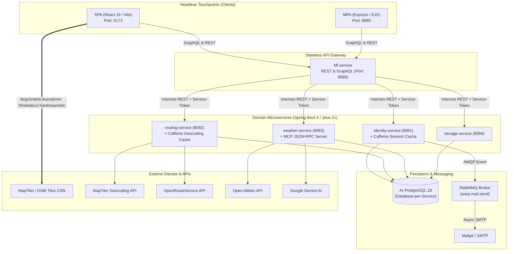

<!-- [KI-Log Nr. KI-25] KI-generiert (Google Antigravity (Gemini 3.8 Flash High)): Projekt-Dokumentation & QS -->
# Portfolio Webprogrammierung

## WaRP – Weather-aware Route Planning
**Konzeption und Implementierung einer verteilten, wetterbewussten Routenplanungsplattform nach den Prinzipien der Composable Architecture (MACH)**

---

**Hochschule / Studiengang:** Fortgeschrittene Systementwicklung / Webprogrammierung  
**Abgabetermin:** 08. November 2026  
**Präsentationstermin:** 09. November 2026  
**Repository / Projekt-Code:** `https://github.com/KeinDatenvolumen/warp`  

---

## Abstract (Deutsch & Englisch)

### Zusammenfassung (Deutsch)

Dieses Portfolio dokumentiert den technischen Lernprozess, die architektonischen Entscheidungen sowie die überwundenen Fehlentwicklungen bei der Konzeption und Realisierung von **WaRP (Weather-aware Route Planning)**. Ziel des Projekts war die Entwicklung eines verteilten Web-Services zur raum-zeitlich gekoppelten Routen- und Wetterplanung für Fahrradfahrer, Motorradfahrer und Wanderer unter strikter Vermeidung monolithischer Strukturen. 

Auf Basis der **MACH-Prinzipien** (*Microservices-based, API-first, Cloud-native, Headless*) wurde eine Systemlandschaft aus fünf entkoppelten Spring-Boot-Microservices (Java 21), vier isolierten PostgreSQL-Datenbanken (*Database-per-Service*) sowie zwei komplementären Frontend-Touchpoints – einer reaktiven Single-Page Application (React 19, TypeScript, Vite) und einer serverseitig gerenderten Multi-Page Application (Node.js, Express, EJS) – geschaffen. Ein zustandsloses Backend-for-Frontend (BFF) fungiert als zentrales API-Gateway und kombiniert GraphQL für flexible Domänenabfragen mit REST für sicherheitskritische Sitzungs- und Streaming-Operationen. 

Der Schwerpunkt dieser Arbeit liegt auf der wissenschaftlichen Reflexion realer Entwicklungsprobleme: Untersucht werden unter anderem die Herausforderungen asynchroner Fremdservice-Orchestrierungen (OpenRouteService, MapTiler, Open-Meteo, Google Gemini), das Auftreten und Beheben von Spring-AOP-Proxy-Fehlern und Detached-Entity-Problemen beim Einsatz von In-Memory-Caches (Caffeine), die Transaktionsentkopplung mittels Message Queues (RabbitMQ) sowie die Implementierung eines eigenen Model Context Protocol (MCP) JSON-RPC-Servers zur KI-gestützten Routenanalyse.

---

### Abstract (English)

This portfolio documents the engineering learning process, architectural decisions, and technical pitfalls encountered during the design and implementation of **WaRP (Weather-aware Route Planning)**. The objective of the project was to build a distributed web service for spatio-temporal route and weather planning tailored to cyclists, motorcyclists, and hikers, strictly adhering to non-monolithic design paradigms.

Following **MACH principles** (*Microservices-based, API-first, Cloud-native, Headless*), we engineered a distributed architecture comprising five decoupled Spring Boot microservices (Java 21), four isolated PostgreSQL databases (*Database-per-Service*), and two distinct client touchpoints: an interactive Single-Page Application (React 19, TypeScript, Vite) and a server-side rendered Multi-Page Application (Node.js, Express, EJS). A stateless Backend-for-Frontend (BFF) serves as the single entry point, combining GraphQL for nested domain queries with REST for security-critical session lifecycle and AI analysis endpoints.

Rather than merely describing the final product, this work critically reflects on key engineering challenges and mistakes made along the way: orchestrating asynchronous third-party integrations (OpenRouteService, MapTiler, Open-Meteo, Google Gemini), resolving Spring AOP self-invocation and JPA detached-entity pitfalls in local in-memory caching (Caffeine), decoupling SMTP mail delivery from database transactions via message queues (RabbitMQ), and implementing a standards-compliant Model Context Protocol (MCP) JSON-RPC server for generative AI route advisories.

---

## 1. Einführung und Projektmotivation

### 1.1 Ausgangsproblem und fachliche Motivation

Klassische Navigationssysteme (wie Google Maps oder Komoot) und klassische Wetterdienste arbeiten in getrennten Silos: Ein Routenplaner berechnet den geometrisch kürzesten oder schönsten Weg von Ort $A$ nach Ort $B$, während ein Wetterdienst lediglich die Prognose für einen einzelnen statischen Ort anzeigt. Für wetterexponierte Outdoor-Aktivitäten – insbesondere mehrstündige Fahrrad-, Motorrad- oder Wandertouren – greift diese Trennung zu kurz. 

Ein Fahrer befindet sich nicht zur selben Zeit auf der gesamten Strecke. Startet eine 120 km lange Radtour um 10:00 Uhr in Stuttgart bei Sonnenschein, erreicht der Fahrer den Albaufstieg erst gegen 13:30 Uhr und das Ziel in Ulm um 16:00 Uhr. Entscheidend ist nicht das Wetter am Zielort zum Zeitpunkt der Abfahrt, sondern die **raum-zeitliche Schnittmenge** $\text{Wetter}(x(t), y(t), t)$ entlang der Streckengeometrie unter Berücksichtigung der aktivitätsspezifischen Reisegeschwindigkeit.

Aus dieser Überlegung entstand **WaRP (Weather-aware Route Planning)**: Ein System, das Geodaten, Streckengeometrien, Aktivitätsprofile und stündliche Wetterprognosen entlang der erwarteten Durchfahrtszeiten korreliert, Risiken (wie Seitenwindböen, nasse Fahrbahnen oder Gewitterzellen) über einen 101-stufigen perzeptuellen Wetterscore bewertet, das optimale Abfahrtszeitfenster berechnet und mittels KI (Google Gemini + MCP-Server) taktische Empfehlungen gibt.

### 1.2 Architektonisches Leitbild: Composable Architecture & MACH

Um den Anforderungen moderner Web-Systemarchitekturen gerecht zu werden und monolithische Kopplungen konsequent auszuschließen, wurde WaRP von Beginn an nach den vier Säulen der **MACH-Architektur** entworfen:

1. **Microservices-based:** Zerlegung der Geschäftslogik in fünf fachlich geschnittene, unabhängig deploybare Services (`bff-service`, `identity-service`, `routing-service`, `weather-service`, `storage-service`), wobei jeder persistierende Dienst seine eigene Datenbank besitzt (*Database-per-Service*).
2. **API-first:** Jede Schnittstelle zwischen Frontends, BFF, internen Services und Message-Brokern wurde vor der Implementierung durch maschinenlesbare Verträge spezifiziert (`contracts/graphql/schema.graphqls`, `contracts/openapi/*.yaml`, `contracts/asyncapi/mail-events.yaml`).
3. **Cloud-native:** Containerisierung aller Komponenten über mehrstufige Dockerfiles, strikte Konfiguration über Umgebungsvariablen (*12-Factor App*), automatisierte Readiness-/Liveness-Probes und CI/CD-gestütztes Container-Deployment auf Heroku.
4. **Headless:** Vollständige Entkopplung der Präsentationsschicht von der Fachlogik. Dieselbe BFF-API bedient parallel zwei völlig unterschiedliche Touchpoints: eine React-basierte **SPA** (Port `5173`) für die kartenintensive Routenplanung und eine Express/EJS-basierte **MPA** (Port `8085`) für klassische, serverseitig gerenderte Nutzerflüsse.



---

## 2. API-Design und Kommunikationsarchitektur

### 2.1 Koexistenz von REST und GraphQL: Wann welches Paradigma?

Eine zentrale Entwurfsfrage zu Projektbeginn war die Aufteilung der Kommunikation zwischen **REST** und **GraphQL**. Ein häufiger Fehler in Studierendenprojekten besteht darin, entweder alles krampfhaft in GraphQL zu pressen (inklusive Login-Cookies) oder GraphQL nur als dünnes Duplikat identischer REST-Endpunkte bereitzustellen. 

Wir haben uns stattdessen für eine **funktionale Aufgabenteilung am BFF** entschieden:

* **Öffentliche REST-API (`/api/v1/...`, spezifiziert in `contracts/openapi/bff-service.yaml`):**
  REST wird am BFF überall dort eingesetzt, wo HTTP-Protokollmechanismen (Statuscodes, `Set-Cookie`-Header, `Retry-After`-Header bei Rate-Limiting, CSRF-Token-Handshake) im Vordergrund stehen oder dedizierte Berechnungs-Pipelines angestoßen werden:
  * `POST /api/v1/sessions` & `DELETE /api/v1/sessions/current` (Setzen und Löschen des `HttpOnly`-, `Secure`-, `SameSite=Lax`-Session-Cookies).
  * `GET /api/v1/csrf` (Abruf des CSRF-Tokens für zustandsverändernde Aufrufe).
  * `POST /api/v1/users`, `/api/v1/email-verifications/*`, `/api/v1/password-resets/*` und `/api/v1/users/me/*` (Konto-Lifecycle mit klaren HTTP-Semantiken wie `201 Created`, `204 No Content`, `409 Conflict`, `422 Unprocessable Content`).
  * `POST /api/v1/routes/weather-optimization` & `/api/v1/routes/weather-ai-analysis` (Rechenintensive Spezialanalysen).

* **Öffentliche GraphQL-API (`POST /graphql`, spezifiziert in `contracts/graphql/schema.graphqls`):**
  GraphQL spielt seine Stärke bei vernetzten Domänenabfragen und unterschiedlichen Client-Anforderungen (SPA vs. MPA) aus:
  * Die **MPA** benötigt auf ihrer Übersichtsseite (`/`) lediglich `activityProfiles { code displayName }` und auf der Profilseite (`/profile`) `currentUser { id name email emailVerified }` sowie `currentSession`.
  * Die **SPA** hingegen fragt im Routenplaner tief verschachtelte Strukturen ab (`routeCalculation` inklusive `geometry`, `segments`, `weatherEvaluation` und `weatherSegments` mit 11 Einzelmetriken pro Segment).
  * Durch GraphQL vermeidet die MPA *Overfetching*, während die SPA *Underfetching* (N+1-Requests zwischen Routing- und Wetterdaten) eliminiert, da das BFF die Daten aus `routing-service` und `weather-service` transparent in einem einzigen GraphQL-Resolver-Baum zusammenführt.

* **Interne Service-to-Service-Kommunikation:**
  Zwischen BFF und den vier nachgelagerten Microservices wird konsequent **REST mit RFC-7807 Problem-Details (`application/problem+json`)** sowie JSON-RPC 2.0 (für den MCP-Server unter `/internal/v1/weather/mcp`) genutzt. Dadurch bleiben die internen Microservices schlank und frei von GraphQL-Abhängigkeiten.

* **Contract-First-Spezifikation & Living Documentation via Swagger UI:**
  Für alle fünf Services existieren vollständige OpenAPI-3.1-Verträge (`contracts/openapi/*.yaml`) sowie das GraphQL-Schema (`contracts/graphql/schema.graphqls`). Um die API-Verträge interaktiv erfahrbar zu machen, ist ein **Swagger-UI-Service** in die Docker-Compose-Umgebung (`http://localhost:8088`) integriert, der über ein Dropdown die Spezifikationen aller fünf Microservices bündelt. Ergänzend steht eine portable Standalone-HTML-Ansicht (`contracts/openapi/index.html`) für die lokale Begutachtung bereit. Der BFF gestattet CORS-Anfragen von `http://localhost:8088`, womit Endpunkte live im Browser getestet werden können („Try it out“).

### 2.2 Prinzip der strikten Zustandslosigkeit (Statelessness)

Ein Kernkriterium unseres API-Designs ist die **Zustandslosigkeit**:
1. **Zustandsloses BFF:** Der `bff-service` hält keinerlei lokalen Sitzungszustand (`SessionCreationPolicy.STATELESS`) und besitzt keine eigene Datenbank. Jeder eingehende Request trägt das `HttpOnly`-Session-Cookie; der BFF extrahiert das Token und validiert es gegen den `identity-service`.
2. **Kein In-Memory-Session-State im Web-Layer:** Selbst bei einem Neustart oder einer horizontalen Skalierung des BFF geht keine Benutzersitzung verloren.
3. **Idempotenz bei Schreiboperationen:** Sowohl beim Start einer Routenberechnung (`POST /internal/v1/route-calculations`) als auch beim Speichern einer Route (`POST /internal/v1/users/{userId}/saved-routes`) wird ein `Idempotency-Key`-Header unterstützt. Wiederholt ein Client bei Netzwerk-Timeouts denselben Request, wird kein Duplikat angelegt, sondern das bereits berechnete bzw. gespeicherte Objekt zurückgegeben.

### 2.3 Asynchronität und begründete Ausnahmen

Die Architekturvorgabe verlangt asynchrone Kommunikation zwischen Komponenten, lässt jedoch **begründete Ausnahmen** zu. In WaRP haben wir diese Unterscheidung bewusst architektonisch modelliert:

* **Asynchrone Entkopplung (Regelfall für langlaufende / externe Prozesse):**
  1. *Routenberechnung (`routing-service`):* Ein Aufruf an `POST /internal/v1/route-calculations` blockiert nicht, bis OpenRouteService antwortet, sondern persistiert den Auftrag in PostgreSQL mit Status `PENDING`, publiziert ein `RouteCalculationCreatedEvent` und antwortet sofort mit `202 Accepted` sowie einem `Location`-Header. Ein `@Async`-Worker (`RouteCalculationProcessor`) übernimmt die Berechnung im Hintergrund; das Frontend fragt den Fortschritt nicht-blockierend per Polling ab.
  2. *E-Mail-Versand (`identity-service` + RabbitMQ):* Der SMTP-Versand ist über RabbitMQ (`warp.mail.send`) vollständig aus der HTTP- und DB-Transaktion entkoppelt (siehe Abschnitt 3.4).
* **Begründete Ausnahmen (Synchron / Direkt):**
  1. *Direktabruf der Kartenkacheln im Browser (`SPA -> MapTiler CDN`):* Würde jede einzelne $512 \times 512$ PNG-Kartenkachel beim Verschieben der Leaflet-Karte durch das BFF und ein Backend geproxyt, entstünde ein massiver I/O-Flaschenhals, der zudem das globale CDN- und Browser-Caching aushebelt. Daher lädt die `TileLayer` in `RouteMap.tsx` die Kacheln mit einem eingeschränkten Public-Key direkt vom MapTiler/OpenStreetMap-CDN.
  2. *Sitzungsvalidierung (`BFF -> identity-service`):* Authentifizierungsprüfungen müssen vor der Ausführung geschützter Operationen deterministisch abgeschlossen sein. Um die Latenz dieser synchronen Abfrage auf unter 1 ms zu drücken, wurde sie durch den lokalen Caffeine In-Memory-Cache optimiert.

---

## 3. Implementierung: Lernverlauf, Fehlentwicklungen und Architekturentscheidungen

In diesem Kapitel dokumentieren wir unseren realen Entwicklungsprozess anhand der wichtigsten technischen Herausforderungen. Im Fokus steht nicht eine Aufzählung fertiger Features, sondern die Analyse von **Fehlern, Erkenntnissen und Architekturentscheidungen** anhand konkreter Code-Ausschnitte.

---

### 3.1 Touchpoints im Vergleich: SPA (React 19) vs. MPA (Express & EJS)

#### Entscheidung und Umsetzung
Um die Unterschiede zwischen einer Client-Side Single-Page Application und einer Server-Side Rendered Multi-Page Application unter realen Bedingungen zu untersuchen, haben wir beide Touchpoints gegen exakt dasselbe BFF implementiert:
* Die **SPA (`frontend/`)** nutzt React 19, Apollo Client und einen clientseitigen `AuthContext`, der den Sitzungsstatus (`loading`, `authenticated`, `unauthenticated`) im Speicher verwaltet.
* Die **MPA (`mpa/`)** nutzt Node.js mit Express und EJS-Templates. Da der Browser bei einer MPA klassische Seitennavigationen (`GET /profile`, `POST /login`) an den Express-Server sendet, fungiert der Express-Server selbst als HTTP-/GraphQL-Client gegenüber dem BFF (`mpa/src/services/bffClient.ts`).

#### Gemachter Fehler 1: Abgebrochene Startup-Queries in der SPA (`sessionInvalidLink`)
In der SPA implementierten wir einen benutzerdefinierten Apollo-Link (`sessionInvalidLink`), der bei jedem GraphQL-Fehler mit dem Code `SESSION_INVALID` automatisch `apolloClient.clearStore()` aufrief, um sensible Daten aus dem In-Memory-Cache des Browsers zu löschen.

**Das Problem:** Wenn ein **nicht angemeldeter** Besucher den Routenplaner (`/route-planner`) öffnete, feuerte die App beim Start parallel zwei GraphQL-Queries ab:
1. `currentSession` (durch den `AuthProvider` zur Prüfung, ob ein Login vorliegt)
2. `activityProfiles` (durch den Routenplaner zum Laden der Profile Fahrrad, Motorrad, Wandern)

Da der Besucher nicht eingeloggt war, antwortete `currentSession` erwartungsgemäß mit `SESSION_INVALID`. Unser `sessionInvalidLink` rief daraufhin sofort `apolloClient.clearStore()` auf – und **brach damit die noch laufende Query `activityProfiles` mitten im Flug ab**! Die Folge war, dass unauthentifizierte Nutzer beim ersten Seitenaufruf keine Aktivitätsprofile sahen.

**Erkenntnis und Lösung (Commit `d6e6dbb`):**
Ein `SESSION_INVALID` bei der initialen `currentSession`-Prüfung ist kein unerwarteter Sitzungsverlust während einer aktiven Sitzung, sondern der normale Ausgangszustand eines anonymen Nutzers. Zudem darf `clearStore()` nur getriggert werden, wenn der Nutzer zuvor tatsächlich authentifiziert war:

```typescript
// frontend/src/api/apolloClient.ts – Korrigierte Behandlung in sessionInvalidLink
const isInitialSessionCheck = operation.operationName === 'CurrentSession'

if (hasSessionInvalidError(result) && !isInitialSessionCheck) {
    notifySessionInvalid()
}
```
Und im `AuthContext.tsx` wird `clearStore()` bei einem `SESSION_INVALID`-Event nur noch ausgeführt, wenn der bisherige Status `authenticated` war.

#### Gemachter Fehler 2: Cookie-Forwarding in der MPA
In der MPA fiel uns zunächst auf, dass ein Login über `POST /login` zwar am BFF eine gültige Session erzeugte, der anschließende Aufruf von `GET /profile` jedoch behauptete, der Nutzer sei nicht eingeloggt.

**Ursache & Lerneffekt:** Bei einer SPA läuft der GraphQL-Client direkt im Browser, sodass der Browser das `HttpOnly`-Cookie automatisch an das BFF mitsendet. Bei der MPA liegt der Express-Server dazwischen (`Browser -> Express-MPA -> BFF`). Empfängt Express den `Set-Cookie`-Header vom BFF, muss er ihn explizit an den Browser durchreichen; und bei jedem nachfolgenden GraphQL-Aufruf vom Express-Server an das BFF muss Express den eingehenden `Cookie`-Header des Browsers manuell in den ausgehenden `fetch`-Request an das BFF kopieren (`headers['cookie'] = cookieHeader`). Diese Erkenntnis hat unser Verständnis für Sicherheitsgrenzen und Cookie-Flüsse in SSR-Architekturen enorm geschärft.

---

### 3.2 Fremdservice-Integration und raum-zeitliche Wetterkorrelation

#### Warum ein einfacher GET-Request keine Integration ist
Die Projektanforderung legt fest, dass ein singulärer GET-Request nicht als Fremdservice-Integration gewertet wird und Asynchronität sowie Fehlerbehandlung eingehalten werden müssen. In WaRP greifen vier externe Systeme in einer mehrstufigen Pipeline ineinander:

1. **MapTiler Geocoding API (`GET` mit Query-Normalisierung & Caching):** Auflösung von Freitext-Ortsnamen in Koordinaten.
2. **OpenRouteService API (`POST /v2/directions/{profile}/geojson`):** Übergabe komplexer Routing-Parameter (Start-/Zielkoordinaten, Aktivitätsprofil-Mapping auf `cycling-regular`, `driving-car`, `foot-hiking` sowie dynamisch übersetzte Wegepräferenzen wie `avoid_features: ["highways", "tollways", "unpavedroads"]`).
3. **Raum-Zeit-Interpolation & Open-Meteo API:** Aus der von OpenRouteService gelieferten GeoJSON-LineString-Geometrie berechnet der `weather-service` anhand der Durchschnittsgeschwindigkeit des Aktivitätsprofils (z. B. Wandern: Abfrage alle 2 km, Fahrrad: alle 5 km, Motorrad: alle 15 km), **wann** der Nutzer welchen Koordinatenpunkt erreicht, und ruft die stündlichen Prognosen für diese Segmente ab.
4. **101-stufiger Perzeptueller Wetterscore & Gewitter-Deckelung (`thunderstormCap`):**
   Ein früher Fehler unseres ersten Score-Entwurfs war ein einfacher Mittelwert über alle Wetterparameter. Das führte zu einem gefährlichen Ergebnis: Wenn Temperatur (22 °C) und Sonnenschein perfekt waren, aber eine Gewitterwahrscheinlichkeit von 85 % bestand, lag der Durchschnittswert immer noch bei „Guten 72 Punkten“.
   **Korrektur:** Wir führten domänenspezifische Gewichtungen und eine harte **Gewitter-Deckelung (`thunderstormCapApplied`)** ein: Sobald die Gewittergefahr einen kritischen Schwellenwert überschreitet, wird der Gesamtscore unabhängig von Temperatur oder Wind gedeckelt und der konkrete Engpassfaktor (`limitingFactor`, `reasonLabel`) im Segment ausgewiesen.

---

### 3.3 Infrastruktur-Optimierung I: In-Memory Caching mit Caffeine (`WARP-035`)

#### Motivation und Auswahl der Cache-Kandidaten
Bei Last- und Klicktests stellten wir zwei gravierende Ineffizienzen fest:
1. **Hotspot Session-Validierung (`identity-service`):** Da das BFF strikt zustandslos ist, führt **jeder einzelne** authentifizierte Request (jede GraphQL-Query, jeder Klick im Frontend) zu einem internen Aufruf an `POST /internal/v1/sessions/validation`, was jedes Mal einen `SELECT`-Query mit Join zwischen `sessions` und `users` auf der PostgreSQL-Datenbank auslöste.
2. **Hotspot Geocoding (`routing-service`):** Tippen Nutzer Ortsnamen wie `"Stuttgart"` oder `"Berlin"` in die Suche ein, führte jede identische Anfrage zu einem langsamen HTTPS-Aufruf an die externe MapTiler-API und verbrauchte API-Quota.

Wir entschieden uns für **Caffeine** (`com.github.ben-manes.caffeine:caffeine`) als lokalen In-Memory-Cache mit unterschiedlichen, fachlich begründeten Eviction-Policies:
* `session-lookups`: `maximumSize=10000, expireAfterWrite=5m` (kurze TTL aus Sicherheitsgründen).
* `geocoding-results`: `maximumSize=5000, expireAfterWrite=24h` (lange TTL, da sich geografische Koordinaten von Städten und Straßen praktisch nicht ändern).

#### Gemachter Fehler 1: Das Spring-AOP Self-Invocation-Problem
In unserem ersten Entwurf wollten wir `@Cacheable` direkt als Hilfsmethode innerhalb von `SessionService` bzw. `GeocodingService` annotieren. 

**Warum das fehlschlug:** Spring Boot implementiert `@Cacheable` über dynamische Proxies (AOP). Ruft eine Methode `validateSession()` innerhalb derselben Klasse `this.findByTokenHash()` auf, wird der Aufruf direkt auf der Zielinstanz (`this`) ausgeführt und **umgeht den Spring-Proxy komplett** – der Cache greift niemals.

**Unsere Lösung:** Wir extrahierten dedizierte Service-Beans (`CachedSessionService` und `CachedGeocodingService`), die per Constructor-Injection in die aufrufenden Fachservices injiziert werden. Dadurch läuft jeder Aufruf garantiert durch den Spring-Cache-Proxy.

#### Gemachter Fehler 2: Caching mutabler JPA-Entities (`SessionEntity`)
In der ersten lauffähigen Version von `CachedSessionService` gaben wir direkt die Hibernate-Entität `SessionEntity` (inklusive der per `@ManyToOne` verknüpften `UserEntity`) zurück und speicherten sie im Caffeine-Cache:

```java
// FEHLERHAFTE ERSTVERSION (Anti-Pattern: JPA-Entity im Cache):
@Cacheable(cacheNames = SESSION_CACHE, key = "#p0", sync = true)
public SessionEntity findByTokenHash(String tokenHash) {
    return sessionRepository.findByTokenHash(tokenHash)
            .orElseThrow(SessionNotFoundException::new);
}
```

Beim Code-Review und der Architektur-Analyse erkannten wir drei gravierende Probleme dieses Ansatzes:
1. **Detached Entities:** Sobald die ursprüngliche Datenbank-Transaktion endet, ist die gecachte `SessionEntity` vom Hibernate `EntityManager` getrennt (*detached*). Greifen nachfolgende Requests darauf zu, drohen `LazyInitializationException` oder unerwartete Seiteneffekte im Persistence Context.
2. **Fehlende Thread-Safety durch Mutabilität:** `SessionEntity` besitzt zustandsverändernde Methoden wie `invalidate(Instant)`. Da ein In-Memory-Cache dieselbe Objektreferenz an parallele Threads ausliefert, verletzt eine mutable Entität die Thread-Sicherheit.
3. **Redundante SpEL-Ausdrücke (`key = "#p0"`):** Bei Methoden mit nur einem Parameter nutzt Springs `SimpleKeyGenerator` diesen Parameter ohnehin standardmäßig als Schlüssel; `#p0` verschlechterte nur die Lesbarkeit.

**Unsere Lösung (Refactoring in Commit `d313c4e`):**
Wir entkoppelten den Cache vollständig von JPA, indem wir ein unveränderliches (*immutables*) Java `record` namens `CachedSession` einführten, das nur die reinen Wertdaten kapselt:

```java
// services/identity-service/src/main/java/de/warp/identity/service/CachedSession.java
public record CachedSession(
        String id,
        String userId,
        Instant createdAt,
        Instant expiresAt,
        Instant invalidatedAt,
        boolean emailVerified
) {
    public boolean isValidAt(Instant instant) {
        return invalidatedAt == null && expiresAt.isAfter(instant);
    }

    public static CachedSession from(SessionEntity session) {
        return new CachedSession(
                session.getId(),
                session.getUser().getId(),
                session.getCreatedAt(),
                session.getExpiresAt(),
                session.getInvalidatedAt(),
                session.getUser().isEmailVerified()
        );
    }
}
```

Und in `CachedSessionService` wird die Entität noch innerhalb des Ladevorgangs auf das immutable Record abgebildet, während `sync = true` vor *Cache Stampedes* (*Thundering Herd*) bei gleichzeitigen Anfragen schützt:

```java
// services/identity-service/src/main/java/de/warp/identity/service/CachedSessionService.java
@Cacheable(cacheNames = SESSION_CACHE, sync = true)
public CachedSession findByTokenHash(String tokenHash) {
    return sessionRepository
            .findByTokenHash(tokenHash)
            .map(CachedSession::from)
            .orElseThrow(SessionNotFoundException::new);
}

@CacheEvict(cacheNames = SESSION_CACHE)
public void evictByTokenHash(String tokenHash) {
    // Die Annotation entfernt den Cache-Eintrag sofort bei Abmeldung.
}
```

Zusätzlich stellten wir im `GeocodingService` fest, dass Suchanfragen wie `"Stuttgart"` und `"stuttgart"` zuvor nur getrimmt (`query.trim()`), aber nicht in Kleinbuchstaben konvertiert wurden, was zu doppelten Cache-Einträgen und doppelten MapTiler-API-Aufrufen führte. Durch `query.trim().toLowerCase(Locale.ROOT)` sowie `sync = true` in `CachedGeocodingService` wurde die Cache-Hit-Rate maximiert.

#### Kritische Reflexion der Cache-Entscheidung
Für unsere Einzelinstanz-Architektur (Docker Compose / einzelne Heroku-Dynos pro Service) war Caffeine die beste Wahl (null Netzwerk-Overhead, Sub-Millisekunden-Zugriff). Würde man den `identity-service` in Zukunft jedoch horizontal auf mehrere Instanzen hinter einem Load-Balancer skalieren, würde ein lokaler `@CacheEvict` beim Logout nur den Cache einer Instanz leeren, während andere Instanzen die Sitzung noch bis zu 5 Minuten als gültig ansehen könnten. In einem solchen Multi-Instance-Szenario würden wir künftig entweder auf einen verteilten Cache (**Redis**) wechseln oder ein Cache-Invalidierungs-Event über unseren bestehenden **RabbitMQ**-Broker an alle Instanzen broadcasten.

---

### 3.4 Infrastruktur-Optimierung II: Entkopplung via RabbitMQ (`WARP-036`)

#### Das Problem synchroner E-Mail-Zustellung
Ursprünglich versendete der `identity-service` Bestätigungs- und Passwort-Reset-E-Mails synchron per `JavaMailSender` direkt innerhalb der `@Transactional`-Methode der Benutzerregistrierung.

**Warum diese Entscheidung falsch war:**
1. **Blockierte DB-Transaktionen:** Ein langsamer SMTP-Handshake (bis zu 5 Sekunden Timeout) hielt die Datenbank-Transaktion und die HikariCP-Connection über die gesamte Dauer offen.
2. **Verstoß gegen Transaktionsgrenzen:** Schlug der Commit nach dem Mailversand fehl, hatte der Nutzer eine E-Mail mit einem Token erhalten, das in der Datenbank gar nicht existierte. War umgekehrt der SMTP-Server kurzzeitig nicht erreichbar, brach die gesamte Benutzerregistrierung mit einem `500 Internal Server Error` ab.

#### Unsere Lösung: Transactional Event Listener + RabbitMQ + Dead-Letter-Queue
Wir trennten die fachliche Transaktion strikt vom Versandprozess:
1. Innerhalb der DB-Transaktion wird lediglich ein Spring-Application-Event (`EmailDeliveryRequestedEvent`) publiziert. Das Event enthält aus Datenschutzgründen **keine** E-Mail-Adresse im Klartext, sondern nur `userId`, `mailType` und das Token.
2. Erst **nach erfolgreichem Datenbank-Commit** (`@TransactionalEventListener(phase = TransactionPhase.AFTER_COMMIT)`) greift der `QueueMailEventRelay` und publiziert die Nachricht an den RabbitMQ-Exchange `warp.mail` (Routing-Key `mail.send`, Queue `warp.mail.send`).
3. Ein asynchroner Consumer (`MailQueueConsumer`) verarbeitet die Queue. Schlägt die SMTP-Zustellung nach 3 Versuchen fehl, wandert die Nachricht automatisch in die **Dead-Letter-Queue (`warp.mail.send.dlq`)**, ohne den Hauptstrom zu blockieren.
4. **Resilienz durch Graceful Degradation:** Ist RabbitMQ in einer Umgebung nicht konfiguriert oder fällt der Broker im Betrieb aus, fängt `QueueMailEventRelay` die `AmqpException` ab und fällt automatisch auf die direkte Zustellung (`DirectMailEventRelay`) zurück. Damit bleibt das System selbst bei einem Broker-Ausfall voll funktionsfähig.

---

### 3.5 Infrastruktur-Optimierung III: Model Context Protocol (MCP) Server & Generative AI (`WARP-014`)

#### Motivation und Architektur
Reine Zahlenwerte (z. B. „18 km/h Wind aus 240°, 1,2 mm Niederschlag, WetRoadIndex 0.65“) sind für Endnutzer oft schwer in konkrete Handlungsentscheidungen für eine mehrstündige Tour zu übersetzen. Statt jedoch einfach einen Freitext-Prompt an ein Sprachmodell zu schicken (was häufig zu Halluzinationen bei Zahlen und Ortsangaben führt), haben wir im `weather-service` einen standardkonformen **Model Context Protocol (MCP) JSON-RPC 2.0 Server** (`McpServerController`, Protokollversion `2024-11-05`) implementiert.

#### Funktionsweise des eigenen MCP-Servers
Über eigene Annotationen (`@McpTool`, `@McpParam`) und eine dynamische Registry (`McpToolRegistry`) stellt der `weather-service` unter `POST /internal/v1/weather/mcp` deterministische Wetter-Analyse-Werkzeuge (`WeatherMcpTools`) bereit:
* `initialize`: Handshake und Capability-Negotiation.
* `tools/list`: Selbstbeschreibung aller verfügbaren Analyse-Tools inklusive JSON-Schema der Parameter.
* `tools/call`: Deterministische Ausführung von Berechnungen (z. B. Identifikation kritischer Gefahrenabschnitte, Berechnung von Seitenwind-Risiken auf exponierten Segmenten oder Analyse verdeckter Parameter wie Taupunkt/Schwüle und nasser Fahrbahn).

Bei einer Anfrage an `POST /api/v1/routes/weather-ai-analysis` kombiniert der `RouteWeatherAiAnalysisService` die deterministischen Ergebnisse dieser MCP-Tools mit der **Google Gemini API** (`GeminiClient`). Das Ergebnis ist eine hochgradig verlässliche, halluzinationsfreie Auswertung mit konkreten Gefahrenhinweisen (`criticalSections`), Ausrüstungsempfehlungen (`gearRecommendations`) und einem transparenten Protokoll der aufgerufenen MCP-Tools (`mcpToolsInvoked`).

---

### 3.6 Datenpersistenz, Sicherheit und Cloud-Betrieb

1. **Database-per-Service & Flyway:**
   Jeder der vier zustandsbehafteten Services (`identity`, `routing`, `weather`, `storage`) besitzt ein eigenes PostgreSQL-Schema bzw. eine eigene Datenbankinstanz. Ein direkter SQL-Zugriff über Servicegrenzen hinweg ist architektonisch ausgeschlossen. Alle Tabellenänderungen werden versioniert über **Flyway** (`V1__...sql`, `V2__...sql`) eingespielt, während Hibernate mit `ddl-auto: validate` beim Start prüft, ob JPA-Entities und DB-Schema exakt übereinstimmen.
2. **Defense-in-Depth Sicherheitsarchitektur:**
   * **Passwörter & Timing-Attack-Schutz:** Passwörter werden mit BCrypt gehasht. Existiert bei einem Login-Versuch die E-Mail-Adresse nicht in der Datenbank, führt `SessionService` dennoch ein `passwordEncoder.matches(request.password(), dummyPasswordHash)` gegen einen beim Start generierten Dummy-Hash aus. So lässt sich über die Antwortzeit nicht ausspähen, ob eine E-Mail-Adresse registriert ist.
   * **Gehashte Session-Tokens:** Selbst bei einem Datenbank-Leak im `identity-service` kann ein Angreifer keine Sitzungen übernehmen, da in der Tabelle `sessions` niemals das rohe Session-Token, sondern ausschließlich dessen **SHA-256-Hash (`token_hash`)** gespeichert wird.
   * **Service-to-Service-Absicherung:** Alle internen Endpunkte (`/internal/v1/...`) werden durch einen Filter (`InternalServiceAuthenticationFilter`) geschützt, der das Shared Secret `X-WaRP-Service-Token` prüft.

---

### 3.7 Zusammenfassung: Was würden wir wieder genauso und was anders machen?

| Entscheidung / Bereich | Bewertung | Fazit für zukünftige Projekte |
| :--- | :---: | :--- |
| **BFF-Pattern mit Kombination aus GraphQL (Queries/Domäne) & REST (Auth/Cookies)** | ✅ **Sehr gut** | **Genauso wieder machen:** Vereint höchste Sicherheit bei Cookies/CSRF mit maximaler Flexibilität für unterschiedliche Frontends (SPA & MPA). |
| **Contract-First mit automatischer Schema-Einbindung im Build (`schema.graphqls`)** | ✅ **Sehr gut** | **Genauso wieder machen:** Verhindert effektiv das Auseinanderlaufen von Dokumentation und Implementierung. |
| **Entkopplung von SMTP/Drittsystemen über RabbitMQ & `@Async`-Events** | ✅ **Sehr gut** | **Genauso wieder machen:** Macht die Kernanwendung schnell und resilient gegen Ausfälle externer Systeme. |
| **Anfängliches Caching von JPA-Entities statt immutabler Records** | ⚠️ **Lernfehler (behoben)** | **Anders machen:** Von Anfang an ausschließlich unveränderliche DTOs/Records (`CachedSession`, `Place`) in Application-Caches ablegen. |
| **Manuelles Mapping großer DTO-Bäume zwischen Services** | 🔄 **Ausbaufähig** | **Anders machen:** Ab einer gewissen Projektgröße Code-Generatoren (z. B. OpenAPI Generator oder MapStruct) einsetzen, um Boilerplate-Code im BFF zu reduzieren. |

---

## 4. Wissenschaftliche Einzelreflexion (Individueller Teil pro Teammitglied)

> **Hinweis zur Fertigstellung vor der Abgabe:**  
> *Laut Prüfungsleitfaden (Seite 3) verfasst jedes Teammitglied einzeln 1 bis 2 Seiten wissenschaftliche Reflexion anhand der folgenden Leitfragen.*

### 4.1 Einzelreflexion – [Vorname Nachname, Matrikelnummer]

* **Reflexion über die eigene Arbeit & Rolle im Projekt:**  
  *(Welche Komponenten/Tickets wurden verantwortet? Wie verlief die Einarbeitung in die Technologien?)*
* **Strukturierte und organisierte Arbeitsweise:**  
  *(Wie hat die Arbeit mit Tickets `WARP-001` bis `WARP-036`, Feature-Branches, Pull Requests und CI/CD-Pipelines funktioniert?)*
* **Eigene Stärken und Schwächen im Projektverlauf:**  
  *(Wo lagen persönliche Stärken, z. B. Backend-Architektur, Fehleranalyse, Frontend-UX, Testing? Wo gab es anfangs Schwierigkeiten?)*
* **Was würde ich in einem ähnlichen Projekt beim nächsten Mal anders machen?**  
  *(Konkrete methodische oder technische Punkte aus persönlicher Sicht.)*
* **Empfehlungen für Studierende des nächsten Jahrgangs:**  
  *(Welche Tipps zu Schnittstellendesign, Docker-Setup, Zeitmanagement und frühzeitigem Deployment sind besonders wertvoll?)*
