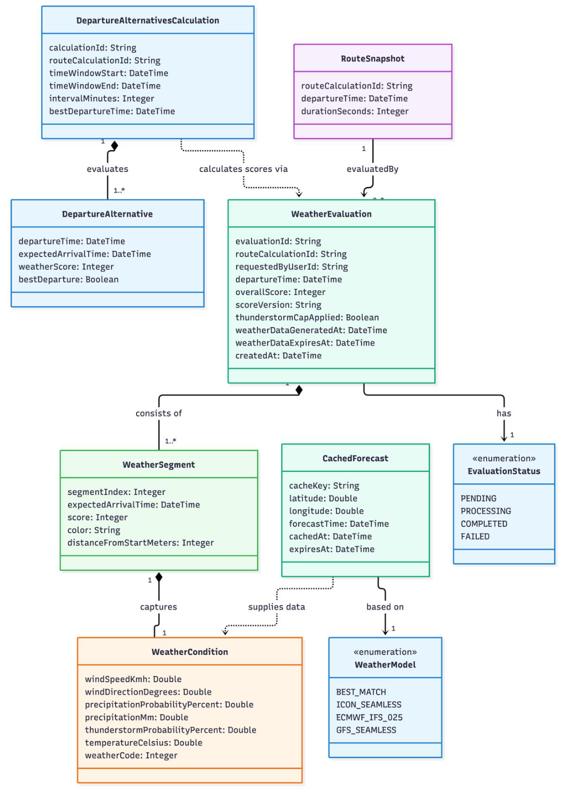
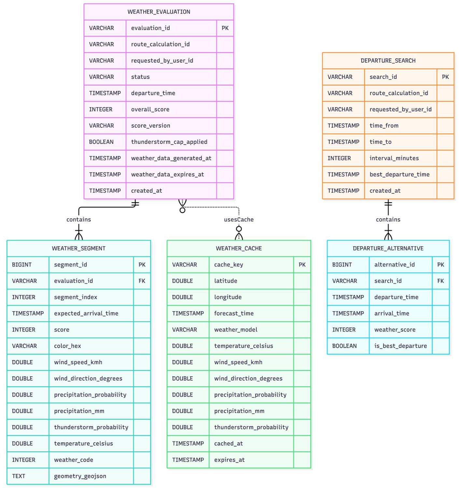

<!-- [KI-Log Nr. KI-25] KI-generiert (Google Antigravity (Gemini 3.8 Flash High)): Projekt-Dokumentation & QS -->
---
marp: true
theme: default
paginate: true
header: 'WaRP – Weather-aware Route Planning | Zwischenpräsentation'
footer: 'DHBW Mosbach | Prof. Dr. Christian Schalles'
style: |
  section {
    font-family: 'Inter', sans-serif;
    background-color: #f8fafc;
    color: #1e293b;
    padding: 40px;
  }
  h1 { color: #0f172a; font-weight: 800; }
  h2 { color: #0284c7; font-weight: 700; font-size: 1.6em; }
  strong { color: #0f172a; }
  .badge { background: #e0f2fe; color: #0369a1; padding: 4px 10px; border-radius: 9999px; font-size: 0.5em; font-weight: bold; }
  .grid-2 { display: grid; grid-template-columns: 1fr 1fr; gap: 20px; }
  .card { background: white; border: 1px solid #e2e8f0; border-radius: 12px; padding: 16px; }
---

<!-- _class: lead -->
<!-- _backgroundColor: #0f172a -->
<!-- _color: #f8fafc -->
<!-- _header: '' -->

# WaRP
### Weather-aware Route Planning mit Aktivitätsprofilen
**Zwischenpräsentation:** Projektskizze, Anforderungen, Domänenmodell & Datenbankmodell

**Team & Rollen:**
* Jonas Bieler (PO) & Enrico Großmann (PO / Fachlicher Lead)
* Kai Spitzer (SM) & Finley Brosig (SM)
* Software Engineers: Alle

*Dozent: Prof. Dr. Christian Schalles | DHBW Mosbach*
*Zeitbudget: 12 Min (+ 15 Min Diskussion)*

---

## 1. Problemstellung & Produktvision
⏱ 0:30 - 2:00 (1:30 min)

### Das Problem
* **Statische Wetter-Apps:** Prognosen gelten starr für einen Ort und eine feste Uhrzeit.
* **Dynamische Bewegung:** Bei einer 3h-Tour ändern sich Ort und Zeit kontinuierlich.
* **Ignorierte Windvektoren:** Gegenwind vs. Rückenwind wird nicht relativ zur Trajektorie berechnet.
* **Unwetterrisiko:** Lokale Gewitter an Zwischenetappen werden manuell kaum erkannt.

### Der WaRP-Ansatz
* **Routensegmentierung:** Zerlegung nach Profil (Fahrrad, Motorrad, Wandern).
* **Dynamischer Zeitbezug:** Wetterabruf exakt für die prognostizierte Ankunftszeit am Wegpunkt.
* **Wetterscore (0–100):** Berechnet aus Wind, Regen und Gewitter. Farbgradient auf der Karte.
* **Beste Abfahrtszeit:** Automatische Simulation alternativer 30-Minuten-Zeitfenster.

---

## 2. Vorgehensmodell: Scrum & Organisation
⏱ 2:00 - 3:30 (1:30 min)

### Warum Scrum?
* **Hohe algorithmische Unsicherheit:** Verknüpfung von Windvektoren mit Trajektorien und Scoring-Formeln bedarf früher Verifikation.
* **Frühe Inkremente:** Funktionsfähige Zwischenstände in jedem Sprint-Review am realen Karten-UI überprüfbar.
* **Rollenverteilung:** 2x PO (Fachlichkeit), 2x SM (Prozess), 4x DEV (Umsetzung).

### Sprint-Roadmap (5 Sprints)
* **Sprint 1:** Monorepo, DB-Setup & CI/CD ✓
* **Sprint 2:** Auth, Login, Leaflet-Karte & Geocoding ✓
* **Sprint 3 (AKTUELL):** Routing- & Open-Meteo-Integration ⏳
* **Sprint 4:** Scoring, Startfenster & **Change Request**
  * *★ 4 freie Tage = massiv erhöhte Team-Kapazität als Puffer!*
* **Sprint 5:** System-Integration, Metriken & Abnahme.

---

## 3. Anforderungsanalyse & Kern-Geschäftsregeln
⏱ 3:30 - 5:00 (1:30 min)

### Priorisierung (MoSCoW)
* **Must Have (MVP):**
  * Registrierung, Login, E-Mail-Verifikation
  * Start- & Endpunkteingabe mit Geocoding
  * 3 Profile: Fahrrad, Motorrad, Wandern
  * Orts- und zeitaufgelöste Wetterbewertung
  * Wetterscore (0–100) auf Karte visualisiert
* **Should Have:**
  * Alternative Abfahrtszeiten & 60-Minuten-Cache
  * Routenspeicherung mit Namen & Favoriten

### Fokus-Use-Cases & Fachregeln
* **Die 2 gewählten Use-Cases:**
  1. *Route planen & segmentieren* (Routing)
  2. *Wetterabhängig bewerten & optimieren* (Weather)
* **⚡ [FR-WETT-03] Gewitter-Kappung:**
  * Gewitterrisiko an $\ge 1$ Wegpunkt $\rightarrow$ Gesamtscore strikt auf **maximal 50 Punkte** gedeckelt!
* **[FR-WETT-12] Gleichstandsregel:**
  * Bei gleichem Höchstscore gewinnt deterministisch die **früheste Abfahrtszeit**.

---

## 4. Systemarchitektur: Microservices & BFF
⏱ 5:00 - 6:30 (1:30 min)

* **Präsentation:** React + Vite (TypeScript), Leaflet / OpenStreetMap (Mobile-First 320–480px)
* **Orchestrierung:** Backend for Frontend (**BFF**) mit GraphQL-Schema (`/graphql`)
* **Fachservices (REST `/internal/v1/*`):**
  * `Identity-Service`: Benutzer & Sitzungsverwaltung (DB: `warp_identity`)
  * `Routing-Service`: OpenRouteService-Anbindung (DB: `warp_routing`)
  * `Weather-Service`: Open-Meteo & Scoring-Algorithmus (DB: `warp_weather`)
  * `Storage-Service`: Gespeicherte Routen & Favoriten (DB: `warp_storage`)

> **Architektur-Entscheidung (ADR):** Warum **kein** Domänenmodell für das BFF?
> Das BFF ist ein reiner Orchestrierungsdienst ohne eigene Fachdomäne und ohne eigene DB. Der Vertrag ist formal das GraphQL-Schema!

---

## 5. Konzeptionelles Domänenmodell: Weather Service
⏱ 6:30 - 9:00 (2:30 min)

### Kernkonzepte im Fokus:
* **`WeatherEvaluation` (Aggregate Root):**
  * Hält Gesamtergebnis (`overallScore`, `thunderstormCapApplied`).
  * Fungiert als *GRASP Information Expert* für die Score-Berechnung.
* **`WeatherSegment` & `WeatherCondition`:**
  * Komposition von Streckenabschnitten mit meteorologischen Werten zum Ankunftszeitpunkt.
* **`DepartureAlternativesCalculation`:**
  * Simuliert 30-Minuten-Zeitfenster & wählt die beste Abfahrtszeit.
* **`RouteSnapshot`:**
  * Vollständige Entkopplung vom Routing-Service.

---

## 6. Relationales Datenbankmodell: warp_weather
⏱ 9:00 - 11:30 (2:30 min)

### Relationale Integrität & Caching:
* **`WEATHER_EVALUATION ||--|{ WEATHER_SEGMENT`:**
  * Segmente speichern vorberechnete Farbwerte (`#55AA40`) für blitzschnelles Rendering.
* **Database-per-Service:**
  * Keine Fremdschlüssel über Servicegrenzen! `route_calculation_id` & `user_id` als `VARCHAR(40)`.
* **Check-Constraints:**
  * `CHECK (overall_score BETWEEN 0 AND 100)`
  * `CHECK (expires_at > cached_at)`
* **`WEATHER_CACHE` (60 Min TTL):**
  * DB-Cache überlebt Neustarts und ermöglicht Multi-Instanz-Skalierung.

---

## 7. Zwischenstand Sprint 2 & Ausblick Sprint 3
⏱ 11:30 - 12:15 (0:45 min)

### GitHub Projects Live-Status (Sprint 3)
* **11 Done ✓:** Setup, BFF GraphQL, Registrierung BE/FE, Login-BE, Mailpit, Karte & Geocoding.
* **2 In Review 👀:** Login-Frontend (`WARP-006-FE`), Profile (`WARP-011`).
* **4 In Progress ⏳:** Routing (`WARP-012`), Weather (`WARP-014`), Storage (`WARP-020`), Mail (`WARP-007`).

### Ausblick Sprint 3 & Change Request
* **Sprintziel 3:** Segment-Scoring mit Farbgradient auf Karte, 30-Min-Startfenster.
* **Vorbereitung auf die Ereigniskarte:**
  1. Strukturierte Aufnahme der Anforderung
  2. Impact-Analyse (Aufwand & betroffene Artefakte)
  3. PO-Entscheidung: Umsetzung / Verschiebung
  4. Change Log & Modell-Vorher/Nachher-Vergleich
  * *Puffer in Sprint 3 garantiert Termintreue!*

---

<!-- _class: lead -->
<!-- _backgroundColor: #0f172a -->
<!-- _color: #f8fafc -->

# Vielen Dank für Ihre Aufmerksamkeit!
### Diskussion & Fragen zur Zwischenabnahme

*Im Backup verfügbar:*
*Detailmodelle zu Identity Service, Storage Service & Routing Service*
